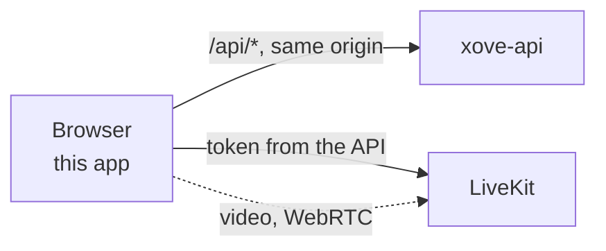
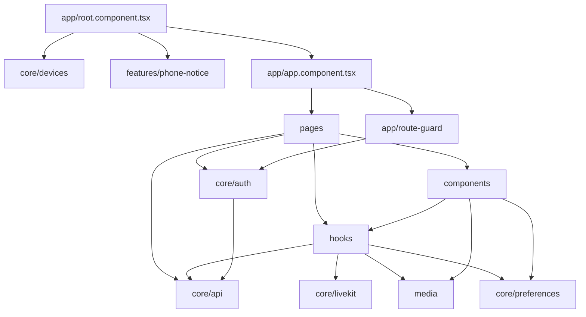
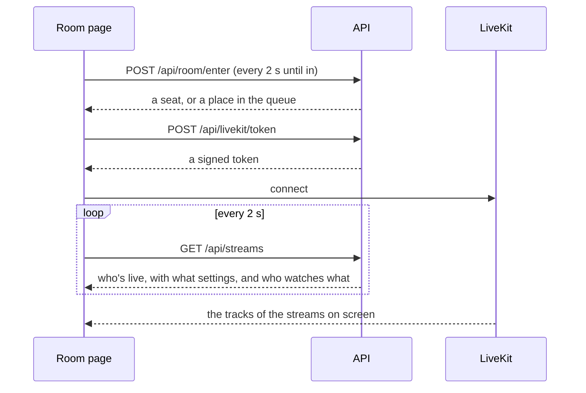
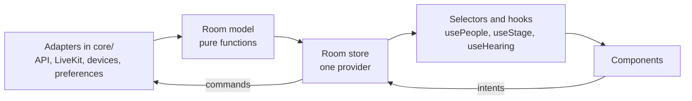

# Architecture

How the web app is built: its modules, its routes, how the room keeps its state, how it talks to the API and to LiveKit, and how it picks a layout for the device. How screens and cameras are sent and played is in [Media](media.md); how everything looks is in the [design sheet](design.md). The API (its endpoints, the room's rules, the data and its security) is in [`xove-api`](https://github.com/Hbrauveres/xove-api/blob/main/docs/README.md).

## Its place



A single-page app (React 19, TypeScript, Vite, React Router, CSS modules) built to static files. It holds no secret and reads no setting: who you are, what you may do and which streams are live all come from the API at run time; the video comes from LiveKit, a WebRTC server that receives each stream once and forwards it to every viewer.

## Modules

Everything is in `app/src`:

| Folder | Owns |
| --- | --- |
| `pages/` | One component per route: `HomePage`, `RequestAccessPage`, `RoomPage`, `AdminPage` |
| `hooks/` | Generic hooks waiting for `shared/hooks/`: the video's shape (`useVideoShape`), the round buttons' row holding the clicked button still (`usePinnedRow`), and a small one (`useFullscreenElement`); the stream's elapsed time is `shared/hooks/use-elapsed.hook.ts`, and whether the keyboard was used last `shared/hooks/use-keyboard-last.hook.ts` |
| `media/` | The ambilight's drawing (`ambilight.ts`), until the stage moves into the room feature |
| `features/room/state/` | Working code only. The settings queue (`settings-queue.service.ts`: changes one after another, a refused one put back). The room as data (`room.model.ts`: people by their id, streams, who watches whom, arrivals, the seat, the activity, my streams' steps, changed by pure functions), what the room shows (`room.selectors.ts`), and `RoomStore` (`room.store.ts`): the one place the seat, the streams and entering again are polled, the video room joined, and the room's actions sent |
| `features/room/hooks/` | The room's hooks, each one job over the store: the store for the page (`use-room-store`, with the sound unlock, the devices and the camera remembered); what the room shows (`use-room-view`); what I send (`use-my-sending`: my streams, their settings through a queue, the camera's preview and switch, changing the window), keeping my streams and the API in step (`use-stream-sync`), my voice (`use-my-voice`); the activity (`use-activity-feed`), the watch report (`use-watch-report`); who's big (`use-stage`), what I hear and what's downloaded (`use-hearing`); the mic's level |
| `features/room/utils/` | The room's helpers, each with its test: the watch report, the stage pick, hearing, what a viewer can pick, each person's colour, when the room can show; and the model's own: a person's id, the first name, keeping the same record, the same people, the streams (`room-streams`), the API's answer (`room-answer`), the activity's events, a sharer's feed, waiting for a seat |
| `features/room/types/`, `features/room/constants/` | The room's types (the room as data, a person, a stream, a sharer, the activity, each hook's inputs) and its constants (the poll, the activity kept, the room's messages, the watch report's delays) |
| `features/room/tests/` | The room's tests, at the same path as their file (`tests/hooks/use-stage.hook.test.ts` for `hooks/use-stage.hook.ts`) |
| `components/stage/` | The player and what's on it: the stage, the ambilight, the controls by owner: my own stream's round buttons (`PlayerButtons`; their icons in `icons.tsx`, the drop-ups on live ones) and, over someone else's stream, `ViewerBar` (what I hear at the left, each sound its own button and slider; my mic or Go live at the right); the voice I hear (`VoiceAudio`), each person's switches and volumes held by the stage for the visit (the hook `features/room/hooks/use-hearing.hook.ts`, its rules in `features/room/utils/hearing.util.ts`), and the previews' buttons (`HearToggles`, in a small preview's row, `PreviewTray`, which floats on its own layer over the page and follows its preview, opened through `usePreviewTray`; a preview's stack and its swap's moment in `stack.ts`); the settings panel (`SettingsPanel`, its Voice tab's mic level in `MicTest`), the facecam, the previews, the empty stage (`EmptyStage`, a TV on standby: the ways to start, alone in their row; with nobody live the settings are `ViewerBar`'s settings-only form, in the corner; its corners' glow in `CornerGlow`; its TV static in `StaticNoise`, a small canvas the page draws 20 times a second, its grain and bands scaled to the stage; the static's light round the stage in `StaticGlow`; both read their bands from `staticBands.ts`, so they roll together, and its `tv` flag lets the TV's turn-on play only the first time the stage stands by in a visit), the info row. The stage is two layers: its box holds every control (the round buttons, the sounds, Go live, the fullscreen button) and takes the pointer; a view inside it holds the picture and its ambilight in the picture's shape |
| `components/room/` | The room around the stage: header, footer, people, activity (pill, list), account menu, the waiting screen and the seat offer |
| `components/ui/` | Shared controls: `Button`, `Range`, `Dropdown`, `Segmented`, `Picker` (a list that floats over its panel, masking what's behind it in the nearest `[data-list-host]`; it opens on request too), `DropUp` (its gestures can redirect to an open panel), `Tooltip` (the app's only tooltip, on its own layer, describing its control for screen readers), `floating.ts` (one tooltip or drop-up showing at a time, what floats inside another belonging to it), the cue (`cue.module.css`), `Avatar`, `PersonAvatar`, `FullPageMessage`, `Toast` (a short message any component shows with `showToast`) |
| `components/brand/`, `brand/` | The mark: its geometry and animation timeline (`brand/`), and the components that draw it (`XoveMark`, `XoveIcon`) |
| `app/` | The shell: the root (`root.component.tsx`), the routes (`app.component.tsx`) and who may open each (`route-guard/`, its rule in `utils/route-access.util.ts`) |
| `core/api/` | The HTTP client (`api-client.service.ts`): one function per endpoint, the call itself and its errors as `ApiError`; the CSRF token and the headers in `utils/`, the API's types in `types/`, its messages in `constants/` |
| `core/auth/` | Who is signed in (`AuthProvider` in `auth.store.tsx`, which asks `GET /api/me` once and on demand; `useAuth`) |
| `core/preferences/` | Choices each browser keeps (`preferences.service.ts`): how I send a screen or a camera, the camera and mic picked, my voice's processing, how I hear a stream or a voice, the stage light; blocked storage gives the defaults (`storage.service.ts`, with the stored values' checks in `utils/preference-values.util.ts`) |
| `core/livekit/` | The video server, the only place that uses `livekit-client`: the adapter (`livekit.adapter.ts`: connects with the access it's given, keeps the room's state per person, takes commands), what's captured, sent, changed and heard (`capture`, `send`, `screen-change`, `screen-sound`, `voice` services), what someone sends read into plain data (`remote-media.adapter.ts`), the noise gate's processor; its helpers in `utils/` (how streams are sent, the room's state per person, the mic's problems), its types and constants beside them |
| `core/devices/` | The browser's devices: the screen picker, the cameras and mics and the mic's meter as services (they ask the browser); a phone or a tablet (`utils/is-handheld.util.ts`), the picker's request and the noise gate's maths as helpers; the stream presets in `constants/` |
| `features/phone-notice/` | What phones and tablets see instead of the app ([below](#phones-and-tablets)) |
| `styles/` | The design tokens (`global.css`) and the tests that check them |
| `test/` | The test helpers: a fake API, a fake LiveKit, and rendering the app at a URL ([Testing](testing.md)) |

At the top, `main.tsx` starts the app, `app/root.component.tsx` chooses between the app and the phone notice, and `app/app.component.tsx` holds the routes.



Pages put the room together; components draw it; hooks own the state and talk to the API and LiveKit (the simpler pages call the API directly); the room's rules (hearing, the stage pick, the settings queue, the watch report) are plain functions in `features/room/utils/`, and `media/` keeps only the ambilight's drawing until the stage moves. Each component has its own CSS module, using the tokens in `styles/global.css`.

## Routes

`app/app.component.tsx` maps each route to a page behind `RouteGuard` and its rule:

| Route | Guard | Shows |
| --- | --- | --- |
| `/` | signed out (signed-in people are sent on) | What Xovê is, "Continue with Google" |
| `/request-access` | signed in, not a member | "You need access", an optional message, the request; a pending state that checks every 20 s and moves you in when approved; a declined state that lets you ask again |
| `/room` | members | The room |
| `/admin` | admins | Pending requests (approve, decline) and members (remove) |
| anything else | | Back to `/` |

Sign-in is the API's: "Continue with Google" goes to `/api/oauth2/authorization/google`, and the API sends you back to `/room` or `/request-access`. The guard only reads `AuthProvider`'s answer (`routeAccess` decides: show, wait, or send elsewhere), so a member page never renders for someone who isn't one.

### Phones and tablets

Xovê is for computers for now. `Root` (`app/root.component.tsx`) decides once, before the router and `AuthProvider`: on a phone or a tablet it shows only the phone notice (`features/phone-notice/`, [how it looks](design.md#phones-and-tablets-see-you-on-the-big-screen)) on every URL, and since `AuthProvider` never mounts, the page makes no call to the API. A device is a phone or a tablet when its main pointer is a finger (`isHandheld`, the media query `pointer: coarse`); a laptop with a touch screen has a fine main pointer, so it gets the app.

## The room's state

The room page combines two sources:

- **The API** decides who has a seat and which streams are live. The page asks it every 2 seconds.
- **LiveKit** carries the video and knows who is connected right now.



| State | Owned by | Lives |
| --- | --- | --- |
| My seat, or my place in the queue and the seat offer | `RoomStore`, in the room's model | The API; polled every 2 s while waiting |
| The live streams, their settings, who watches what, who's here since when | `RoomStore`, in the room's model | The API; polled every 2 s by every open room |
| Who is connected, their tracks, my own captures | `core/livekit/livekit.adapter.ts`, held by `RoomStore` | LiveKit |
| Where each of my streams is (off, picking, starting, live, stopping) | the room's model | This page only |
| Who's on my stage | `use-stage` | This page only |
| What I hear from each person, and what's downloaded | `use-hearing` | This page only (the volumes I start from: the browser) |
| How I send (quality, mode, the camera picked, my mic and its processing and line), the volumes I start from (a screen's sound, a voice), the ambilight's settings | `core/preferences/preferences.service.ts` | The browser (`localStorage`, `xove.*`) |
| Each person's mutes and volumes, for this visit | `Stage` | This page only |
| Whether the settings are open, the setting a live button asked for, and the camera's preview | `RoomPage`, `use-camera-preview` | This page only |

**One id for everyone.** Everyone in the room, me included, is their identity on the video server (`user-42`): the access names me, the API's `userId`s name the others. "Is this me" is a comparison, and each person's colour comes from their id, the same on every screen. The room shows once I have a seat and the access has named me; until then the waiting screen says "Looking for a seat…". If the video access fails, the room opens anyway, to say why, with my account's name.

**Waiting for a seat.** The queue's rules (who's next, how long a place and an offer last) are the API's ([how](https://github.com/Hbrauveres/xove-api/blob/main/docs/architecture.md#seats-and-the-queue)). Without a seat, the waiting screen shows the place in the queue and asks again every 2 seconds; that poll is also how the API knows the page is still there. When a seat is offered, a popup counts down the seconds the API gives ("Enter room" accepts, "Cancel" leaves the queue), and the tab's title says "Your turn". Closing the waiting page sends `POST /api/room/leave` with `keepalive`, so the request survives the tab closing.

**Who's on the stage.** Each viewer picks who is big: a preview, or a live stream's line in the activity list (a camera's line puts the camera big). By default, and when the big person stops, it's the person sharing the longest (`features/room/utils/stage-pick.util.ts`). Once the pick has been still for a second, the page reports it (`PUT /api/streams/watching`), and again when a poll shows the API lost it (after a restart), so the people panel can say who watches whom. Only the page that's really in the video room reports, so a second tab doesn't overwrite it.

**When the API restarts.** The API keeps the room in memory ([how](https://github.com/Hbrauveres/xove-api/blob/main/docs/architecture.md#memory-and-the-database)). After a restart, an open room asks for its seat again on its next poll, with its LiveKit connection, and registers again what it's still sending; if the places filled up meanwhile, it stops sending. Nobody has to reload.

**Reloading while sharing.** The page sees that the API lists a stream of its own that nothing sends, and ends it.

**When a sharer leaves** (closes the tab, loses the connection), LiveKit tells the API, which ends all of that person's streams ([how](https://github.com/Hbrauveres/xove-api/blob/main/docs/architecture.md#livekit)); every room drops them on its next poll, so nobody watches a frozen picture.

## Talking to the API

`core/api/api-client.service.ts` is the only place that calls `fetch`:

- **Same origin, under `/api`.** In development, Vite forwards `/api` to a local API ([Getting started](getting-started.md)); on the servers, a reverse proxy does.
- **The session cookie** goes with every request (`credentials: "same-origin"`); the app never sees it.
- **CSRF:** every `POST`, `PUT` and `DELETE` copies the readable `XSRF-TOKEN` cookie into an `X-XSRF-TOKEN` header. Another site can't read the cookie, so it can't forge the header.
- **Errors** come as RFC 9457 problem details; the client throws an `ApiError` with the status and the API's `detail` as its message (or a plain fallback per status), and the pages show that message.
- **An empty answer** (an endpoint that returns nothing) reads as `null`.
- **A 401 from `GET /api/me`** means signed out: `AuthProvider` shows the home page.

Every endpoint, who may call it and what it answers, is in [`xove-api`'s API page](https://github.com/Hbrauveres/xove-api/blob/main/docs/api.md). A web release that needs a new API field ships only once that API version is live, and the app still works without the field.

## LiveKit in the browser

`RoomStore` (`features/room/state/`) joins the video room once I have a seat, through the adapter in `core/livekit/`, until the room page closes:

1. The store asks the API for a token (`POST /api/livekit/token`), which names this person (`user-<id>`), the room and what they may send: a screen with its sound, a camera, and a microphone (sent only alongside my screen or camera, while I turn my voice on: [Media](media.md#the-voice)).
2. The adapter connects with it, `adaptiveStream` and `dynacast` on ([Media](media.md#what-a-viewer-downloads)).
3. The adapter keeps the room's state person by person: each LiveKit event updates only the person it's about (someone talking changes only their talking flag; a camera starting, only their camera), and anything unchanged keeps its object, so the rest of the room doesn't redraw. The page reads the store with `useSyncExternalStore`. The connection's state says "reconnecting" while LiveKit retries.
4. Leaving the page disconnects. **One connection per person:** opening the room on a second device disconnects the first.

**Sound.** Browsers block sound that starts without a click on the page, so the first click or key in the room unlocks it (`room.startAudio()`), and LiveKit plays what was silent.

Sharing a screen or a camera is in [Media](media.md).

## The stage's layout

The room has one layout, theater mode, that follows the window's size ([how it looks](design.md#the-room-theater-mode)). How the code keeps it smooth:

- **The stage never moves in the page.** Resizing changes the layout around it, so the video and a share go on without reloading.
- **The picture's shape.** `useVideoShape` reads the big video's width ÷ height from its `resize` event (ignoring changes under 1%). The stage's box takes its column's width and a height from it; the view inside takes the picture's shape in container units of the box, centred. The box is a size container, so the controls read its own width: under 360 px they're compact (a container query, not the window).
- **Fading:** the stage hides the controls after `CHROME_IDLE_MS` without a move or a press on it ([how it looks](design.md#motion)). The controls fade part by part, so a part marked `data-stays` (a heard voice) stays. Only the keyboard's focus holds them up (`useKeyboardLast`): a click leaves focus behind on the button it pressed.
- **No pull-to-refresh in the room:** while the room is open (`data-room`), the page sets `overscroll-behavior: none`, so a drag down never reloads it.
- **Fullscreen** is the browser's own, on the stage's box.

## Where the code is going

The modules above are the app as it is today. It's being reorganised, with no change of behaviour, into the structure below. Each step moves whole areas, and this page's tables follow as they move. The four folders exist already, each with its first file: `app/app.component.tsx`, `core/api/types/api.types.ts`, `shared/hooks/use-elapsed.hook.ts` (with `shared/utils/time-ago.util.ts`), and `features/room/utils/who-is-here.util.ts`. Every component, today's and the next version's, with its pictures and its future folder: [Components](components/README.md).

### The structure

By feature, with everything that belongs together side by side:

```
app/src/
├── app/            the shell: routes, providers, the app component
├── core/           one per app, no UI: the API client, auth, the LiveKit adapter, devices, preferences
│   └── <module>/   its service or adapter; utils/  constants/  types/  tests/
├── shared/         reused by two or more features
│   ├── ui/<name>/  the building blocks: face, icon button, menu, slider, switch, panel, icons…
│   ├── hooks/  utils/  constants/  enums/  types/  tests/
│   └── styles/     tokens.css (every colour, size, spacing, duration, easing and layer), global.css
└── features/
    ├── room/       header/  people/  stage/  chat/  queue/   (areas, each a folder of components)
    │               state/   hooks/  utils/  constants/  enums/  types/   tests/   room.page.tsx
    ├── settings/   home/   request-access/   admin/
```

- **Every module has one shape:** a feature, a `core/` module, `shared/` and `app/` show their working code first (pages, components, `hooks/`, `state/`, a service or an adapter), and their parts beside it in a folder per kind: `utils/` (helpers that format, build or map, each with its test; a part may name a hook's type, `ReturnType<typeof useX>`, but never runs working code), `constants/`, `types/`, `enums/`. A working file holds no type (its props and inputs too), named constant or helper; a function that makes calls (the network, storage, LiveKit) belongs to its service. Each module's tests are in its own `tests/` folder, at the same path as their file. `features/room/` is the example.
- **A component is a folder:** `person-row/person-row.component.tsx`, `person-row.component.module.css` and `index.ts` (its only export); its test is in the feature's `tests/`. Nothing else: its helpers go to the feature's `utils/`, its constants to `constants/`, its enums to `enums/`, its types to `types/`.
- **Names:** kebab-case with the type as a suffix: `.component.tsx`, `.page.tsx`, `.hook.ts`, `.util.ts`, `.service.ts`, `.adapter.ts`, `.store.ts`, `.model.ts`, `.selectors.ts`, `.constants.ts`, `.enum.ts`, `.types.ts`; tests `.test.ts(x)`.
- **Where a thing lives:** used by one feature, in that feature; by two or more, in `shared/`; one per app with no UI, in `core/`.
- **Short names:** `@app/…`, `@core/…`, `@shared/…` and `@features/…` (in `tsconfig.app.json`'s `paths` and Vite's `resolve.alias`), never long relative paths into another folder.
- **Imports go one way:** `features` → `shared`, `core`; `shared` → `core` only for types (`import type`); `core` → nothing in the app. The lint rule enforces it, by short name and by relative path. A feature uses another only through its `index.ts`, and no file imports another component's CSS.

### The rules

- **One job per file.** If describing it needs "and", it's two files. Components about 150 lines at most, hooks and services about 200, any file 300.
- **One test file for every file with logic**, in its module's `tests/` folder at the same path, testing that file's behaviour ([Testing](testing.md#test-rules)).
- **Each building block exists once**, with variants: one icon button, one menu (one floating system: anchor, outside press, Escape, focus return, one open at a time), one face, one switch, one set of icons.
- **Tokens only:** no literal colour, duration or easing in a component's CSS.
- **Components never find each other through the page** (`querySelector`, labels, `data-*` used as hooks): a ref, a context, or CSS.
- **No module-level mutable state.** Hooks return stable values; effects only sync with something outside React.
- **Comments say why**, never history: no issue or spec numbers in the code.
- **Functions stay small and plain:**
  - at most 60 lines
  - complexity at most 10
  - nesting at most 3 levels
  - at most 4 parameters (more go in one object)
  - no `any`, no forced `!`, no `as` outside tests
  - a number other than 0, 1 or -1 goes in a named constant
  - named exports only
- **Layout:** Prettier, 120 characters. Nobody lays code out by hand.

### The checks

Every rule a tool can measure runs in the commit checks as `3 · Code checks`, on the whole app's code.

**What's exempt, and why:**
- **Tests** (`*.test.ts(x)`, `src/test/`, its fakes and factories) are exempt from the size, number and escape-hatch limits. A `describe` block is long by nature, and expected values belong in the test. They keep their own rules ([Testing](testing.md#test-rules)).
- **`scripts/`** (the checks themselves) is exempt from the same limits. It's tooling run with Node, not part of the app.
- **The copy check skips tests.** Tests repeat their arrange steps on purpose, so each one reads on its own.
- **No exemption from the escape hatches' own back door.** A comment that switches a check off (`oxlint-disable`, `@ts-ignore`, `@ts-expect-error`, `@ts-nocheck`, `jscpd:ignore`, `prettier-ignore`) is a finding in app code. Fix the code instead.

| Check | Catches | Run it |
| --- | --- | --- |
| TypeScript | The build: `strict`, `noImplicitOverride`, `noFallthroughCasesInSwitch`. `tsconfig.strict.json` adds `noUncheckedIndexedAccess` (a value read from a list may be missing) and `exactOptionalPropertyTypes` (an optional field set to `undefined` by mistake). | `npm run build`; the strict config through the guard |
| oxlint | Hooks' dependencies, accessibility, unused code, the import direction, the size and shape limits above, escape hatches, unexplained numbers, default exports | through the guard |
| jscpd | A block of code copied into another place (8 lines or 60 tokens, CSS included) | `npm run check:copies` |
| knip | Files nothing imports, exports nothing uses | `npm run check:unused` |
| The code check | The structure's rules: folders and names, every part in its kind's folder and none inside working code, a test for every file with logic in its module's `tests/` folder (beside it in the old folders, until they move), tokens in CSS, no DOM queries between components, LiveKit only in `core/`, no history in comments, lines over 120 characters (Prettier doesn't wrap strings and comments), comments that switch a check off, and the tests' own rules | `npm run check:code -- <folder> --all` |
| Prettier | Layout | `npm run format` fixes, `npm run format:check` checks |
| The size budget | The built JavaScript and styles, compressed, against `checks/size-budget.json` | `npm run build && npm run check:size` |

**The guard and its list.** `npm run guard` runs TypeScript's strict config, oxlint, jscpd, knip and the code check, and compares what they find with `checks/known-findings.json`:

- **The list** is what today's code still breaks: counts per tool, rule and file. Each entry names the step that owns it (`checks/owners.json`).
- **Recorded findings** show as warnings.
- **The guard fails** on:
  - a finding the list doesn't allow, in an old file as much as a new one
  - a recorded finding that's gone: lower the list with `npm run guard -- --record` in the same change
  - a list that allows more than `main`'s
- **The list only shrinks.** Each step of the reorganisation clears its own areas. The one exception is the change that adds a rule to the code check: that rule's findings in the old folders are recorded once, each owned by the step that moves its folder. The guard knows a rule is new because `main`'s code check doesn't define it. When it's empty, the two stricter TypeScript settings move into the main config.
- **A tool that goes quiet fails.** If a tool reports nothing where the list expects findings (a setting lost, its output changed), that's an error, not a clean-up, and it can't be recorded.
- **The tools are pinned** (oxlint, TypeScript, Prettier, knip, jscpd at exact versions). Dependabot proposes their upgrades in a PR of their own (the `checks` group). An upgrade that brings new findings fixes them in that PR, since the list can't grow.

**The size budget.**
- **Today:** JavaScript 286 kB and styles 16 kB, compressed (kB as Vite prints them), about 10% above what the app weighs today.
- **Over budget fails.** So does falling more than 10% under it: a lighter app lowers its budget, so the room it freed isn't quietly used up.
- **Raising a budget** is a deliberate change in `checks/size-budget.json`, in the PR that needs it, saying why.

### The state, in layers

From the edge in, each layer talking only to its neighbours:



The model is the room as data: people keyed by one `PersonId` (me included, as anyone else), streams, watches, hearing, activity, one state machine per stream. The components see data and intents, never LiveKit's or the API's objects.

## Repository layout

```
app/                  the web app: everything its image is built from
  src/                the modules above
  public/             the favicon (no home-screen app while desktop only)
  Dockerfile, Caddyfile, caddy/   the image: the Vite build served by Caddy, built from source
  compose.yaml        runs the image (locally and in the checks)
  scripts/            the checks (guard, check-code, check-styles, check-size), test-alone, brand-icons.mjs (the favicon from the mark's geometry)
  checks/             the guard's list of known findings, who owns them, the size budget
  tsconfig.strict.json, .oxlintrc.json, .jscpd.json, knip.json, .prettierrc.json   the checks' settings
docs/                 these pages, and the design sheet's pictures
.github/workflows/    the commit checks and the releases
```

## Security, the web app's side

- **No secrets:** the app holds none; what a member may do always comes from the API, which checks it again on every request ([`xove-api`'s security](https://github.com/Hbrauveres/xove-api/blob/main/docs/security.md)).
- **CSRF:** the header on every change, as above.
- **The image** is a static build served by Caddy as a non-root user, and every change passes a vulnerability scan of the image and the dependencies, and a static analysis of the code, before it can be merged (`.github/workflows/ci.yml`).
