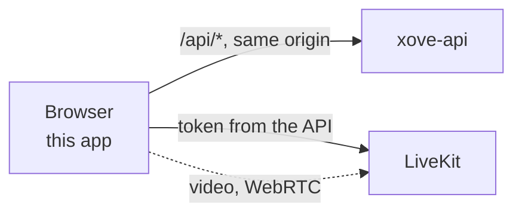
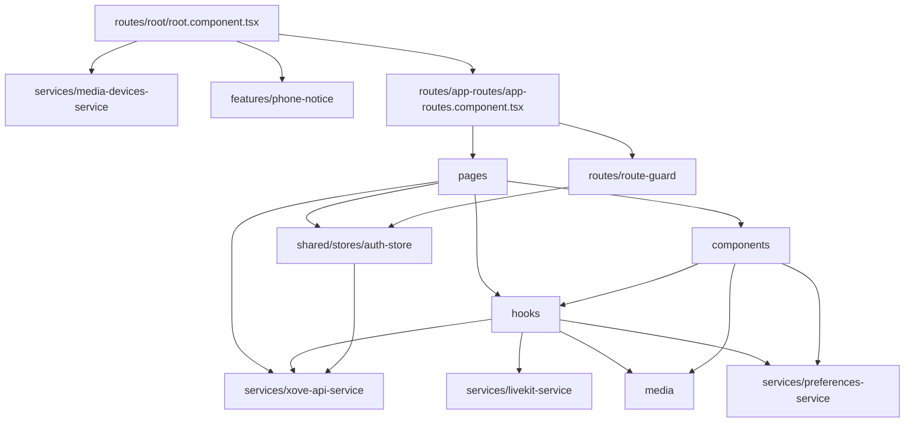
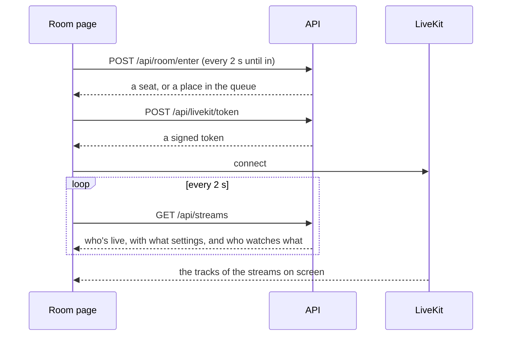
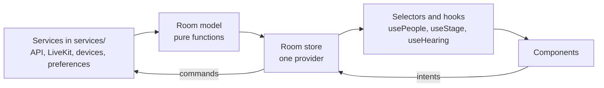

# Architecture

How the web app is built: its modules, its routes, how the room keeps its state, how it talks to the API and to LiveKit, and how it picks a layout for the device. How screens and cameras are sent and played is in [Media](media.md); how everything looks is in the [design sheet](design.md). The API (its endpoints, the room's rules, the data and its security) is in [`xove-api`](https://github.com/Hbrauveres/xove-api/blob/main/docs/README.md).

## Its place



A single-page app (React 19, TypeScript, Vite, React Router, CSS modules) built to static files. It holds no secret and reads no setting: who you are, what you may do and which streams are live all come from the API at run time; the video comes from LiveKit, a WebRTC server that receives each stream once and forwards it to every viewer.

## Modules

Everything is in `app/src`:

| Folder | Owns |
| --- | --- |
| `pages/` | One component per route: `HomePage`, `RequestAccessPage`, `AdminPage`, until they move in (#194); the room's page is in the room feature (`room-page/`) |
| `features/room/stores/room-store/` | The room's store, a unit: the room as data (`room.model.ts`: people by their id, streams, who watches whom, arrivals, the seat, the activity, my streams' steps, changed by pure functions), what the room shows (`room.selectors.ts`), and `RoomStore` (`room.store.ts`): the one place the seat, the streams and entering again are polled, the video room joined, and the room's actions sent; its hooks `use-room-store` (the store, the room, the video) and `use-room-seat` (the seat and its actions), and the helpers only it uses in `utils/` (the streams, the API's answer, the activity's events, a sharer's feed, keeping the same record, waiting for a seat) |
| `features/room/stores/room-session/` | The room once I'm in, shared with its areas through a context (`RoomSessionProvider`, read with `useRoomSession`): one hook gathers the room from the store (`use-session-core`: what the room shows, `use-room-view`; what I send, `use-my-sending` with my streams, their settings through a queue, the camera's preview and switch, changing the window; keeping my streams and the API in step, `use-stream-sync`; my voice, `use-my-voice`; the activity, `use-activity-feed`; the camera remembered), and one shapes each area's part: the stage's (`use-session-stage`: who's on it, the watch report, who watches, my buttons' controls), the header's (`use-session-header`: the activity, the people, my account), the settings panel's (`use-session-settings`, its open state from `use-settings-open`); the ambilight's settings, remembered (`use-ambilight`). The areas read their part; the pieces inside them keep their props |
| `features/room/hooks/` | The room's hooks several pieces share: who's big (`use-stage`), what I hear and what's downloaded (`use-hearing`); the mic's level; whether the keyboard was used last (`use-keyboard-last`); the time now, ticking (`use-now`); a track played in a video or audio element at this browser's volume (`use-played-track`), the TV turning on (`use-turn-on`), the settings' anchor the controls hand the stage (`use-settings-anchor`), Go live's width (`use-go-live-width`); a sound's slider opened by a rest of the mouse and closed on leaving (`use-hold-or-rest`), the previews' rows on their layer (`use-preview-tray`), what's fullscreen (`use-fullscreen-element`) |
| `features/room/utils/` | The helpers several of the room's pieces share, each with its test beside it: the stage pick, hearing, a person's id and name, the first name, an activity event in words, the light's grid, the static's bands and its flicker; a sound's icon, the full room's message (`full-room`, from the stream places), whether a preview has a row and what in it takes Tab |
| `features/room/types/`, `features/room/constants/` | The room's types (the room as data, a person, a stream, a sharer, the activity, the shared hooks' inputs) and its constants (the poll, the activity kept, the room's messages, a slider's rest and leave, the previews' layer, the stream's words) |
| `features/room/components/stage*/` | The stage, in small pieces, each with its test and stories: the stage itself (`stage/`: its box, in the picture's shape), the player (`stage-player/`: the frame, and in it the picture's layer (`stage-picture-layer/`, the view's size and place) holding every control over the picture, so they sit on it whatever its shape; a hook each for the controls fading when the mouse rests, fullscreen, where the settings open, the quality asked of the big stream, going to my stream when I start one, and what fits the picture (`use-picture-fit`: its width, `use-picture-width`, and Go live's, which Go live reports through `features/room/hooks/use-go-live-width.hook.ts`; what folds into "…" and my own row's size and place, `use-row-fold` from the plain `row-fold.util`; whether the small view fits)), what plays (`stage-view/`, `stage-picture/`, `stage-screen-video/`, `stage-facecam/`, `stage-notice/`), the light round it (`stage-light/`, its maths in its `utils/`), the empty stage (`stage-empty-stage/`, a TV on standby, with `stage-start-buttons/`, `stage-static-noise/`, `stage-static-glow/` and `stage-corner-glow/`; the bands both read in `features/room/utils/static-bands.util.ts`, so they roll together), the bar of controls (`stage-controls/`): over someone else's stream the viewer bar (`stage-viewer-bar/`: what I hear at the left, each sound `stage-viewer-sound/` on the one sound button `stage-sound-button/`; my mic or Go live at the right, `stage-viewer-me/` (my mic the one `stage-my-mic/`, in my own row too) and `stage-go-live/`, its rows `stage-go-live-rows/` in the bar's one menu box `stage-bar-menu/`; while the browser holds the room's sound, `stage-unmute/` in the sounds' place; on a narrow picture "…", `stage-more-menu/`, holding what folded, a folded sound `stage-more-sound/`), over my own my round buttons (`stage-player-buttons/`, each stream `stage-stream-button/`, a live one's drop-up `stage-stream-quick/` with what's shared `stage-screen-source/`, which the settings use too); the fullscreen button (`stage-stage-overlay/`) and, while the small view is folded, the button that opens it (`stage-small-view-button/`); the row under it (`stage-info/`: who's on the stage `stage-now-watching/`, the other streams `stage-also-live/` with each preview `stage-live-preview/` and the places taken `stage-places/`; a preview's row of buttons on its own layer over the page, `stage-preview-tray/` and `stage-preview-tray-row/`, its sounds `stage-hear-toggles/` with `stage-sound-drawer/` and `stage-sound-slider/`) and what I hear (`stage-sounds/`, `stage-voice-audio/`). The controls hand the stage their cog and row through a context (`features/room/hooks/use-settings-anchor.hook.ts`), so the settings open over them; nothing searches the page. The view keeps the small view's place and whether the TV has turned on, for the visit; its Hide folds it into the corner button with one move (`stage-player/`'s `use-fold`, none with reduced motion), the focus following; on a picture too narrow for it, it folds by itself, quietly |
| `components/stage/` | The settings panel, until it moves in (#193): `SettingsPanel`, its Voice tab's mic level in `MicTest` |
| `features/room/components/` | The room's pieces, in area folders (`room/`, `header/`, `queue/`, `stage/`, `stage-controls/`, `stage-info/`), the area in each name, each with its test and stories: the page (`room/room-page/`: my seat or the room laid out, the devices listed from the waiting room on, the sound unlocked by the first click or key, when the room can show), the room's error line (`room/room-error/`: under the stage, or over the player in fullscreen), the queue (`queue/queue-waiting-room/`, and the seat offer `queue/queue-seat-offer/` on the browser's own modal dialog), the footer (`room/room-footer/`), the header (`header/header/`, placing its own pieces from the session), the activity pill (`header/header-activity-pill/`, its moving line `header/header-activity-ticker/`) and list (`header/header-activity-list/`), who's here (`header/header-people-button/`, the seats `header/header-seats/`), my picture and my menu (`header/header-my-picture-button/`, `header/header-my-menu/`) |
| `shared/stores/floating-store/` | What floats, one thing on screen at a time: `useFloating` tells the store a piece is open and its kind (opened by a click or the keyboard, opened on a mouse rest, a tooltip). The store's rules decide what closes, what's inside another stays, and its one listener takes a press outside and Escape, which returns focus to the button. Each piece holds its own open state; the settings panel stays pinned and doesn't join |
| `shared/components/` (floating blocks) | On that store: `dropdown/` (one piece of glass, its sections on it), `picker/` with `picker-list/` (a list that floats over its panel, masking what's behind it in the nearest `[data-list-host]`; a menu of `menuitemradio` options), `drop-up/` and `drop-up-row/` (a labelled `fieldset`; its gestures can redirect to an open panel), `tooltip/` (the app's only tooltip, on its own layer, describing its control for screen readers; it follows its control on every frame while shown, sits `beside` a list's option, and with `cutOnly` shows only for a cut name). A redirected drop-up (the settings open) follows every rest, closing what's opened first (`floatingStore.closeOpened`). `picker/` and `drop-up/` can be told to be open (`open`, `onOpenChange`); `cue/` is how a control is pointed at |
| `shared/components/` (the design system) | One block per purpose (ADR-0094), each with its test and stories: `button/`, `slider/`, `segmented/` (real radios), `toast/` (its state in `shared/stores/toast-store/`, shown with `toastStore.show`), `wordmark/` (the mark, full or icon; its geometry, timeline and favicon in its `utils/`, read by `scripts/brand-icons.mjs` too), `panel/` and `panel-section/` (the one glass, its sections parted by a hairline), `page-shell/` (home, form, waiting, message), `field/`, `stat-pill/` and `count-chip/` (counters by space), `control-label/` and `section-heading/` (labels by space), `menu-row/` (a menu's action: a link or a button; its menu sets its role), `icon-button/` (the round button in two sizes, L 48 for my own buttons and M 34 for every other, and the header's, words' and close's purposes), `action-pill/` (a button with words: M 34 or L 44, glass, red or soft) and `label-pill/` (a name over a picture, 22 px) |
| `routes/` | Which page opens at which address, and who may open it: the root (`root/`), the route table (`app-routes/`), the guard (`route-guard/`, its rule in its `utils/route-access.util.ts`) |
| `services/xove-api-service/` | The HTTP client (`xove-api.service.ts`): one function per endpoint, the call itself and its errors as `ApiError`; the CSRF token and the headers in `utils/`, the API's types in `types/`, its messages in `constants/` |
| `shared/stores/auth-store/` | Who is signed in (`AuthProvider` in `auth.store.tsx`, which asks `GET /api/me` once and on demand; `useAuth` in its `hooks/`) |
| `services/app-config-service/` | The settings the server gives the app before it shows (`/config.json`, read once in `main.tsx`): today the stream places (1 to 6); a missing or broken file gives nothing, and the room falls back on the API's answer |
| `services/settings-queue-service/` | My stream's settings on their way to the API: changes one after another, a refused one put back |
| `services/preferences-service/` | Choices each browser keeps (`preferences.service.ts`): how I send a screen or a camera, the camera and mic picked, my voice's processing, how I hear a stream or a voice, the stage light; blocked storage gives the defaults (`storage.service.ts`, with the stored values' checks in `utils/preference-values.util.ts`) |
| `services/livekit-service/` | The video server, the only place that uses `livekit-client`: the adapter (`livekit.adapter.ts`: connects with the access it's given, keeps the room's state per person, takes commands), what's captured, sent, changed and heard (`capture`, `send`, `screen-change`, `screen-sound`, `voice` services), what someone sends read into plain data (`remote-media.adapter.ts`), who's speaking measured from what I hear (`speaking.service.ts` over `voice-activity.adapter.ts`, [Media](media.md#the-voice)), the noise gate's processor (which also says when my voice is sent); its helpers in `utils/` (how streams are sent, the room's state per person, the mic's problems), its types and constants beside them |
| `services/media-devices-service/` | The browser's devices: the screen picker, the cameras and mics and the mic's meter as services (they ask the browser); a phone or a tablet (`utils/is-handheld.util.ts`), the picker's request and the noise gate's maths as helpers; the stream presets in `constants/` |
| `features/phone-notice/` | What phones and tablets see instead of the app ([below](#phones-and-tablets)): its page and art in `components/` |
| `shared/` | What the whole app uses: the auth store, the time constants, the building blocks in `components/` (`icon`, `icon-button`, `face`, `switch`, `live-badge`, `headline`, `error-notice`), the icons' drawings, my mic's state and how long ago (`constants/`, `types/`, `utils/`), the design tokens (`styles/tokens.css`, every value the CSS uses) and the page's base rules (`styles/global.css`) |
| `testing/` | The test helpers: a fake API, a fake LiveKit, and rendering the app at a URL ([Testing](testing.md)); only tests import it |

At the top, `main.tsx` starts the app, `routes/root/root.component.tsx` chooses between the app and the phone notice, and `routes/app-routes/app-routes.component.tsx` holds the routes.



Pages put the room together; components draw it; hooks own the state and talk to the API and LiveKit (the simpler pages call the API directly); the room's rules (hearing, the stage pick, the watch report) are plain functions in `features/room/utils/`, and the settings queue is a service (`services/settings-queue-service/`). Each component has its own CSS module, using the tokens in `shared/styles/tokens.css`.

## Routes

`routes/app-routes/app-routes.component.tsx` maps each route to a page behind `RouteGuard` and its rule:

| Route | Guard | Shows |
| --- | --- | --- |
| `/` | signed out (signed-in people are sent on) | What Xovê is, "Continue with Google" |
| `/request-access` | signed in, not a member | "You need access", an optional message, the request; a pending state that checks every 20 s and moves you in when approved; a declined state that lets you ask again |
| `/room` | members | The room |
| `/admin` | admins | Pending requests (approve, decline) and members (remove) |
| anything else | | Back to `/` |

Sign-in is the API's: "Continue with Google" goes to `/api/oauth2/authorization/google`, and the API sends you back to `/room` or `/request-access`. The guard only reads `AuthProvider`'s answer (`routeAccess` decides: show, wait, or send elsewhere), so a member page never renders for someone who isn't one.

### Phones and tablets

Xovê is for computers for now. `Root` (`routes/root/root.component.tsx`) decides once, before the router and `AuthProvider`: on a phone or a tablet it shows only the phone notice (`features/phone-notice/`, [how it looks](design.md#phones-and-tablets-see-you-on-the-big-screen)) on every URL, and since `AuthProvider` never mounts, the page makes no call to the API. A device is a phone or a tablet when its main pointer is a finger (`isHandheld`, the media query `pointer: coarse`); a laptop with a touch screen has a fine main pointer, so it gets the app.

## The room's state

The room page combines two sources:

- **The API** decides who has a seat and which streams are live. The page asks it every 2 seconds.
- **LiveKit** carries the video and knows who is connected right now.



| State | Owned by | Lives |
| --- | --- | --- |
| My seat, or my place in the queue and the seat offer | `RoomStore`, in the room's model | The API; polled every 2 s while waiting |
| The live streams, their settings, who watches what, who's here since when | `RoomStore`, in the room's model | The API; polled every 2 s by every open room |
| Who is connected, their tracks, my own captures | `services/livekit-service/livekit.adapter.ts`, held by `RoomStore` | LiveKit |
| Where each of my streams is (off, picking, starting, live, stopping) | the room's model | This page only |
| Who's on my stage | `use-stage` | This page only |
| What I hear from each person, and what's downloaded | `use-hearing` | This page only (the volumes I start from: the browser) |
| How I send (quality, mode, the camera picked, my mic and its processing and line), the volumes I start from (a screen's sound, a voice), the ambilight's settings | `services/preferences-service/preferences.service.ts` (the ambilight's through `use-ambilight`) | The browser (`localStorage`, `xove.*`) |
| Each person's mutes and volumes, for this visit | `Stage` | This page only |
| Whether the settings are open, the setting a live button asked for, and the camera's preview | The room session (`use-settings-open`, `use-camera-preview`) | This page only |

**One id for everyone.** Everyone in the room, me included, is their identity on the video server (`user-42`): the access names me, the API's `userId`s name the others. "Is this me" is a comparison, and each person's colour comes from their id, the same on every screen. The room shows once I have a seat and the access has named me; until then the waiting screen says "Looking for a seat…". If the video access fails, the room opens anyway, to say why, with my account's name.

**Waiting for a seat.** The queue's rules (who's next, how long a place and an offer last) are the API's ([how](https://github.com/Hbrauveres/xove-api/blob/main/docs/architecture.md#seats-and-the-queue)). Without a seat, the waiting screen shows the place in the queue and asks again every 2 seconds; that poll is also how the API knows the page is still there. When a seat is offered, a popup counts down the seconds the API gives ("Enter room" accepts, "Cancel" leaves the queue), and the tab's title says "Your turn". Closing the waiting page sends `POST /api/room/leave` with `keepalive`, so the request survives the tab closing.

**Who's on the stage.** Each viewer picks who is big: a preview, or a live stream's line in the activity list (a camera's line puts the camera big). By default, and when the big person stops, it's the person sharing the longest (`features/room/utils/stage-pick.util.ts`). Once the pick has been still for a second, the page reports it (`PUT /api/streams/watching`), and again when a poll shows the API lost it (after a restart), so the people panel can say who watches whom. Only the page that's really in the video room reports, so a second tab doesn't overwrite it.

**The stream places.** How many streams can be live at once (1 to 6) is a setting of the environment, `XOVE_STREAM_PLACES`, which both the API and the web app's container get. The container serves it as `/config.json` (Caddy's templates fill it in; the Vite dev server serves the same file), and `main.tsx` reads it before the app shows. The room's model takes its places from there; when it's missing, from the API's streams answer (`places`); and when that's missing too, from the free places plus the live streams. The places' dots, "… of N live" and the full room's message follow it.

**When the API restarts.** The API keeps the room in memory ([how](https://github.com/Hbrauveres/xove-api/blob/main/docs/architecture.md#memory-and-the-database)). After a restart, an open room asks for its seat again on its next poll, with its LiveKit connection, and registers again what it's still sending; if the places filled up meanwhile, it stops sending. Nobody has to reload.

**Reloading while sharing.** The page sees that the API lists a stream of its own that nothing sends, and ends it.

**When a sharer leaves** (closes the tab, loses the connection), LiveKit tells the API, which ends all of that person's streams ([how](https://github.com/Hbrauveres/xove-api/blob/main/docs/architecture.md#livekit)); every room drops them on its next poll, so nobody watches a frozen picture.

## Talking to the API

`services/xove-api-service/xove-api.service.ts` is the only place that calls `fetch`:

- **Same origin, under `/api`.** In development, Vite forwards `/api` to a local API ([Getting started](getting-started.md)); on the servers, a reverse proxy does.
- **The session cookie** goes with every request (`credentials: "same-origin"`); the app never sees it.
- **CSRF:** every `POST`, `PUT` and `DELETE` copies the readable `XSRF-TOKEN` cookie into an `X-XSRF-TOKEN` header. Another site can't read the cookie, so it can't forge the header.
- **Errors** come as RFC 9457 problem details; the client throws an `ApiError` with the status and the API's `detail` as its message (or a plain fallback per status), and the pages show that message.
- **An empty answer** (an endpoint that returns nothing) reads as `null`.
- **A 401 from `GET /api/me`** means signed out: `AuthProvider` shows the home page.

Every endpoint, who may call it and what it answers, is in [`xove-api`'s API page](https://github.com/Hbrauveres/xove-api/blob/main/docs/api.md). A web release that needs a new API field ships only once that API version is live, and the app still works without the field.

## LiveKit in the browser

`RoomStore` (`features/room/stores/room-store/`) joins the video room once I have a seat, through the adapter in `services/livekit-service/`, until the room page closes:

1. The store asks the API for a token (`POST /api/livekit/token`), which names this person (`user-<id>`), the room and what they may send: a screen with its sound, a camera, and a microphone (sent only alongside my screen or camera, while I turn my voice on: [Media](media.md#the-voice)).
2. The adapter connects with it, `adaptiveStream` and `dynacast` on ([Media](media.md#what-a-viewer-downloads)).
3. The adapter keeps the room's state person by person: each LiveKit event updates only the person it's about (someone talking, as measured from their sound, changes only their talking flag; a camera starting, only their camera), and anything unchanged keeps its object, so the rest of the room doesn't redraw. The page reads the store with `useSyncExternalStore`. The connection's state says "reconnecting" while LiveKit retries.
4. Leaving the page disconnects. **One connection per person:** opening the room on a second device disconnects the first.

**Sound.** Browsers block sound that starts without a click on the page, so the first click or key in the room unlocks it (`room.startAudio()`), and LiveKit plays what was silent.

Sharing a screen or a camera is in [Media](media.md).

## The stage's layout

The room has one layout, theater mode, that follows the window's size ([how it looks](design.md#the-room-theater-mode)). How the code keeps it smooth:

- **The stage never moves in the page.** Resizing changes the layout around it, so the video and a share go on without reloading.
- **The picture's shape.** `useVideoShape` reads the big video's width ÷ height from its `resize` event (ignoring changes under 1%). The stage's box takes its column's width and a height from it; the view inside takes the picture's shape in container units of the box, centred. The box is a size container, so the controls read its own width: under 360 px they're compact (a container query, not the window).
- **Fading:** the stage hides the controls after `CHROME_IDLE_MS` without a move or a press on it ([how it looks](design.md#motion)). Each glass fades by its own opacity: a fading group sets `--chrome-fade` to 0 rather than fading itself, so the glass keeps its blur; a part marked `data-stays` (a heard voice) stays. Nothing fades while the pointer rests on a control, a control's menu is open in the player (`aria-expanded`), something holds them up (the settings, my buttons' drop-ups), or a control has the keyboard's focus (`useKeyboardLast`: a click's focus doesn't count). The rule is `utils/chrome-kept.util.ts`.
- **No pull-to-refresh in the room:** while the room is open (`data-room`), the page sets `overscroll-behavior: none`, so a drag down never reloads it.
- **Fullscreen** is the browser's own, on the stage's box.

## Where the code is going

The modules above are the app as it is today. It's being reorganised, with no change of behaviour, into the structure below. The new folders are in place (`routes/`, `features/`, `shared/`, `services/`, `testing/`); the old ones (`pages/`, `components/`, `hooks/`, `media/`, `brand/`) move in step by step, and this page's tables follow. Every component, today's and the next version's, with its pictures and its future folder: [Components](components/README.md).

### The structure

```
app/src/
├── main.tsx
├── routes/       which page opens at which address, and who may open it: root/, app-routes/, route-guard/
├── features/     the product's areas: room/, settings/, home/, request-access/, admin/, phone-notice/
│   └── room/     components/ (by area: stage/stage-facecam/, header/header-seats/…), stores/ (room-store/, room-session/),
│                 hooks/  utils/  constants/  types/  enums/   (what several of the room's pieces share)
├── shared/       what the whole app uses: components/ (the building blocks), stores/ (auth-store/), hooks/ utils/ constants/ types/ enums/,
│                 styles/ (tokens.css, global.css)
├── services/     the links to the outside world: xove-api-service/, livekit-service/, preferences-service/, media-devices-service/,
│                 settings-queue-service/
└── testing/      the fakes, the sample data and the setup tests share; only tests import it
```

- **A unit is a folder:** a component, a store, a service or an adapter, with its code, its test beside it (`facecam.component.test.tsx`), its CSS module if it's a component, a component's stories (`facecam.component.stories.tsx`: its states in Storybook, [Testing](testing.md#storybook)), and `index.ts`: the only door other code goes through.
- **Its parts sit inside it,** as files in folders by kind: `hooks/`, `utils/` (helpers that format, build or map, each with its test beside it), `constants/`, `types/`, `enums/`, only when it has some. A part used by several units of a feature sits in the feature's own part folders; one used by several features in `shared/`'s; a service's parts in the service. A working file holds no type (its props and inputs too), named constant or helper; a function that makes calls (the network, storage, LiveKit) belongs to a service.
- **Nothing nested:** no unit inside a unit, no folder inside a part folder. A feature's `components/` holds component folders, or area folders (one level) holding only component folders, never both; each name keeps its area (`stage/stage-facecam/`), and areas of one feature may use each other's components. A path is at most 7 levels under `src/`. A feature is split by its data, not its size: about 25 components in one area is a signal to look again.
- **Names:** kebab-case with the type as a suffix: `.component.tsx`, `.page.tsx`, `.hook.ts`, `.util.ts`, `.service.ts`, `.adapter.ts`, `.store.ts`, `.model.ts`, `.selectors.ts`, `.constants.ts`, `.enum.ts`, `.types.ts`; tests `.test.ts(x)`.
- **Short names:** `@routes/…`, `@features/…`, `@shared/…`, `@services/…` and `@testing/…` (in `tsconfig.app.json`'s `paths` and Vite's `resolve.alias`), never long relative paths into another folder.
- **Imports go down:** `routes` → `features` → `shared` → `services`. No feature uses another; only tests use `testing/`. The lint rule enforces the direction, and the code check the rest (below), and no file imports another component's CSS.

### The rules

- **One job per file.** If describing it needs "and", it's two files. Components about 150 lines at most, hooks and services about 200, any file 300.
- **One test file for every file with logic**, beside it, testing that file's behaviour ([Testing](testing.md#test-rules)).
- **Each building block exists once**, with variants: one icon button, one floating layer (its store, with Dropdown, DropUp, Picker and Tooltip as blocks on it: outside press, Escape, focus return, one thing on screen at a time), one face, one switch, one set of icons.
- **Tokens only:** every colour, size, duration, easing, layer and window size comes from `shared/styles/tokens.css`, sizes in rem ([Design sheet](design.md#tokens)); no other CSS file writes a value, `global.css` included. Window and box sizes are `@custom-media` names (`@media (--narrow)`, `@container (--tiny)`): browsers don't read those yet, so PostCSS turns them into plain CSS when Vite builds (`postcss.config.js`; `scripts/container-media.ts` does it for `@container`, which `postcss-custom-media` leaves alone).
- **Components never find each other through the page** (`querySelector`, labels, `data-*` used as hooks): a ref, a context, or CSS.
- **No module-level mutable state.** Hooks return stable values; effects only sync with something outside React.
- **Comments say why**, never history: no issue or spec numbers in the code.
- **Functions stay small and plain:**
  - at most 60 lines
  - complexity at most 10
  - nesting at most 3 levels
  - at most 4 parameters (more go in one object)
  - no `any`, no forced `!`, no `as` outside tests
  - a number other than 0, 1 or -1 goes in a named constant
  - named exports only
- **Layout:** Prettier, 120 characters. Nobody lays code out by hand.

### The checks

Every rule a tool can measure runs in the commit checks as `3 · Code checks`, on the whole app's code.

**What's exempt, and why:**
- **Tests and stories** (`*.test.ts(x)`, `*.stories.tsx`, `src/testing/`, its fakes and factories) are exempt from the size, number and escape-hatch limits. A `describe` block is long by nature, and expected values belong in the test. They keep their own rules ([Testing](testing.md#test-rules)).
- **`scripts/`** (the checks themselves) and **`e2e/`** (the end-to-end tests and their harness) are exempt from the same limits. They're tooling, not part of the app.
- **The copy check skips tests.** Tests repeat their arrange steps on purpose, so each one reads on its own.
- **No exemption from the escape hatches' own back door.** A comment that switches a check off (`oxlint-disable`, `@ts-ignore`, `@ts-expect-error`, `@ts-nocheck`, `jscpd:ignore`, `prettier-ignore`) is a finding in app code. Fix the code instead.

| Check | Catches | Run it |
| --- | --- | --- |
| TypeScript | The build: `strict`, `noImplicitOverride`, `noFallthroughCasesInSwitch`. `tsconfig.strict.json` adds `noUncheckedIndexedAccess` (a value read from a list may be missing) and `exactOptionalPropertyTypes` (an optional field set to `undefined` by mistake). | `npm run build`; the strict config through the guard |
| oxlint | Hooks' dependencies, accessibility, unused code, the import direction, the size and shape limits above, escape hatches, unexplained numbers, default exports. Two accessibility rules are set in `.oxlintrc.json`: `media-has-caption` is off, since every video and sound is a live stream with no words to caption (an empty captions track would only satisfy the rule; it comes back with real captions); and an `application` region may take the keyboard's focus (the facecam: ARIA expects an application to), as a `tabpanel` may | through the guard |
| jscpd | A block of code copied into another place (8 lines or 60 tokens, CSS included) | `npm run check:copies` |
| knip | Files nothing imports, exports nothing uses | `npm run check:unused` |
| The code check | The structure's rules: folders and names, every part in its kind's folder and none inside working code, a test beside every file with logic, units in their own folders with their parts inside them, area folders one level deep, nothing nested past 7 levels, imports through a unit's `index.ts` and never up, across features or into `testing/`, any colour, size, duration, easing, layer or window size written in CSS outside `tokens.css` (zero isn't a value), no DOM queries between components, LiveKit only in `services/`, a component in a `components/` folder of the new structure with no stories, no history in comments, lines over 120 characters (Prettier doesn't wrap strings and comments), comments that switch a check off, and the tests' own rules | `npm run check:code -- <folder> --all` |
| Storybook | Every story in headless Chromium: one that throws, or breaks an accessibility rule (contrast included), fails | `npm run test:storybook` |
| Prettier | Layout | `npm run format` fixes, `npm run format:check` checks |
| The size budget | The built JavaScript and styles, compressed, against `checks/size-budget.json` | `npm run build && npm run check:size` |

**The guard and its list.** `npm run guard` runs TypeScript's strict config, oxlint, jscpd, knip and the code check, and compares what they find with `checks/known-findings.json`:

- **The list** is what today's code still breaks: counts per tool, rule and file. Each entry names the step that owns it (`checks/owners.json`).
- **Recorded findings** show as warnings.
- **The guard fails** on:
  - a finding the list doesn't allow, in an old file as much as a new one
  - a recorded finding that's gone: lower the list with `npm run guard -- --record` in the same change
  - a list that allows more than `main`'s
- **The list only shrinks.** Each step of the reorganisation clears its own areas. The one exception is the change that adds a rule to the code check: that rule's findings in the old folders are recorded once, each owned by the step that moves its folder. The guard knows a rule is new because `main`'s code check doesn't define it. When it's empty, the two stricter TypeScript settings move into the main config.
- **A moved file keeps its entries.** The guard compares with `main`'s list through git's renames, so moving a file isn't a new finding.
- **A tool that goes quiet fails.** If a tool reports nothing where the list expects findings (a setting lost, its output changed), that's an error, not a clean-up, and it can't be recorded. When a change really clears a tool's last findings, check the tool by hand (run it alone: it finds nothing), then take its entries out of the list by hand and record.
- **The tools are pinned** (oxlint, TypeScript, Prettier, knip, jscpd at exact versions). Dependabot proposes their upgrades in a PR of their own (the `checks` group). An upgrade that brings new findings fixes them in that PR, since the list can't grow.

**The size budget.**
- **Today:** JavaScript 286 kB and styles 18 kB, compressed (kB as Vite prints them), about 10% above what the app weighs today. The styles grew when every value became a token: a `var(--name)` is longer than the value it names.
- **Over budget fails.** So does falling more than 10% under it: a lighter app lowers its budget, so the room it freed isn't quietly used up.
- **Raising a budget** is a deliberate change in `checks/size-budget.json`, in the PR that needs it, saying why.

### The state, in layers

From the edge in, each layer talking only to its neighbours:



The model is the room as data: people keyed by one `PersonId` (me included, as anyone else), streams, watches, hearing, activity, one state machine per stream. The components see data and intents, never LiveKit's or the API's objects.

## Repository layout

```
app/                  the web app: everything its image is built from
  src/                the modules above
  public/             the favicon (no home-screen app while desktop only)
  Dockerfile, Caddyfile, caddy/   the image: the Vite build served by Caddy, built from source
  config/             config.json, the settings the server fills in from its environment (`/config.json`)
  compose.yaml        runs the image (locally and in the checks)
  scripts/            the checks (guard, check-code, check-styles, check-size), test-alone, brand-icons.mjs (the favicon from the mark's geometry)
  e2e/                the end-to-end tests, one per feature case at every size, and their harness (harness/: the app on its fakes; support/: open, observe, frames) ([Testing](testing.md#end-to-end-every-feature-at-every-size))
  checks/             the guard's list of known findings, who owns them, the size budget
  tsconfig.strict.json, .oxlintrc.json, .jscpd.json, knip.json, .prettierrc.json   the checks' settings
docs/                 these pages, and the design sheet's pictures
.github/workflows/    the commit checks and the releases
```

## Security, the web app's side

- **No secrets:** the app holds none; what a member may do always comes from the API, which checks it again on every request ([`xove-api`'s security](https://github.com/Hbrauveres/xove-api/blob/main/docs/security.md)).
- **CSRF:** the header on every change, as above.
- **The image** is a static build served by Caddy as a non-root user, and every change passes a vulnerability scan of the image and the dependencies, and a static analysis of the code, before it can be merged (`.github/workflows/ci.yml`).
