# The next version, component by component

The room's redesign: three columns (who's here, the stream, the room's chat), the people as cards with their own previews, a rail of faces when the column is folded, and a chat. These pictures come from the redesign's draft, a static page with no logic: they show the direction chosen, not finished behaviour. Each piece is built in the [new structure](../architecture.md#where-the-code-is-going) after the reorganisation, and its details are settled in a working prototype first.

Desktop only for now. Pictures: the draft at 1600 px wide.

**Kinds:** a *building block* is small and used in many places (`shared/ui/`); a *room piece* is built from blocks and has one job; a *screen region* holds pieces in place.

## Layers

The room is a stack, back to front. Each picture adds one layer on top of the ones before it.

| | Layer | What it holds |
| --- | --- | --- |
| 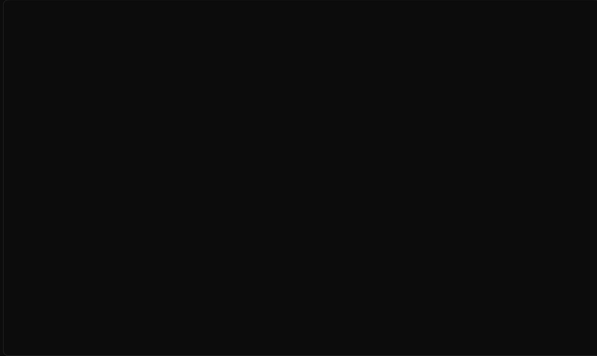 | **Ground** | The near-black background everything sits on. One flat colour, no picture. |
| 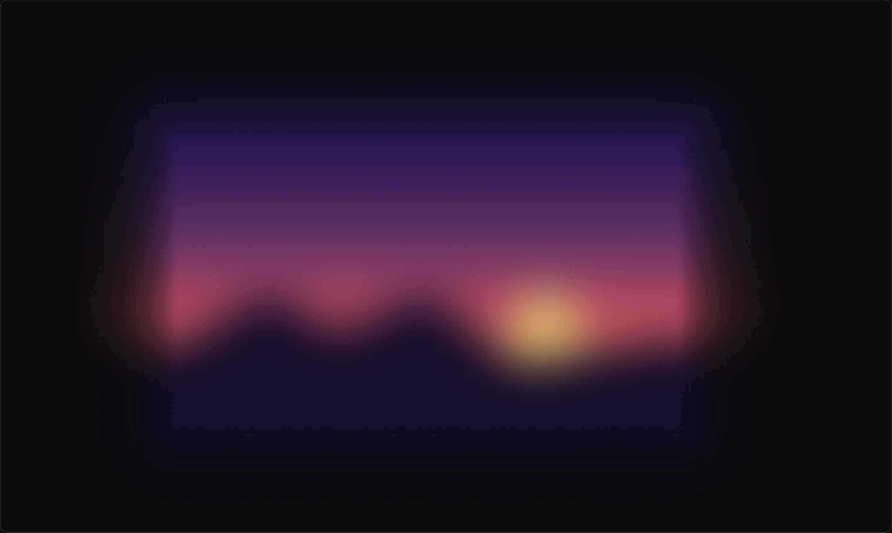 | **Stage light** | The ambilight: the stream's own colours, blurred, glowing out around the stage and under the panels. It has a ceiling, so a white stream glows grey instead of blinding. |
| 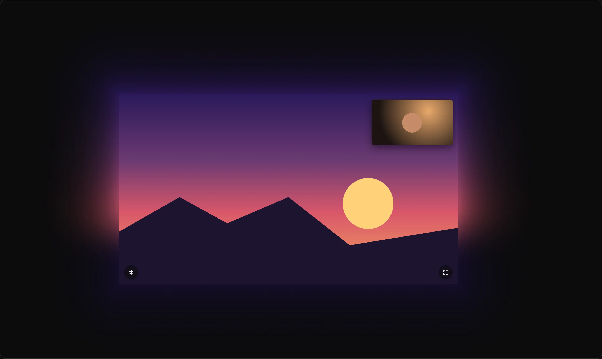 | **Stage** | The stream itself, with what sits on it: the facecam and the stage's buttons. |
| 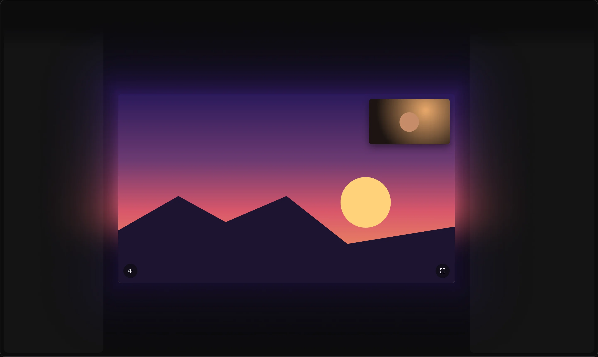 | **Panels** | The two side surfaces, people on the left and chat on the right: a light tint over the ground and the light, fading in from the header. |
| 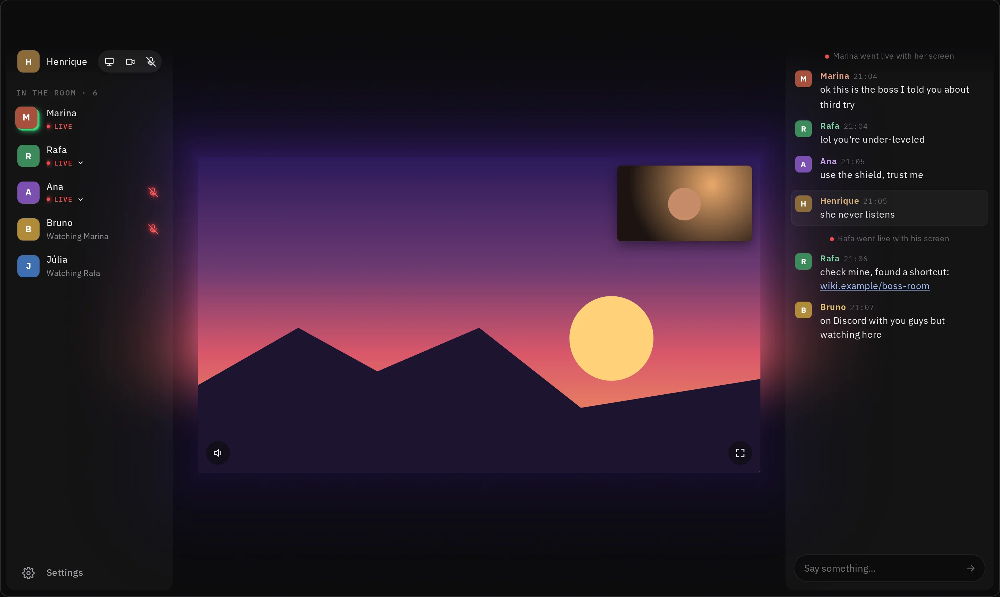 | **Panel content** | What lives on the panels: my card, the people, the chat's messages and its message box. |
| 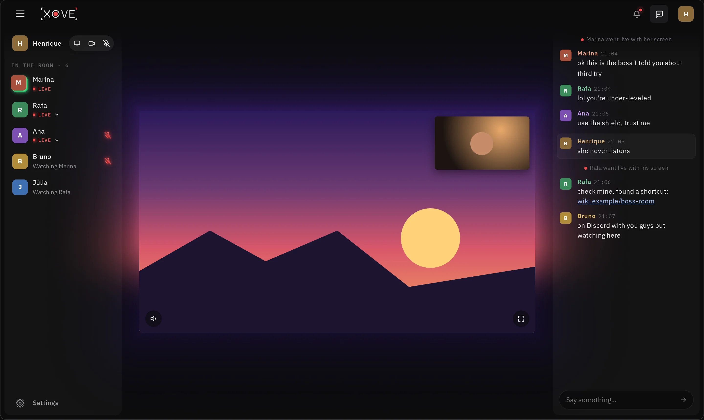 | **Header** | The bar on top: the menu, the wordmark, the bell, the chat button and my picture. It sits above the stage's light. |
| 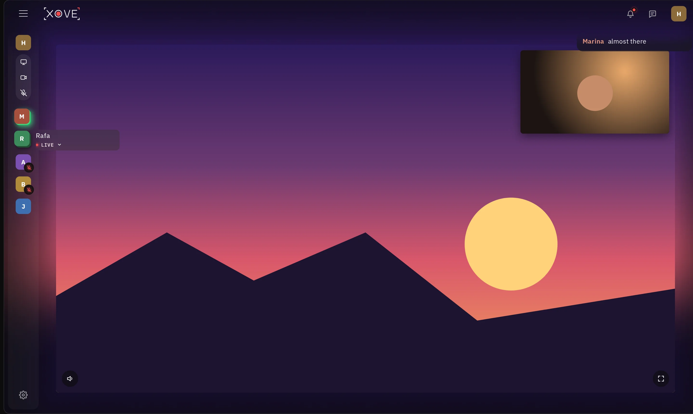 | **Floating** | What opens over everything else, for a moment: the rail's hover card, the chat toast, the menus. |

## Building blocks

Small pieces used in many places. Each is built once and reused everywhere.

### Face

*Building block* · `shared/ui/face/`

<table><tr>
<td>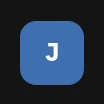 At rest</td>
<td>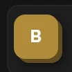 Pointed at: it lifts on its own coloured walls</td>
<td>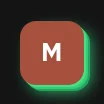 Talking: green walls, glowing with the voice</td>
<td>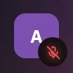 With the muted badge (in the rail)</td>
</tr></table>

**Why its own component:** A person is shown by the same square face everywhere, in different sizes and with several states (talking, the one I'm watching, pointed at, muted). Built once, every place shows a person the same way and the talking glow follows one rule.

**Where it's used:** People rows, the rail, my card, chat messages, the activity list, my menu and the hover card. Sizes: 32 px in the people column, 26 px in the activity list, 24 px in the chat.

### Icon button

*Building block* · `shared/ui/icon-button/`

<table><tr>
<td>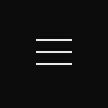 Menu</td>
<td>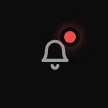 Header: the bell, with its count</td>
<td>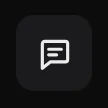 Header, pressed (chat open)</td>
<td>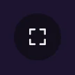 On the stage</td>
<td>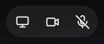 My buttons, off</td>
<td>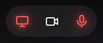 My buttons, on (red)</td>
</tr></table>

**Why its own component:** Every action that is only an icon shares the same needs: a hit area, hover and focus, pressed and off states, a label for screen readers. Today it comes in three looks: rounded squares in the header, round dark glass on the stage, round in my card. One component with those variants keeps them consistent.

**Where it's used:** The header (menu, bell, chat, my picture), the stage (volume, fullscreen, show the camera), the facecam (swap, minimise), my card (screen, camera, mic), the preview's controls.

### Count badge

*Building block* · `shared/ui/count-badge/`

<table><tr>
<td>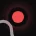 On the bell</td>
<td>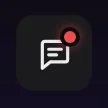 On the chat button: unread messages</td>
</tr></table>

**Why its own component:** A small red number pinned to a button's corner. Its position, size and how it shows a large count should be the same on every button.

**Where it's used:** The bell (new activity) and the chat button (unread messages while the chat is hidden).

### LIVE badge

*Building block* · `shared/ui/live-badge/`

<table><tr>
<td>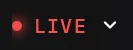 Closed</td>
<td>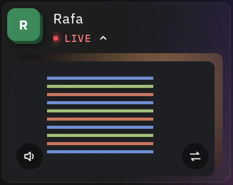 Open: it shows the person&#x27;s preview</td>
</tr></table>

**Why its own component:** It says someone is live and is also the button that opens their preview. One look and one behaviour wherever a live person appears.

**Where it's used:** People rows and the rail's hover card.

### Mic state

*Building block* · `shared/ui/mic-state/`

<table><tr>
<td>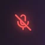 Their mic is off (red, glowing)</td>
<td>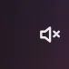 I muted them (white crossed speaker)</td>
</tr></table>

**Why its own component:** Only the states that matter are shown: their mic off, or muted by me. An open mic shows nothing, because talking is the face's green walls. A small component keeps that rule in one place.

**Where it's used:** People rows; in the rail it's the small badge on the face.

### Slider

*Building block* · `shared/ui/slider/`

<table><tr>
<td>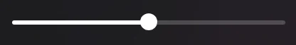 In a person&#x27;s menu</td>
<td>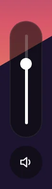 Upright, for the stream&#x27;s volume</td>
</tr></table>

**Why its own component:** One slim slider, lying down or standing up, with the filled part following the thumb. Built once, every volume control looks and moves the same.

**Where it's used:** A person's voice volume, the stream's volume on the stage, the preview's volume.

### Menu

*Building block* · `shared/ui/menu/`

<table><tr>
<td>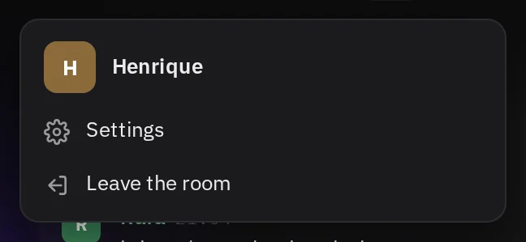 My menu</td>
<td>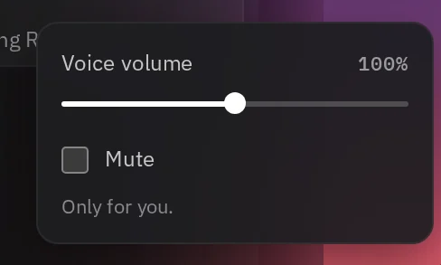 A person&#x27;s settings</td>
<td>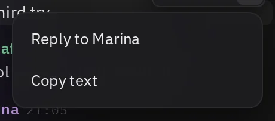 A message&#x27;s &quot;More&quot;</td>
<td>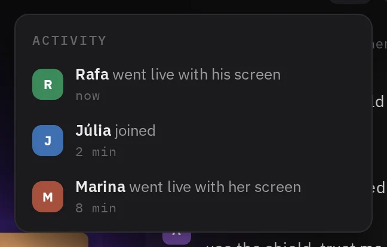 The activity list</td>
</tr></table>

**Why its own component:** Four things open as the same kind of floating box: a dark surface with rounded corners, a shadow, rows or controls inside, closed by Escape or a click outside. One component owns the box, where it opens and how it closes; each use only gives it its rows.

**Where it's used:** My picture (Settings, Leave the room), a right-click on a person, a message's "⋯", the bell.

### Panel

*Building block* · `shared/ui/panel/`

<table><tr>
<td>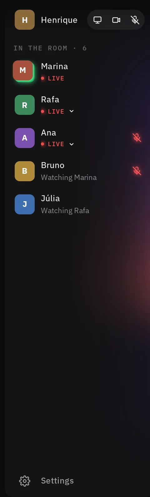 The people panel</td>
<td>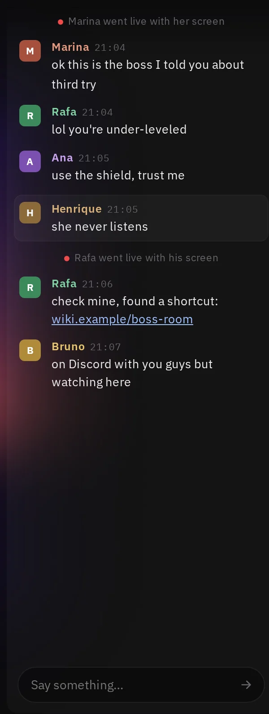 The chat panel</td>
</tr></table>

**Why its own component:** The two side surfaces are the same material: a light tint over the ground, no live blur, the top fading in from the header. One component makes them match exactly.

**Where it's used:** The people column and the chat column.

### Section label

*Building block* · `shared/ui/section-label/`

<table><tr>
<td>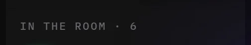 &quot;In the room · 6&quot;</td>
</tr></table>

**Why its own component:** Small, spaced, monospace capitals that name a section. Same type and spacing everywhere a list gets a title.

**Where it's used:** The people column; the activity list's "Activity" title is the same style.

### Wordmark

*Building block* · `shared/ui/wordmark/`

<table><tr>
<td>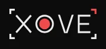 In the header</td>
</tr></table>

**Why its own component:** Xovê's name and mark, drawn with its red corner. It is the brand: one source, never redrawn by hand.

**Where it's used:** The header.

## The header

The bar along the top.

### Header

*Screen region* · `features/room/header/header/`

<table><tr>
<td>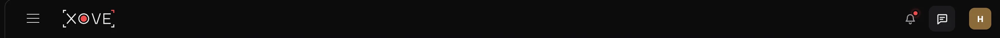 The whole bar</td>
</tr></table>

**Why its own component:** The top bar holds the app's global actions, apart from the room's content, and sits above the stage's light. As one piece it lays out its two ends and spaces its buttons by what the eye sees.

**Where it's used:** The room, at every size.

### My picture button

*Room piece* · `features/room/header/my-picture-button/`

<table><tr>
<td>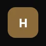 My picture</td>
<td> It opens my menu</td>
</tr></table>

**Why its own component:** My own face as a button that opens my menu. It joins the face and the menu in one place.

**Where it's used:** The header's right end.

### Activity list

*Room piece* · `features/room/header/activity-list/`

<table><tr>
<td> Opened from the bell</td>
</tr></table>

**Why its own component:** A list of what happened in the room (went live, joined), each line with a face, the text and when. It has its own content and will grow its own rules (how many, how long they stay).

**Where it's used:** Opened from the bell.

## The people

The left column, open or folded.

### My card

*Room piece* · `features/room/people/my-card/`

<table><tr>
<td>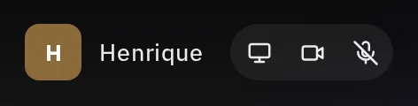 Open</td>
<td>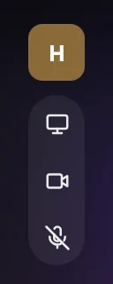 Folded into the rail: my buttons stand under my face</td>
</tr></table>

**Why its own component:** Me, apart from everyone else: my face, my name and my three buttons to go live (screen, camera, mic). It changes shape when the column folds, and the buttons must never be hidden.

**Where it's used:** The top of the people column.

### Send buttons

*Room piece* · `features/room/people/send-buttons/`

<table><tr>
<td> All off</td>
<td> Screen and mic on</td>
</tr></table>

**Why its own component:** A pill of three icon buttons that start and stop what I send. As one group they keep their order and spacing, lie down or stand up with the column, and show on in red.

**Where it's used:** Inside my card.

### Person row

*Room piece* · `features/room/people/person-row/`

<table><tr>
<td>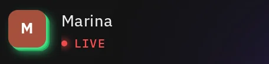 On the stage, talking</td>
<td>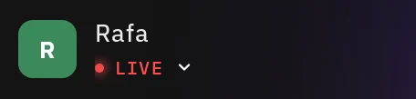 Live</td>
<td>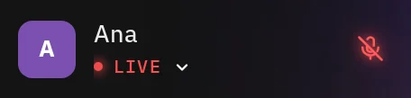 Live, mic off</td>
<td>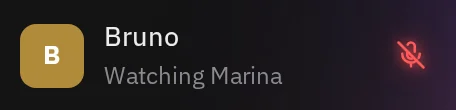 Watching someone, mic off</td>
<td>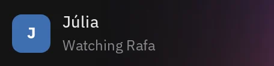 Watching someone</td>
<td>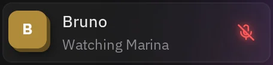 Pointed at</td>
</tr></table>

**Why its own component:** The main repeated piece of the room: a face, a name, what they're doing (LIVE or "Watching …") and their mic. Up to 20 of them, with many combinations of states, so it must be one piece with clear states.

**Where it's used:** The people column, one per person; the rail's hover card is the same row, grown out of the rail.

### Live preview

*Room piece* · `features/room/people/live-preview/`

<table><tr>
<td>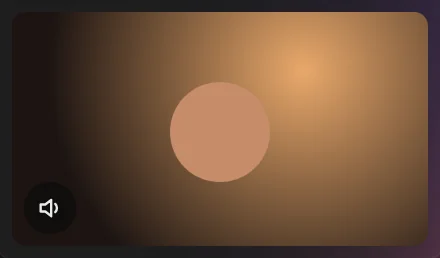 One stream</td>
<td>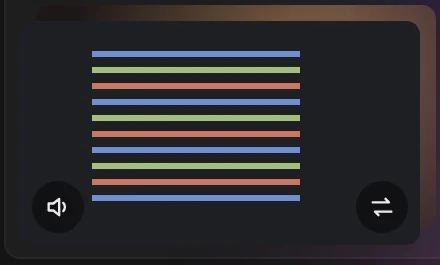 Screen and camera, stacked, with a swap</td>
</tr></table>

**Why its own component:** A small player for someone's stream, with its own volume and, when they share both, a swap. Clicking it puts that stream on the stage. It's the same in the list and in the hover card.

**Where it's used:** Under a person's row when their LIVE badge is opened, and in the rail's hover card.

### Settings button

*Room piece* · `features/room/people/settings-button/`

<table><tr>
<td>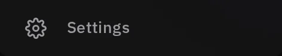 At the column&#x27;s foot</td>
</tr></table>

**Why its own component:** The way to the app's settings, at the foot of the column, with its icon and its word (only the icon when folded).

**Where it's used:** The bottom of the people column.

### Person menu

*Room piece* · `features/room/people/person-menu/`

<table><tr>
<td> Right-click on a person</td>
</tr></table>

**Why its own component:** Settings for one person, only for me: their voice volume and mute. It's a Menu with a slider and a checkbox in it.

**Where it's used:** A right-click on a person's row, or on their hover card.

### Rail

*Room piece* · `features/room/people/rail/`

<table><tr>
<td>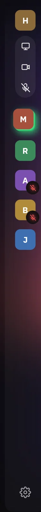 The people folded into faces</td>
</tr></table>

**Why its own component:** The people column folded to its faces, to give the stage room. Same people and states as the open list in a narrow shape, so it's the column's second layout, not a copy of it.

**Where it's used:** The people column when the menu folds it.

### Rail hover card

*Room piece* · `features/room/people/rail-hover-card/`

<table><tr>
<td>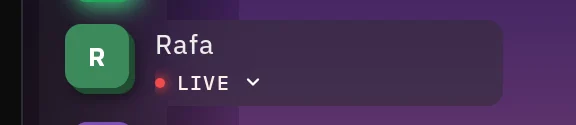 Pointing at a face</td>
<td>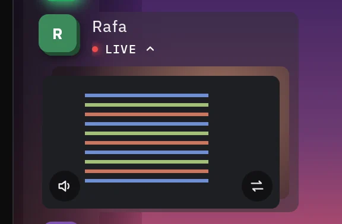 With their preview open</td>
</tr></table>

**Why its own component:** Pointing at a face in the rail grows that person's row out of the column, as a pill in the column's own colour. It has its own rules: it opens only when the pointer rests, nothing below moves while pointing, and it meets the column with no seam.

**Where it's used:** The rail, one at a time.

## The stage

The middle: the stream and what sits on it.

### Stage

*Screen region* · `features/room/stage/stage/`

<table><tr>
<td>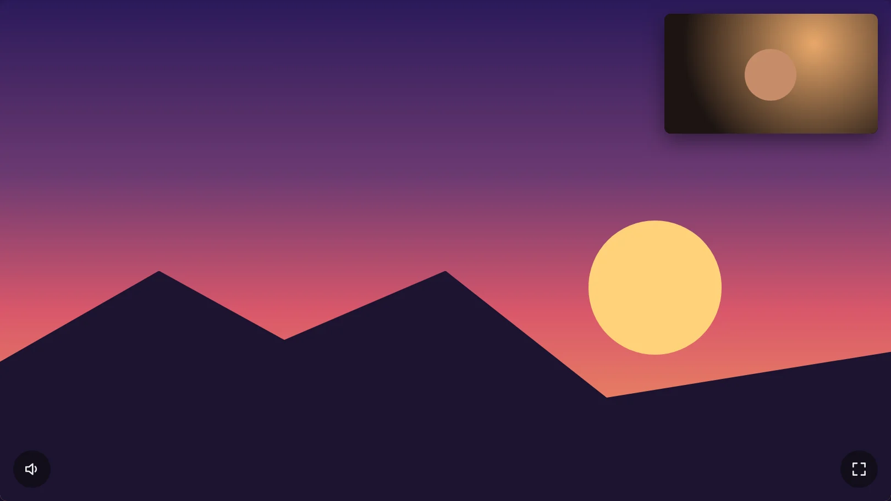 The stream</td>
</tr></table>

**Why its own component:** The stream itself, always 16:9 and as large as the middle allows, with corners for its buttons. Everything else in the middle is placed relative to it.

**Where it's used:** The middle of the room.

### Stage light

*Room piece* · `features/room/stage/stage-light/`

<table><tr>
<td> The light around the stage</td>
</tr></table>

**Why its own component:** The ambilight: drawn from the stream's edges on a small canvas, stretched around the stage, with a ceiling for bright streams. It has its own cost and its own rules, so it lives apart from the stage.

**Where it's used:** Behind the stage, reaching under the panels.

### Facecam

*Room piece* · `features/room/stage/facecam/`

<table><tr>
<td> Over the screen, with swap and minimise</td>
</tr></table>

**Why its own component:** When someone shares their screen and camera, the camera sits over the screen in a small window that can be swapped, minimised and dragged.

**Where it's used:** On the stage, when the streamer shares both.

### Stage controls

*Room piece* · `features/room/stage/stage-controls/`

<table><tr>
<td> Volume, with its upright slider</td>
<td> Fullscreen</td>
<td> With the camera minimised: show the camera</td>
</tr></table>

**Why its own component:** The stage's own buttons in two corners: the stream's volume on the left, fullscreen (and show the camera) on the right. Icon buttons in the dark-glass variant, in fixed places so they never move.

**Where it's used:** The stage's bottom corners.

## The chat

The right column, and what shows of it when it's hidden.

### System line

*Room piece* · `features/room/chat/system-line/`

<table><tr>
<td> Someone went live</td>
</tr></table>

**Why its own component:** A line from the room, not from a person: small, muted, with a red dot. It must never look like a message.

**Where it's used:** Between messages in the chat.

### Message group

*Room piece* · `features/room/chat/message-group/`

<table><tr>
<td> Someone&#x27;s messages</td>
<td> Mine (the same, on a soft band)</td>
</tr></table>

**Why its own component:** Messages from one person in a row, under one face, name and time. The repeated unit of the chat, with a variant for my own.

**Where it's used:** The chat, one group per run of messages from the same person.

### Message tools

*Room piece* · `features/room/chat/message-tools/`

<table><tr>
<td> Pointing at a message</td>
</tr></table>

**Why its own component:** A small bar of actions at a message's corner (delete, time out, ban, more), shown on hover. Which tools show depends on whose message it is (and later on my role).

**Where it's used:** Over the message being pointed at.

### Message box

*Room piece* · `features/room/chat/message-box/`

<table><tr>
<td> Empty</td>
<td> With text: the arrow turns red</td>
</tr></table>

**Why its own component:** Where I write: one pill with the send arrow inside, grey when empty and red when there's something to send.

**Where it's used:** The foot of the chat.

### Chat toast

*Room piece* · `features/room/chat/chat-toast/`

<table><tr>
<td> A new message while the chat is hidden</td>
</tr></table>

**Why its own component:** With the chat hidden, the newest message peeks in for a moment at the top. It floats over the stream, so it has a dark floor to stay readable on any stream.

**Where it's used:** Top right of the room, only while the chat is hidden.
