# Today's app, component by component

Every visual piece of the web app **as it is today** (desktop), with a picture, what it does, where its code lives now, where it goes in the [new structure](../architecture.md#where-the-code-is-going), and what happens to it. The app is being reorganised into that structure as it is, with no change of behaviour, before the [next version](next.md) is built; this page is the starting point and is kept current as pieces move.

**What happens to it:** *Kept* moves into its folder and is rewritten to the [rules](../architecture.md#where-the-code-is-going), behaving as today. *Replaced* means the next version brings a new piece for the same job, after the reorganisation. *Merged* means several copies become one shared component. *Removed* goes with phone support, which is paused: the app is desktop only for now.

Pictures: the room at 1920 × 1080, with fake people and moving pictures.

| Section | |
| --- | --- |
| [The header](#the-header) | The bar along the top of the room. |
| [The stage](#the-stage) | The stream and everything on and around it. |
| [Around the room](#around-the-room) | The settings, the footer, the queue and the pages outside the room. |
| [Building blocks](#building-blocks) | The shared controls, and the copies that become one |
| [Removed](#removed) | Phone-only code, and what phones and tablets see instead |

## The header

The bar along the top of the room.

### Header

<table><tr>
<td>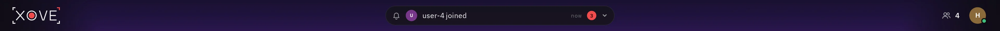 The whole bar</td>
</tr></table>

The room's top bar: the wordmark at the left, the activity pill in the middle, the people button and my account button at the right.

| Today | Goes to | What happens |
| --- | --- | --- |
| `features/room/components/header/header/` (`Header`) | Here | Done (#189); redrawn in the next version |

### Wordmark

<table><tr>
<td>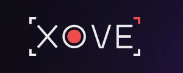 In the header</td>
</tr></table>

Xovê's name and mark, drawn with its red corner; it animates on hover.

| Today | Goes to | What happens |
| --- | --- | --- |
| `shared/components/wordmark/` (full and icon; its geometry, timeline and favicon in its `utils/`) | Here | Done (#188) |

### Activity pill and list

<table><tr>
<td>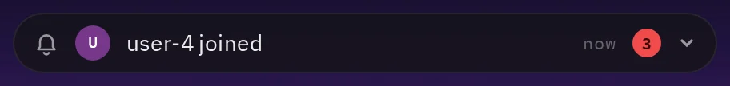 The pill: the latest event and how many are new</td>
<td>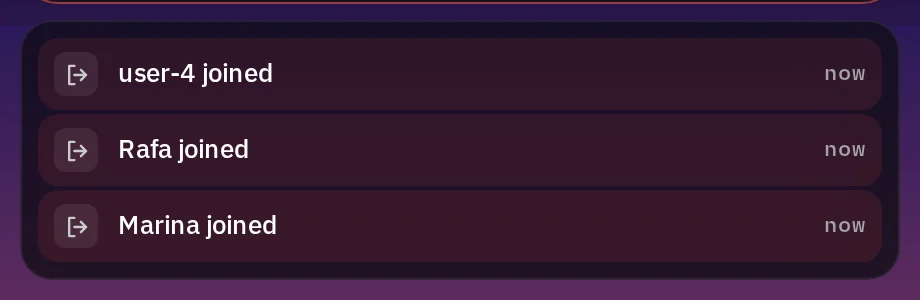 Opened: the list of events</td>
</tr></table>

What happened in the room (someone joined, went live), as a pill that opens a list.

| Today | Goes to | What happens |
| --- | --- | --- |
| `features/room/components/header/header-activity-pill/` (its seen marks a hook), its moving line `header-activity-ticker/`, `header-activity-list/`; the words in `features/room/utils/activity-text.util.ts`, how long ago in `shared/utils/time-ago.util.ts` | Here | Done (#189); the next version's bell replaces the pill |

### People button

<table><tr>
<td>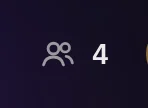 How many are here</td>
<td>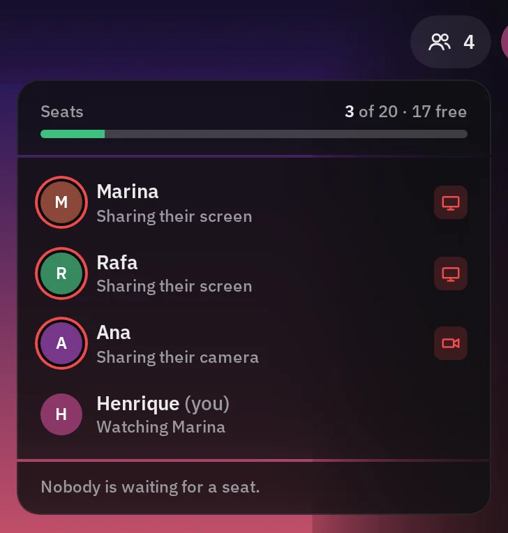 Opened: the seats and who&#x27;s here</td>
</tr></table>

How many people are here; it opens the seats and the list of people with what each one shares or watches.

| Today | Goes to | What happens |
| --- | --- | --- |
| `features/room/components/header/header-people-button/` (the order, the line under each name and the queue in its `utils/`), the seats `header-seats/` | Here | Done (#189); the next version's people column replaces it |

### My picture button and my menu

<table><tr>
<td>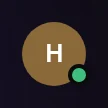 My picture</td>
<td>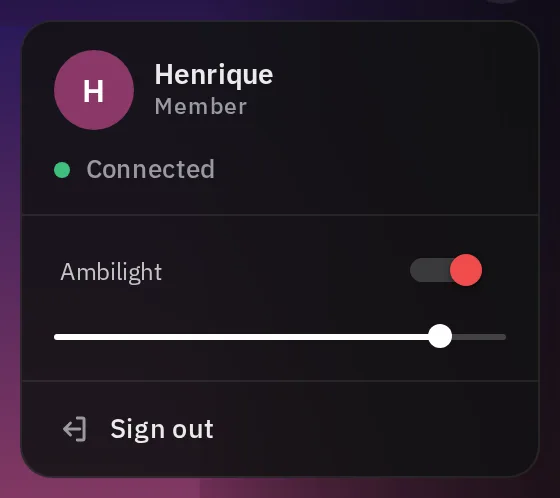 Opened: who I am, the ambilight&#x27;s switch and brightness, sign out</td>
</tr></table>

My picture; it opens my menu.

| Today | Goes to | What happens |
| --- | --- | --- |
| `features/room/components/header/header-my-picture-button/` and `header-my-menu/` (on the shared Dropdown, Switch, Slider and Menu row); the ambilight's settings in `features/room/stores/room-session/hooks/use-ambilight.hook.ts` | Here | Done (#189) |

## The stage

The stream and everything on and around it.

### Stage

<table><tr>
<td>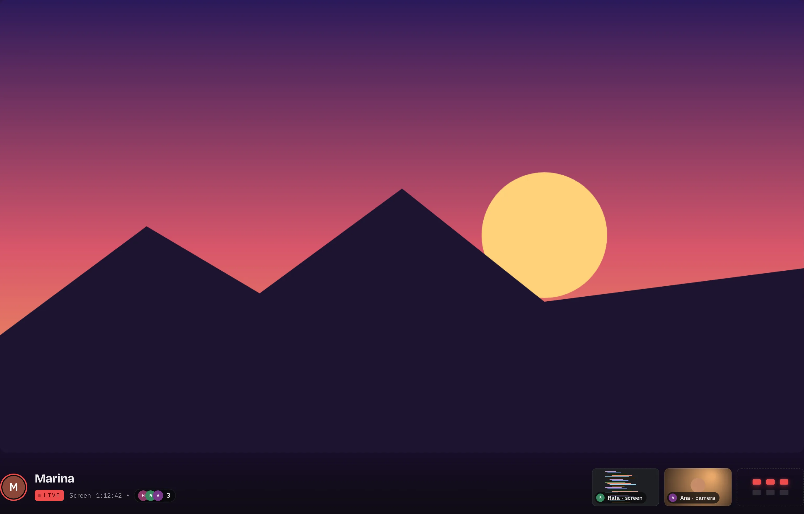 The stage with its info row and previews</td>
<td>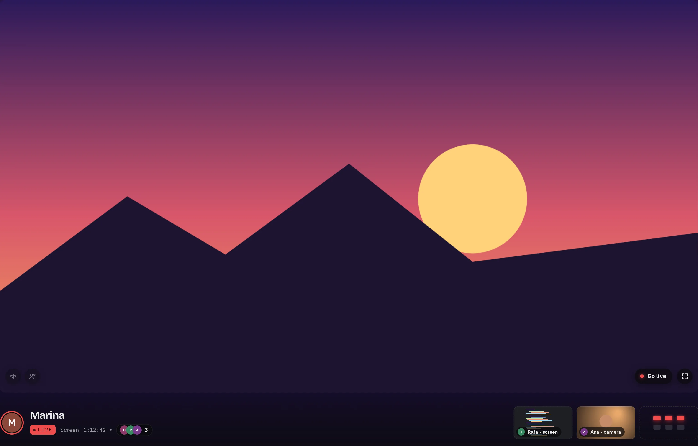 Its controls, shown while the pointer moves</td>
</tr></table>

The stream being watched, as large as the room allows, with its controls on the picture (a layer with the picture's size and place, so a tall picture keeps them on it, not on the dark around it), and the info row and previews under it.

| Today | Goes to | What happens |
| --- | --- | --- |
| `features/room/components/stage/stage/` (the box), `stage/stage-player/` (the frame; its controls fading, fullscreen, the settings' place, the quality, what fits the picture and folds into "…", each a hook), the picture's layer `stage/stage-picture-layer/`, `stage/stage-view/`, `stage/stage-picture/`, `stage/stage-screen-video/`, `stage/stage-notice/`, `stage-controls/stage-controls/`, `stage-info/stage-info/`, `stage/stage-sounds/`, `stage/stage-voice-audio/` | Here | Done (#190): `Stage.tsx` split into its pieces; the controls on the picture (#247) |

### Stage light (ambilight)

<table><tr>
<td> The light around the stage</td>
</tr></table>

The stream's own colours glowing around the stage, drawn from its edges on a small canvas.

| Today | Goes to | What happens |
| --- | --- | --- |
| `features/room/components/stage/stage-light/` (the maths in its `utils/`, the drawing a painter and a frame loop) | Here | Done (#190) |

### Viewer bar

<table><tr>
<td>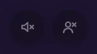 What I hear from the person I watch</td>
<td>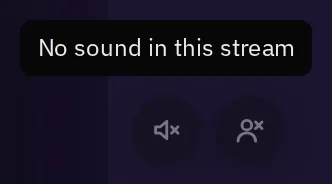 A sound&#x27;s button, with its tooltip</td>
</tr></table>

Over someone else's stream: each sound I hear from them (screen sound, voice) as its own round button (M 34) with a slider; a greyed one says why; my mic or Go live (an action pill) at the right. On a picture too narrow for all of it, Go live and then both sounds fold into "…".

| Today | Goes to | What happens |
| --- | --- | --- |
| `features/room/components/stage-controls/stage-viewer-bar/`, each sound `stage-viewer-sound/` on the one sound button `stage-sound-button/`, me `stage-viewer-me/` with my mic `stage-my-mic/` (the same block in my own row); while the browser holds the room's sound, `stage-unmute/` ("Click to unmute") in the sounds' place; the slider's rest in `features/room/hooks/use-hold-or-rest.hook.ts` | Here | Done (#191); the next version's stage controls replace it |

### Go live menu

<table><tr>
<td>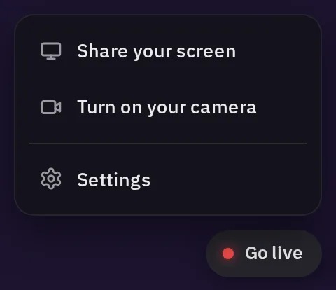 Share my screen, turn on my camera, settings</td>
</tr></table>

Starts what I share, from a drop-up over the stage.

| Today | Goes to | What happens |
| --- | --- | --- |
| `features/room/components/stage-controls/stage-go-live/`, an action pill, its drop-up on the floating layer in the bar's one menu box `stage-bar-menu/`, its rows `stage-go-live-rows/` (on the shared Menu row) | Here | Done (#191; its rows and box shared with "…", #247); the next version's send buttons replace it |

### More menu ("…")

<table><tr>
<td>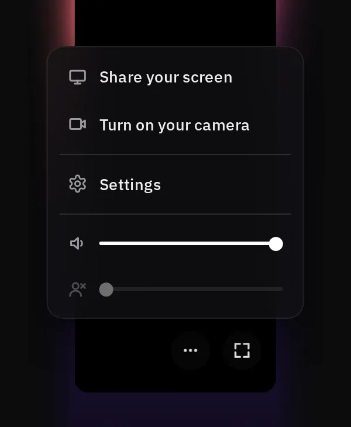 "…" open on a narrow picture</td>
</tr></table>

On a picture too narrow for the whole bar, an M round button holding what folded: the settings, Go live's rows, and the stream's sound and the streamer's voice together, each with its icon and its slider (disabled while muted or unheard) on the menu rows' grid. Its menu is centred on the picture. Fullscreen, my mic and my own buttons never fold.

| Today | Goes to | What happens |
| --- | --- | --- |
| `features/room/components/stage-controls/stage-more-menu/`, a folded sound `stage-more-sound/`, Go live's rows `stage-go-live-rows/`, the box `stage-bar-menu/`; what folds `stage-player/`'s `use-row-fold` | Here | New (#247); the next version's stage controls replace it |

### Player buttons

<table><tr>
<td>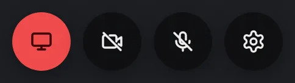 My stream&#x27;s round buttons: screen, camera, mic, settings</td>
</tr></table>

Over my own stream: my screen, camera and mic, on or off, and the settings: round buttons, L 48, red while on. On a narrow picture they move beside fullscreen, then turn M 34; none of them folds.

| Today | Goes to | What happens |
| --- | --- | --- |
| `features/room/components/stage-controls/stage-player-buttons/`, each stream `stage-stream-button/`, a live one's drop-up `stage-stream-quick/` with `stage-screen-source/` (the settings use it too) | Here | Done (#191); the next version's send buttons replace it |

### Stage overlay

<table><tr>
<td>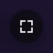 Fullscreen</td>
</tr></table>

The stage's fullscreen button, round, M 34, at the picture's bottom right; it never folds.

| Today | Goes to | What happens |
| --- | --- | --- |
| `features/room/components/stage/stage-stage-overlay/` | Here | Done (#191); the next version's stage controls replace it |

### Small view

<table><tr>
<td>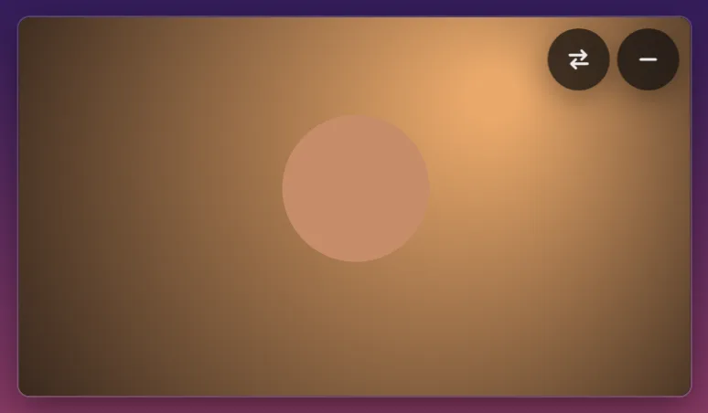 The camera over the screen</td>
<td>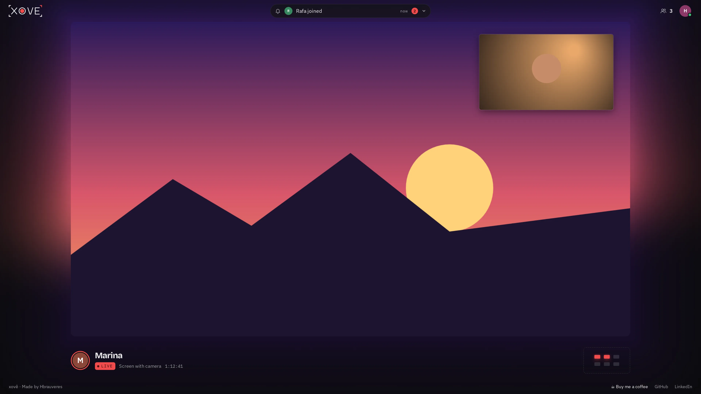 In the room</td>
<td>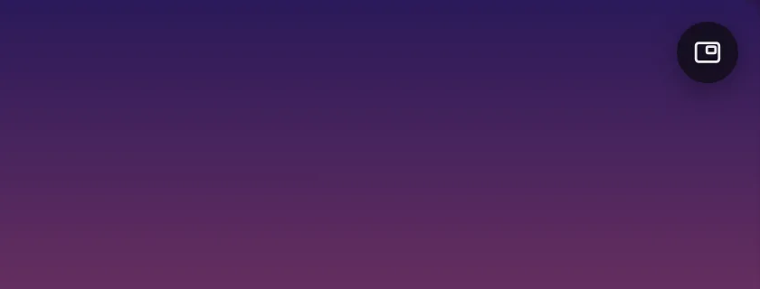 Folded into its corner button</td>
</tr></table>

When someone shares their screen and their camera, the camera sits over the screen; it can be swapped and dragged. It's a quarter of the picture, but at least 200 px, and the picture's whole width on a picture that narrow or narrower; under 84 px it folds by itself. Hide folds it, in one move, into a round button in the picture's top-right corner, which opens it again where it was.

| Today | Goes to | What happens |
| --- | --- | --- |
| `features/room/components/stage/stage-facecam/` (its move a hook), the corner button `stage-small-view-button/`, the fold `stage-player/`'s `use-fold` | Here | Done (#190, the fold #191, its size on a narrow picture #247) |

### Empty stage

<table><tr>
<td>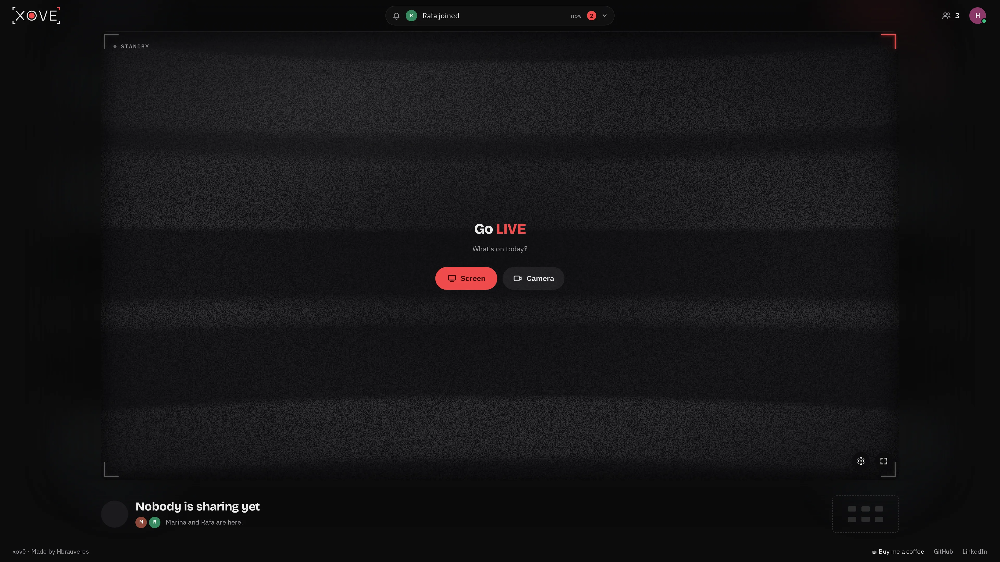 Nobody is live: a TV on standby</td>
</tr></table>

When nobody shares: a TV on standby, with its static and glow, and the ways to start.

| Today | Goes to | What happens |
| --- | --- | --- |
| `features/room/components/stage/stage-empty-stage/`, `stage-start-buttons/`, `stage-static-noise/`, `stage-static-glow/`, `stage-corner-glow/`; the bands in `features/room/utils/static-bands.util.ts`; the TV's turn-on kept by the view, no global | Here | Done (#190) |

### Now watching

<table><tr>
<td>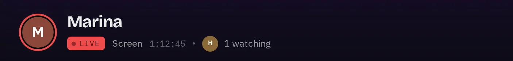 Who&#x27;s on the stage, live for how long, and who watches</td>
</tr></table>

Under the stage: whose stream it is, what it is, how long it's been live and who's watching.

| Today | Goes to | What happens |
| --- | --- | --- |
| `features/room/components/stage-info/stage-now-watching/` | Here | Done (#191); the next version shows it in the people column |

### Also live, preview tray and hear toggles

<table><tr>
<td>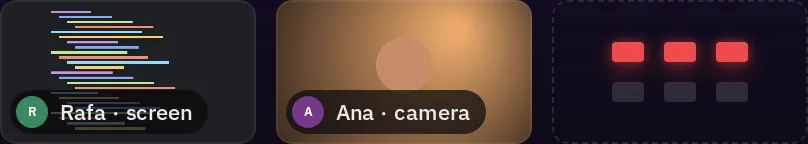 The other streams, and the free seats</td>
<td>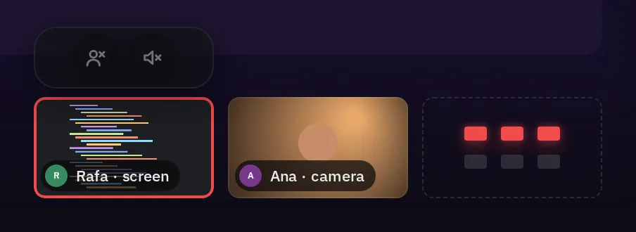 Pointing at a preview: its sound buttons</td>
</tr></table>

The other live streams as small previews, their names on label pills, the places still free, and, over a preview, its own row of round buttons (M 34).

| Today | Goes to | What happens |
| --- | --- | --- |
| `features/room/components/stage-info/stage-also-live/`, `stage-live-preview/`, `stage-places/`, `stage-preview-tray/`, `stage-preview-tray-row/`, `stage-hear-toggles/`, `stage-sound-drawer/`, `stage-sound-slider/`; the layer's state in `features/room/hooks/use-preview-tray.hook.ts` | Here | Done (#191); the next version's people column and live preview replace them |

### My stream

<table><tr>
<td>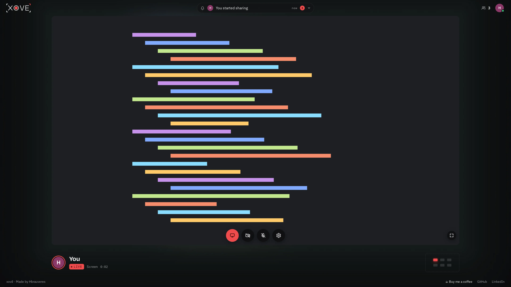 Me sharing my screen</td>
</tr></table>

The room while I share: my stream on the stage with my own buttons.

| Today | Goes to | What happens |
| --- | --- | --- |
| `features/room/components/stage*/` | As above | Done (#190, my buttons #191) |

## Around the room

The settings, the footer, the queue and the pages outside the room.

### Room page

<table><tr>
<td>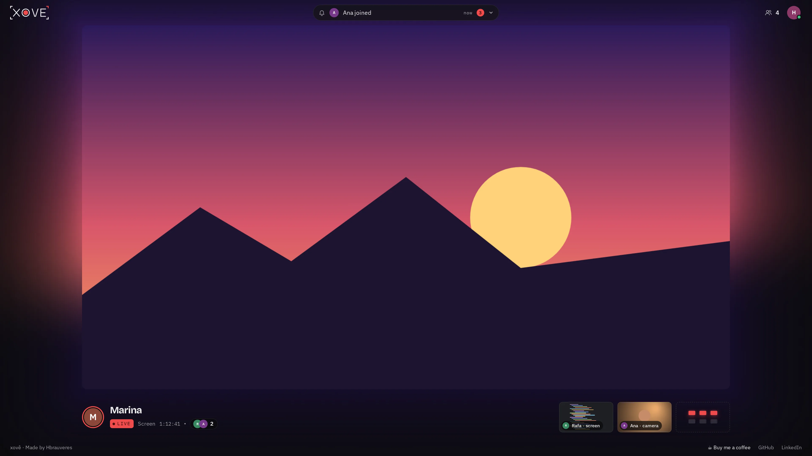 The room laid out: the header, the stage with its row, the footer</td>
</tr></table>

While I wait for a seat, the waiting room; once I'm in, the room laid out: the header, the stage in its column, the room's error line, the footer. It holds no state: each area reads its part of the room session.

| Today | Goes to | What happens |
| --- | --- | --- |
| `features/room/components/room/room-page/` (#192), the room session `features/room/stores/room-session/` | — | Kept; the next version's three columns after the gate |

### Room error

The room's problem in one line (the shared Error notice), over the bottom of the middle; in fullscreen, over the player's top. It shows only when something fails (the video access, a stream that won't start), so it has no picture here; its look is the Error notice's in the [design sheet](../design.md).

| Today | Goes to | What happens |
| --- | --- | --- |
| `features/room/components/room/room-error/` (#192) | — | Kept |

### Settings panel

<table><tr>
<td>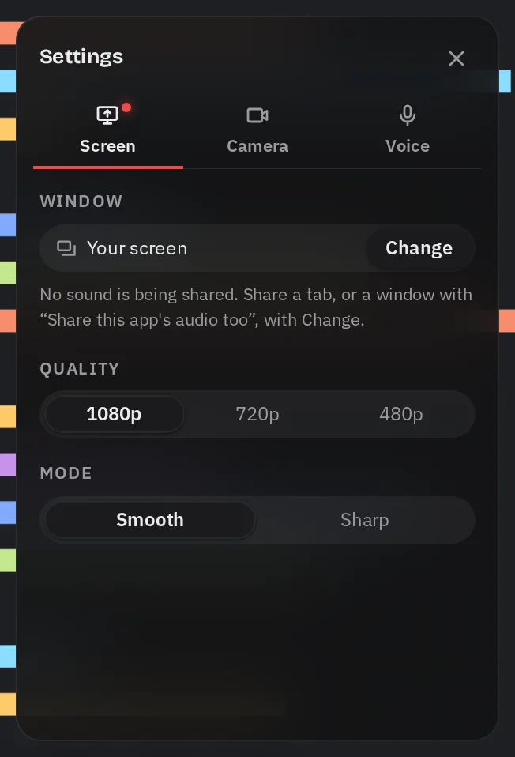 Screen, camera and voice settings</td>
</tr></table>

What I send: the screen, the camera and the voice, each a tab, with its quality and devices, and a mic test.

| Today | Goes to | What happens |
| --- | --- | --- |
| `features/room/components/settings/` (ADR-0106): the panel `settings-panel/` (a native `<dialog>` on the shared Panel; sliding, the cue, the camera's preview and the focus each a hook), the tabs `settings-tabs/` on the shared Tabs, `settings-screen-tab/`, `settings-camera-tab/`, `settings-voice-tab/`, the quality and mode `settings-quality-mode/`, the camera's preview `settings-camera-preview/` (in the stage's video frame, "Only you see this" a label pill), the mic test `settings-mic-test/` (the threshold slider, Test the dark pill), a tab's line `settings-hint/` | Here | Done (#193) |

### Room footer

<table><tr>
<td>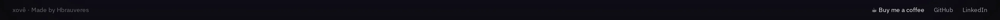 The footer&#x27;s links</td>
</tr></table>

The room's footer: credits and links.

| Today | Goes to | What happens |
| --- | --- | --- |
| `features/room/components/room/room-footer/` (#192) | — | Kept; decided again with the next version |

### Waiting room

<table><tr>
<td>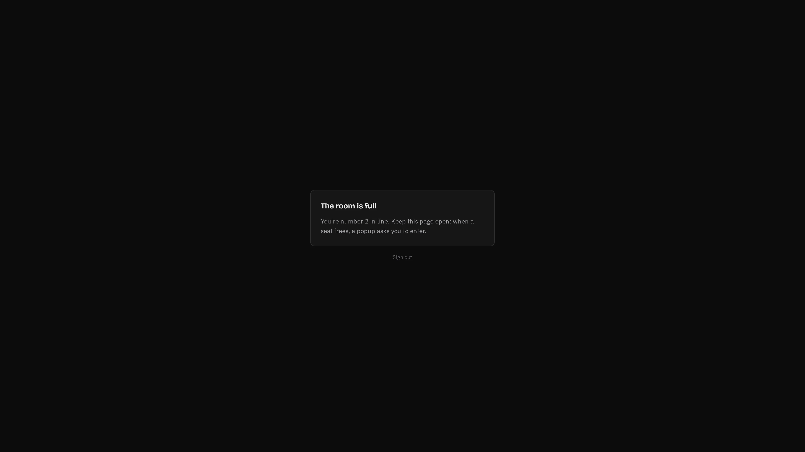 The room is full: waiting for a seat</td>
</tr></table>

When the room is full: waiting for a seat, and the offer when one frees.

| Today | Goes to | What happens |
| --- | --- | --- |
| `features/room/components/queue/queue-waiting-room/` (its card a Panel as an `<output>`), `queue-seat-offer/` (the browser's own modal dialog) (#192) | — | Kept |

### Sign-in

<table><tr>
<td>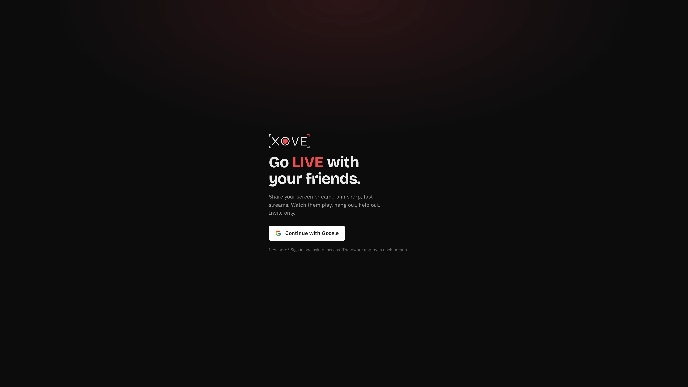 Signed out</td>
</tr></table>

The first page: what Xovê is, and signing in with Google.

| Today | Goes to | What happens |
| --- | --- | --- |
| `pages/HomePage.tsx` | `features/home/` (on the shared Page shell) | Kept |

### Request access

<table><tr>
<td>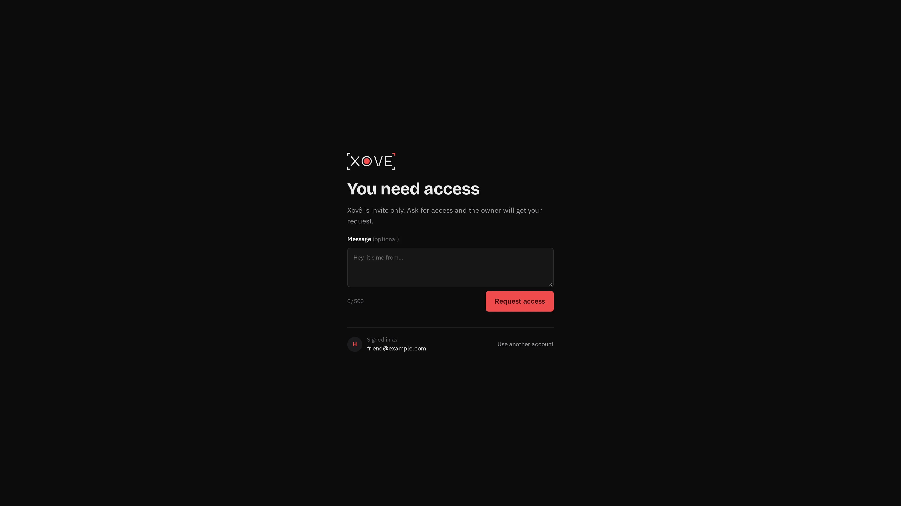 Asking to join</td>
<td>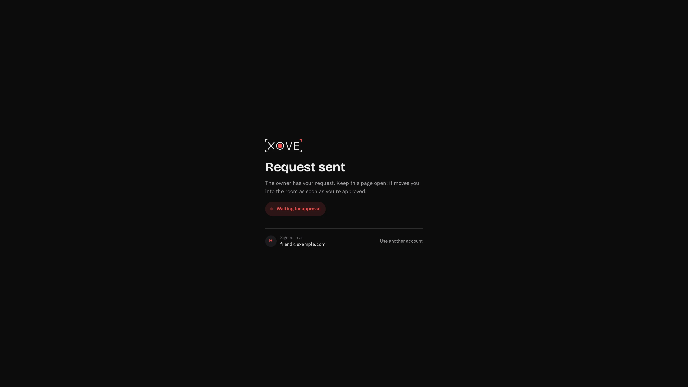 Request sent</td>
</tr></table>

Asking to join, and the wait for an answer.

| Today | Goes to | What happens |
| --- | --- | --- |
| `pages/RequestAccessPage.tsx` | `features/request-access/` | Kept |

### Admin

<table><tr>
<td>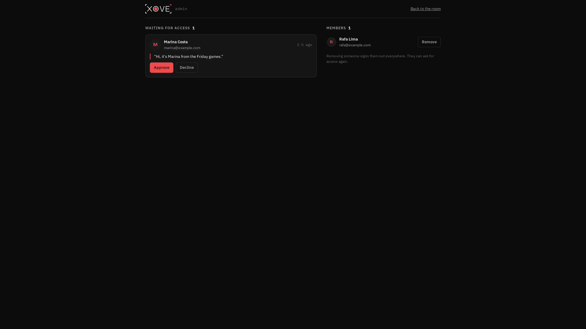 Requests and members</td>
</tr></table>

For the admin: the access requests and the members.

| Today | Goes to | What happens |
| --- | --- | --- |
| `pages/AdminPage.tsx` ("3 min ago" from `shared/utils/time-ago.util.ts`) | `features/admin/` | Kept |

## Building blocks

The shared controls today, and the copies that become one component each.

| Block | Today | Goes to | What happens |
| --- | --- | --- | --- |
| Button | `shared/components/button/` | Here | Done (#188) |
| Slider | `shared/components/slider/`, and its threshold variant (a line knob, a level in its track; the mic test drew its own) | Here | Done (#188, threshold #193) |
| Segmented control | `shared/components/segmented/` (real radios) | Here | Done (#188) |
| Floating layer | `shared/stores/floating-store/` | Here | Done (#187) |
| Picker, drop-up, dropdown | `shared/components/picker/`, `picker-list/`, `drop-up/`, `drop-up-row/` (glass, or the panel's look in a panel, #193), `dropdown/` (one piece of glass, its sections on it, #249) | Here, on the floating layer | Done (#187) |
| Slim scrollbar | `data-scroll="slim"` in `shared/styles/global.css` (it was written four times) | Here | Done (#193) |
| Cue | `shared/components/cue/` | Here | Done (#187) |
| Tooltip | `shared/components/tooltip/`: follows its control while shown; beside a list's option, only for a cut name (#249) | Here, on the floating layer | Done (#187) |
| Avatar | `shared/components/face/` (was `ui/Avatar.tsx`, `PersonAvatar.tsx`): the room's colour and initial with its rings, the account's photo | Already there | Merged |
| Round button | `shared/components/icon-button/`, `variant="round"`: one base (glass, a soft shadow, lighter when pointed at, a red keyboard ring, 45% when unavailable, red when on) in two sizes, L 48 for my own buttons and M 34 for every other; its other purposes the header's and close | Here | Done (#191): the player's, the stage's, the overlay's, the mini and the toggle variants are one |
| Action pill | `shared/components/action-pill/`: a button with words, XS 26, S 30, M 34 or L 44, glass, red, soft or dark (white while on), an icon or the live dot first; Go live, the empty stage's ways to start, and Change and Test (they were a round button with words and the mic test's own pill) | Here | Done (#191, dark #193) |
| Live dot | `shared/components/live-dot/`: the red dot with its glow, S on a tab, M on a pill | Here | Done (#193) |
| Tabs | `shared/components/tabs/`: the sliding marker, the live dot, every pane as tall as the tallest, greyed in place when unusable; the settings' tabs | Here | Done (#193) |
| Video frame | `features/room/components/stage/stage-video-frame/`: 16:9, black, 8 px corners; Also live's cards and the camera's preview | Here | Done (#193) |
| Label pill | `shared/components/label-pill/`: a label over a picture, 22 px glass, a face or an icon first, or words alone; the previews' names, the camera preview's "Only you see this" | Here | Done (#191, #193) |
| Switch | `shared/components/switch/`: a setting's row, 30 px, its words and the switch; my menu and the Voice tab (the tab restyled it) | Already there | Merged; its row #193 |
| Icons | `shared/components/icon/` and its drawings in `shared/constants/icons.constants.ts` (was `stage/icons.tsx`, `room/ActivityIcon.tsx` and inline drawings) | Already there | Merged |
| LIVE badge | `shared/components/live-badge/`: beside who's on the stage, and over my preview | Already there | Merged |
| Headline | `shared/components/headline/`: the big statement with its key words in the accent (sign-in, the empty stage) | Already there | Merged |
| Toast | `shared/components/toast/`, its state `shared/stores/toast-store/` | Here | Done (#188) |
| Page shell | `shared/components/page-shell/`: home, request access, the waiting room, the loading line | Here | Done (#188) |
| Panel | `shared/components/panel/`, `panel-section/`: the settings, the menus, the waiting room's card; one piece of glass, its sections parted by a hairline (#249) | Here | Done (#188) |
| Field, Stat pill, Count chip, Control label, Section heading | `shared/components/field/`, `stat-pill/`, `count-chip/`, `control-label/`, `section-heading/` | Here | Done (#188) |
| Menu row | `shared/components/menu-row/`: one action in a menu, its icon and words; my menu's Admin and Sign out, the Go live menu's three (they were two looks) | Here | Done (#189) |
| Error notice | `shared/components/error-notice/`: the red-tinted box a problem is told in, on the home page and over the room (it was a copied `.error` rule in both pages) | Already there | Merged |

## Removed

Phone support is paused, so its code went, with its tests.

| What | Today |
| --- | --- |
| The install screen and prompt | `pages/InstallPage.tsx`, `install/`, `hooks/useInstalled.ts` |
| Swipes and taps | `hooks/useStageSwipe.ts`, `hooks/useTapToggle.ts`, `components/stage/StageDots.tsx` |
| The phone's layouts | The phone and sideways branches of `Stage`, `RoomPage` and `hooks/useRoomLayout.ts`; `components/room/ActivityBell.tsx`; `components/stage/StreamsRow.tsx`, `LiveFeed.tsx`, `HereCards.tsx`, `hereFor.ts`, `makeRoom.ts`; the compact Now watching; the phone half of the footer; the safe areas |
| The LIVE dot | `components/ui/LiveDot.tsx`: nothing used it |

### In their place: the phone notice

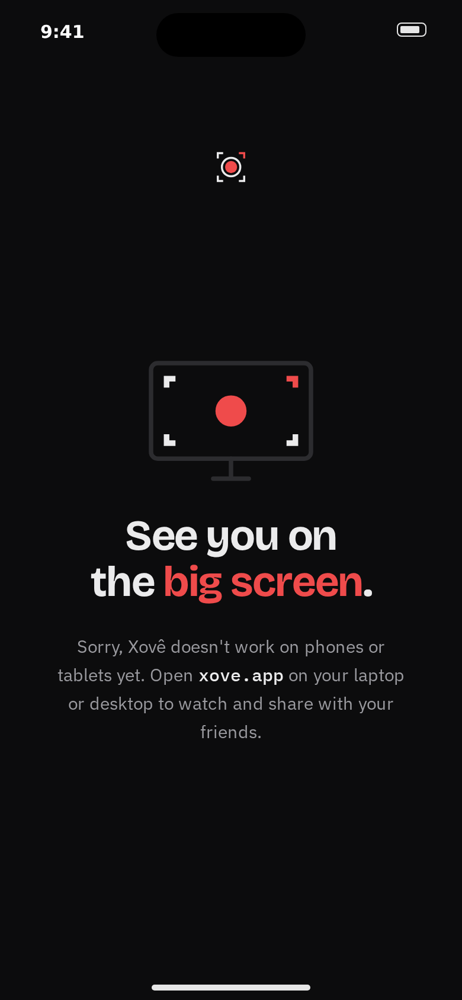

What a phone or a tablet sees on every page: the mark, a computer drawn from it, "See you on the big screen." and one line ([how it looks](../design.md#phones-and-tablets-see-you-on-the-big-screen)). Already in the new structure: `features/phone-notice/` (the page, and `big-screen-art/` for the drawing), chosen by `routes/root/root.component.tsx` with `services/media-devices-service/utils/is-handheld.util.ts`.

Not pictured here, but listed with their area above: the stage's notices, the voice's audio element, the mic test inside the settings, the toast and the tooltip.
