# Today's app, component by component

Every visual piece of the web app **as it is today** (desktop), with a picture, what it does, where its code lives now, where it goes in the [new structure](../architecture.md#where-the-code-is-going), and what happens to it. The app is being reorganised into that structure as it is, with no change of behaviour, before the [next version](next.md) is built; this page is the starting point and is kept current as pieces move.

**What happens to it:** *Kept* moves into its folder and is rewritten to the [rules](../architecture.md#where-the-code-is-going), behaving as today. *Replaced* means the next version brings a new piece for the same job, after the reorganisation. *Merged* means several copies become one shared component. *Removed* goes with phone support, which is paused: the app is desktop only for now.

Pictures: the room at 1920 × 1080, with fake people and moving pictures.

| Section | |
| --- | --- |
| [The header](#the-header) | The bar along the top of the room. |
| [The stage](#the-stage) | The stream and everything on and around it. |
| [Around the room](#around-the-room) | The settings, the footer, the queue and the pages outside the room. |
| [Building blocks](#building-blocks) | The shared controls, and the copies that become one |
| [Removed](#removed) | Phone-only code |

## The header

The bar along the top of the room.

### Header

<table><tr>
<td>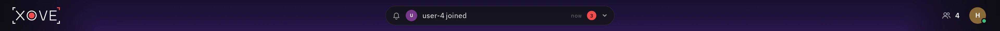 The whole bar</td>
</tr></table>

The room's top bar: the wordmark at the left, the activity pill in the middle, the people button and my account button at the right.

| Today | Goes to | What happens |
| --- | --- | --- |
| `components/room/RoomHeader.tsx` | `features/room/header/header/` | Kept, then redrawn in the next version |

### Wordmark

<table><tr>
<td>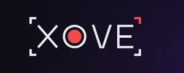 In the header</td>
</tr></table>

Xovê's name and mark, drawn with its red corner; it animates on hover.

| Today | Goes to | What happens |
| --- | --- | --- |
| `components/brand/XoveMark.tsx`, `XoveIcon.tsx`, `parts.tsx`, `useMarkAnimation.ts`; its geometry in `brand/mark.ts`, `markTimeline.ts` | `shared/ui/wordmark/` (its geometry in `shared/utils/`) | Kept |

### Activity pill and list

<table><tr>
<td>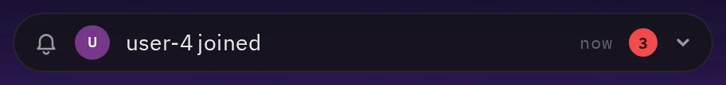 The pill: the latest event and how many are new</td>
<td>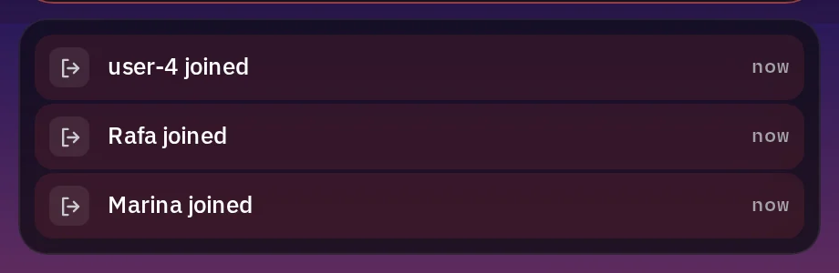 Opened: the list of events</td>
</tr></table>

What happened in the room (someone joined, went live), as a pill that opens a list.

| Today | Goes to | What happens |
| --- | --- | --- |
| `components/room/ActivityPill.tsx`, `ActivityList.tsx`, `activityText.ts` | `features/room/header/activity-pill/`, `activity-list/` (the text in `utils/`) | Kept; the next version's bell replaces the pill |

### People button

<table><tr>
<td>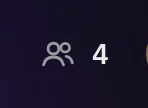 How many are here</td>
<td>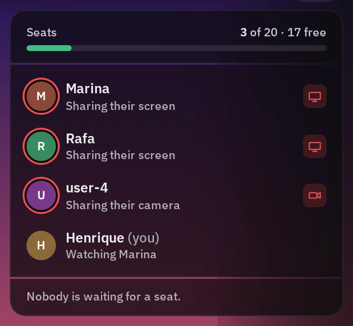 Opened: the seats and who&#x27;s here</td>
</tr></table>

How many people are here; it opens the seats and the list of people with what each one shares or watches.

| Today | Goes to | What happens |
| --- | --- | --- |
| `components/room/PeopleButton.tsx` | `features/room/header/people-button/` | Kept; the next version's people column replaces it |

### Account button and menu

<table><tr>
<td>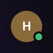 My picture</td>
<td>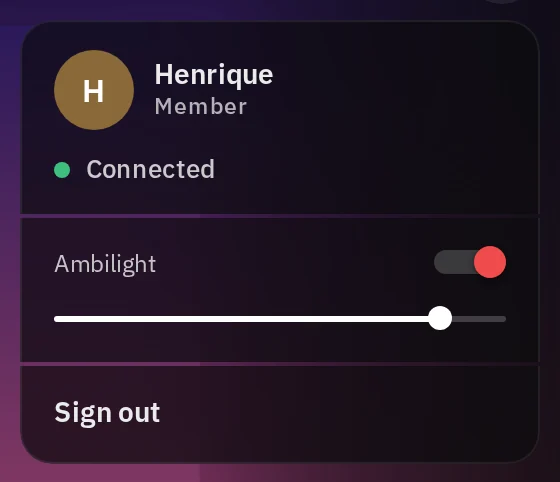 Opened: who I am, the ambilight&#x27;s switch and brightness, sign out</td>
</tr></table>

My picture; it opens my menu.

| Today | Goes to | What happens |
| --- | --- | --- |
| `components/room/AccountButton.tsx` (it holds a switch, a slider and the footer's items) | `features/room/header/my-picture-button/`, `my-menu/` (on the shared Menu, Switch and Slider) | Kept |

## The stage

The stream and everything on and around it.

### Stage

<table><tr>
<td>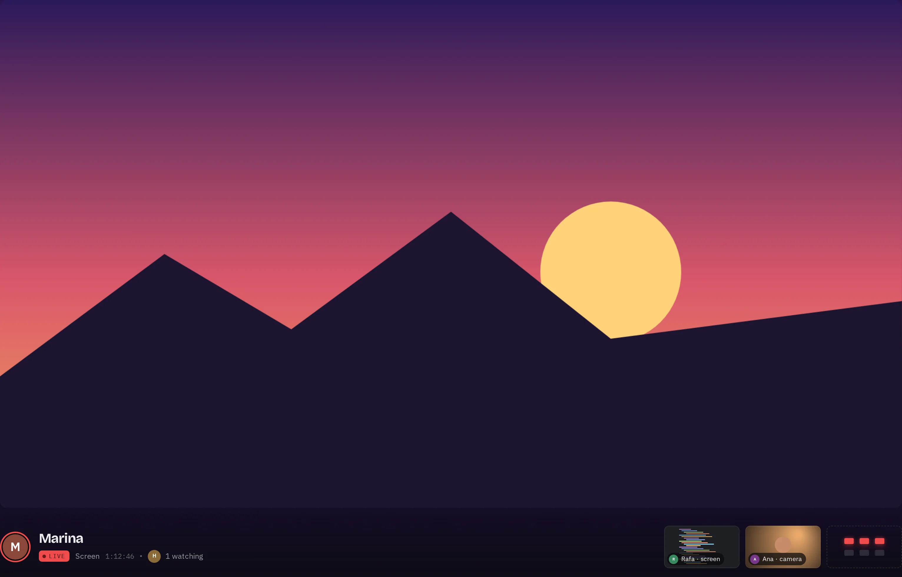 The stage with its info row and previews</td>
<td>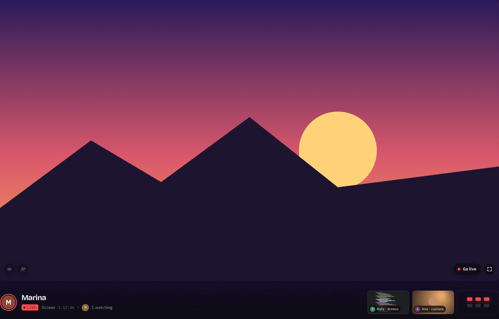 Its controls, shown while the pointer moves</td>
</tr></table>

The stream being watched, as large as the room allows, with its controls in the corners, and the info row and previews under it.

| Today | Goes to | What happens |
| --- | --- | --- |
| `components/stage/Stage.tsx` (one file holds audio, quality, fullscreen, the controls' idle, gestures and layouts) | Split into `features/room/stage/stage/`, `stage-light/`, `screen-video/`, `voice-audio/`, `stage-notice/`, with hooks for hearing and the idle | Kept, split into its pieces |

### Stage light (ambilight)

<table><tr>
<td> The light around the stage</td>
</tr></table>

The stream's own colours glowing around the stage, drawn from its edges on a small canvas.

| Today | Goes to | What happens |
| --- | --- | --- |
| `components/stage/Ambilight.tsx`; the maths in `media/ambilight.ts` | `features/room/stage/stage-light/` (the maths in `utils/`) | Kept |

### Viewer bar

<table><tr>
<td>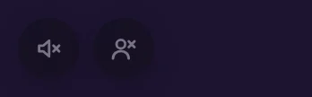 What I hear from the person I watch</td>
<td>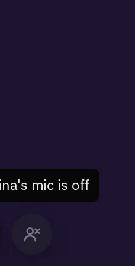 A sound&#x27;s button, with its tooltip</td>
</tr></table>

Over someone else's stream: each sound I hear from them (screen sound, voice) as its own button with a slider; my mic or Go live at the right.

| Today | Goes to | What happens |
| --- | --- | --- |
| `components/stage/ViewerBar.tsx` | `features/room/stage/viewer-bar/` (on the shared Icon button, Slider and a hold-or-rest hook) | Kept; the next version's stage controls replace it |

### Go live menu

<table><tr>
<td>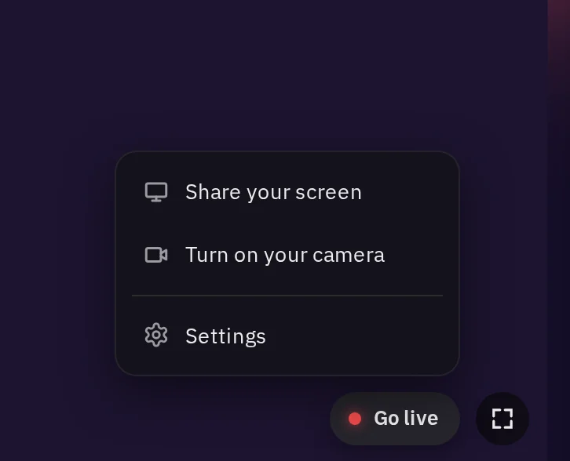 Share my screen, turn on my camera, settings</td>
</tr></table>

Starts what I share, from a drop-up over the stage.

| Today | Goes to | What happens |
| --- | --- | --- |
| In `ViewerBar.tsx`, on `components/ui/DropUp.tsx` | On the shared Menu | Kept; the next version's send buttons replace it |

### Player buttons

<table><tr>
<td>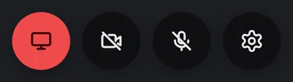 My stream&#x27;s round buttons: screen, camera, mic, settings</td>
</tr></table>

Over my own stream: my screen, camera and mic, on or off, and the settings.

| Today | Goes to | What happens |
| --- | --- | --- |
| `components/stage/PlayerButtons.tsx`, its icons in `icons.tsx` | `features/room/stage/player-buttons/` (on the shared Icon button and icons) | Kept; the next version's send buttons replace it |

### Stage overlay

<table><tr>
<td>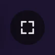 Fullscreen</td>
</tr></table>

The stage's fullscreen button.

| Today | Goes to | What happens |
| --- | --- | --- |
| `components/stage/StageOverlay.tsx` | `features/room/stage/stage-overlay/` | Kept; the next version's stage controls replace it |

### Facecam

<table><tr>
<td>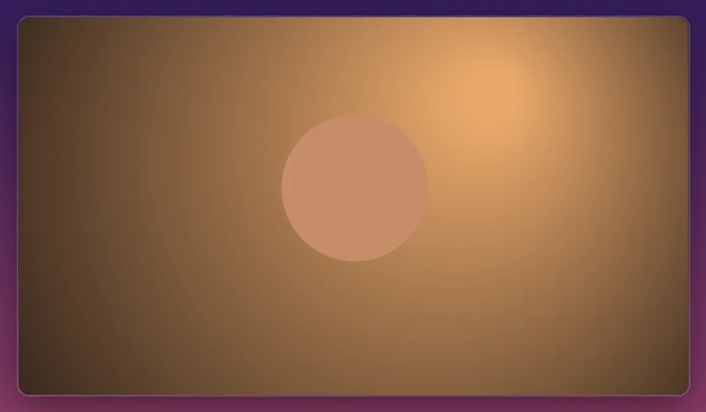 The camera over the screen</td>
<td>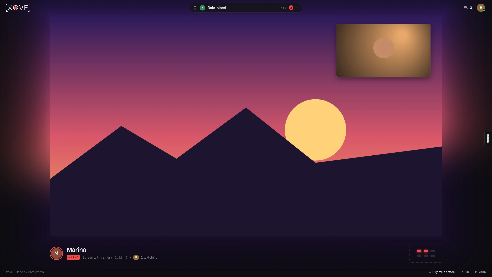 In the room</td>
</tr></table>

When someone shares their screen and their camera, the camera sits over the screen; it can be swapped, minimised and dragged.

| Today | Goes to | What happens |
| --- | --- | --- |
| `components/stage/Facecam.tsx` | `features/room/stage/facecam/` | Kept |

### Empty stage

<table><tr>
<td>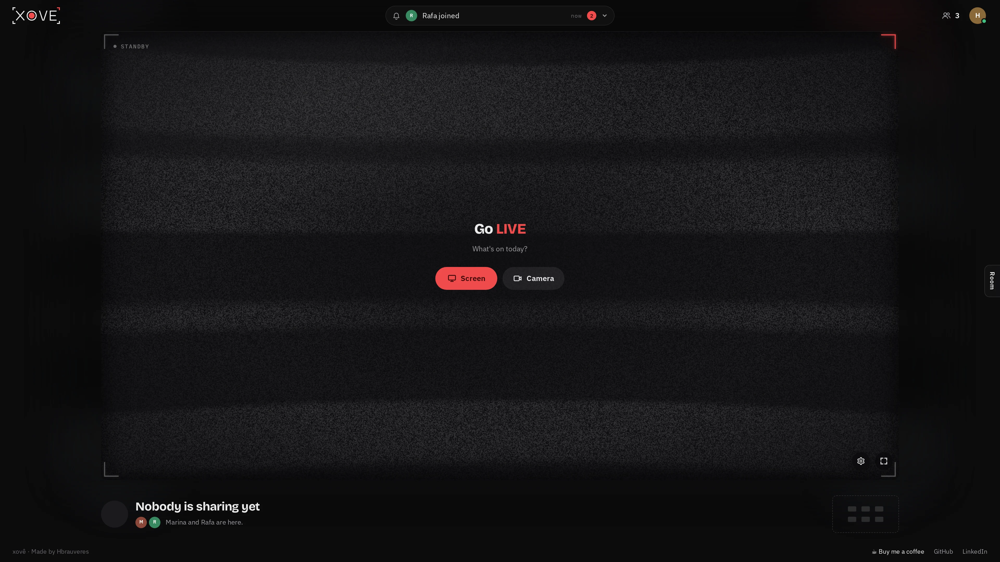 Nobody is live: a TV on standby</td>
</tr></table>

When nobody shares: a TV on standby, with its static and glow, and the ways to start.

| Today | Goes to | What happens |
| --- | --- | --- |
| `components/stage/EmptyStage.tsx`, `StaticNoise.tsx`, `StaticGlow.tsx`, `CornerGlow.tsx`, `staticBands.ts` (with a module-level flag) | `features/room/stage/empty-stage/` (the flag becomes state) | Kept |

### Now watching

<table><tr>
<td>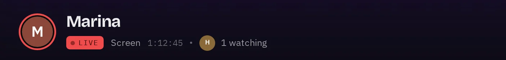 Who&#x27;s on the stage, live for how long, and who watches</td>
</tr></table>

Under the stage: whose stream it is, what it is, how long it's been live and who's watching.

| Today | Goes to | What happens |
| --- | --- | --- |
| `components/stage/NowWatching.tsx` | `features/room/stage/now-watching/` | Kept; the next version shows it in the people column |

### Also live, preview tray and hear toggles

<table><tr>
<td>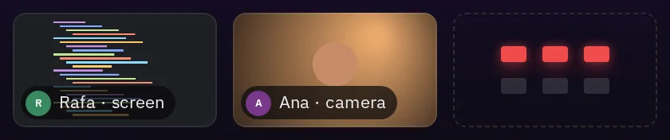 The other streams, and the free seats</td>
<td>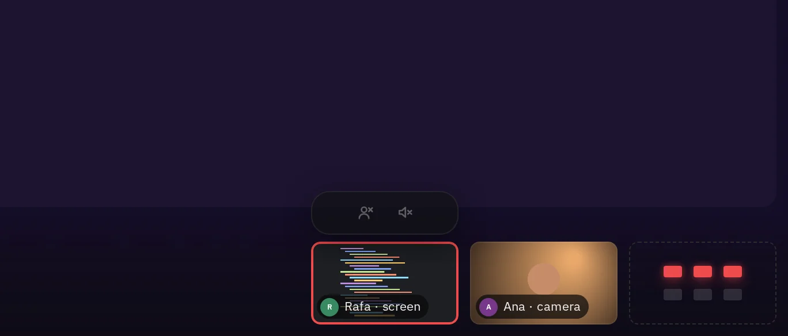 Pointing at a preview: its sound buttons</td>
</tr></table>

The other live streams as small previews, the seats still free, and, over a preview, its own sound buttons.

| Today | Goes to | What happens |
| --- | --- | --- |
| `components/stage/AlsoLive.tsx`, `PreviewTray.tsx`, `usePreviewTray.ts`, `HearToggles.tsx`, `stack.ts` | `features/room/stage/also-live/`, `preview-tray/`, `hear-toggles/`, on one shared live preview | Kept; the next version's people column and live preview replace them |

### My stream

<table><tr>
<td>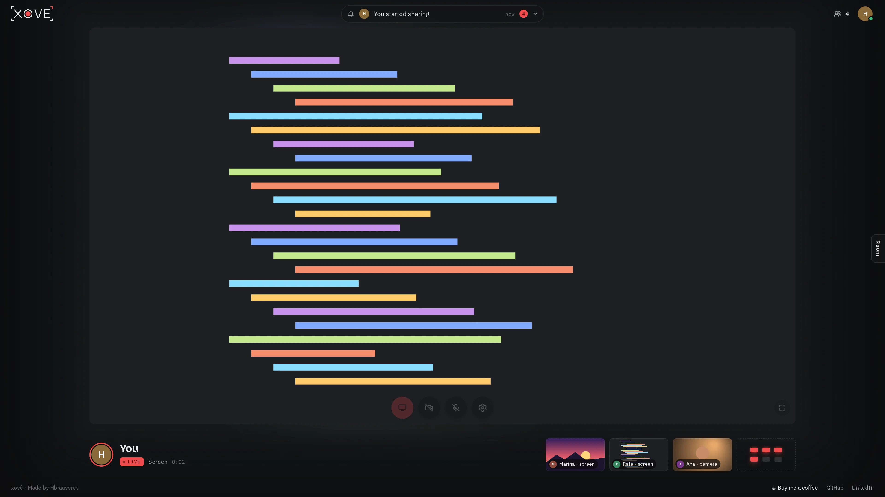 Me sharing my screen</td>
</tr></table>

The room while I share: my stream on the stage with my own buttons.

| Today | Goes to | What happens |
| --- | --- | --- |
| `Stage.tsx`, `PlayerButtons.tsx` | As above | Kept |

## Around the room

The settings, the footer, the queue and the pages outside the room.

### Settings panel

<table><tr>
<td>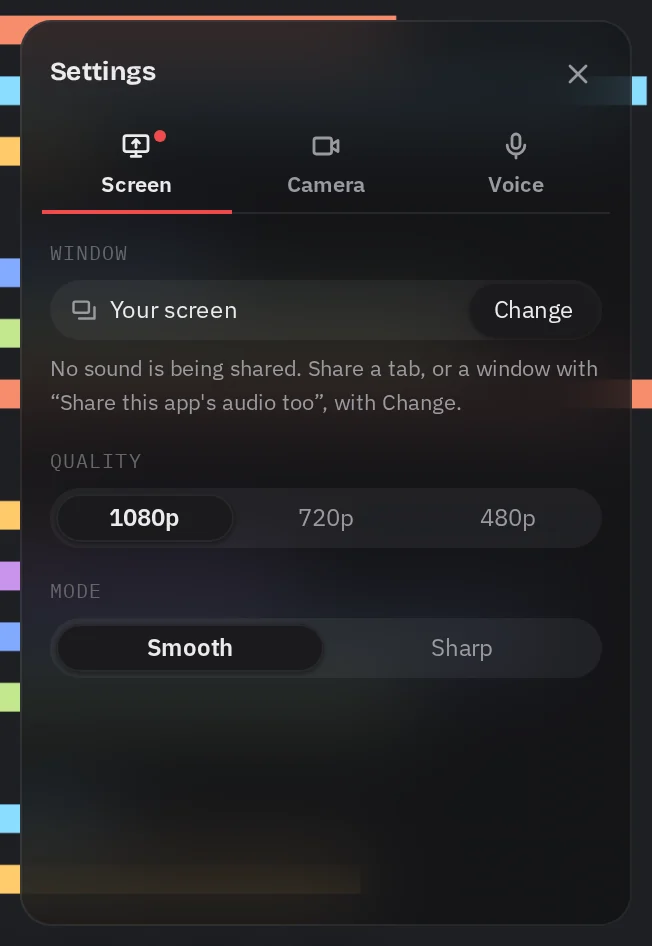 Screen, camera and voice settings</td>
</tr></table>

What I send: the screen, the camera and the voice, each a tab, with its quality and devices, and a mic test.

| Today | Goes to | What happens |
| --- | --- | --- |
| `components/stage/SettingsPanel.tsx` (four jobs in 527 lines), `MicTest.tsx` | `features/settings/` (a shell on the shared Panel, one folder per tab, `mic-test/`) | Kept |

### Room footer

<table><tr>
<td>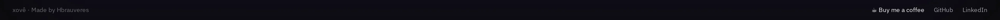 The footer&#x27;s links</td>
</tr></table>

The room's footer: credits and links.

| Today | Goes to | What happens |
| --- | --- | --- |
| `components/room/RoomFooter.tsx` (its phone half goes) | `features/room/room-footer/` | Kept; decided again with the next version |

### Waiting room

<table><tr>
<td>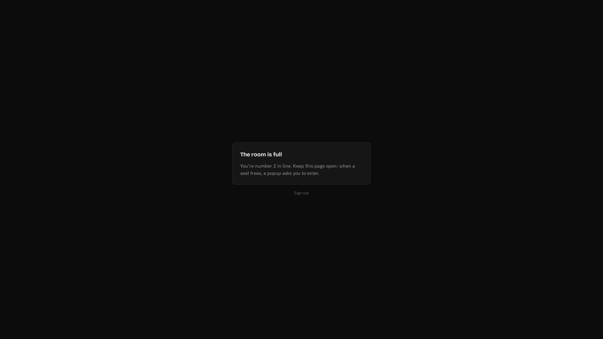 The room is full: waiting for a seat</td>
</tr></table>

When the room is full: waiting for a seat, and the offer when one frees.

| Today | Goes to | What happens |
| --- | --- | --- |
| `components/room/WaitingRoom.tsx`, `SeatOffer.tsx` | `features/room/queue/waiting-room/`, `seat-offer/` | Kept |

### Sign-in

<table><tr>
<td>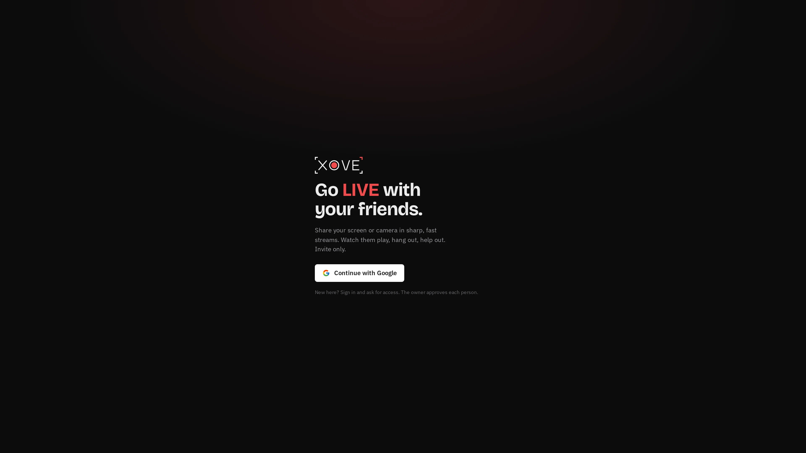 Signed out</td>
</tr></table>

The first page: what Xovê is, and signing in with Google.

| Today | Goes to | What happens |
| --- | --- | --- |
| `pages/HomePage.tsx` | `features/home/` (on the shared Page shell) | Kept |

### Request access

<table><tr>
<td>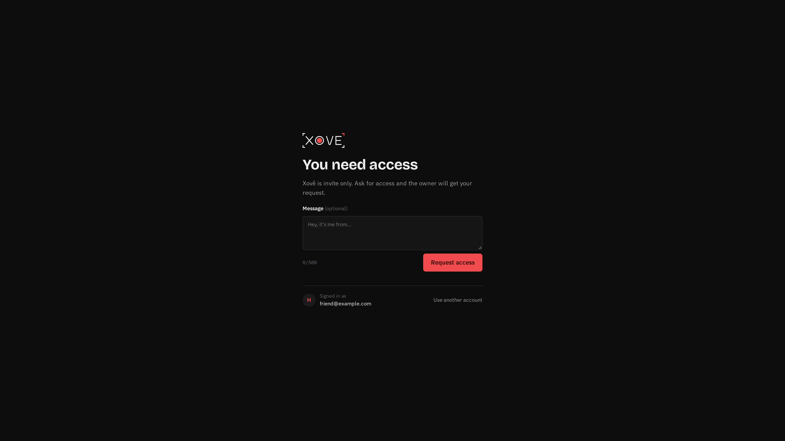 Asking to join</td>
<td>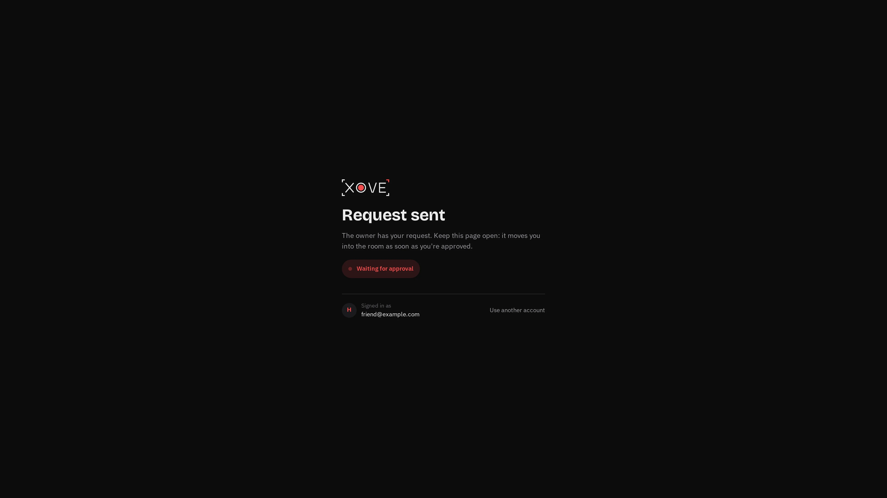 Request sent</td>
</tr></table>

Asking to join, and the wait for an answer.

| Today | Goes to | What happens |
| --- | --- | --- |
| `pages/RequestAccessPage.tsx` | `features/request-access/` | Kept |

### Admin

<table><tr>
<td>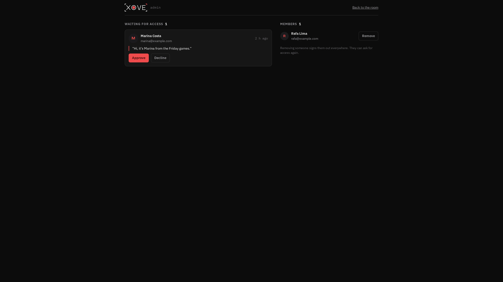 Requests and members</td>
</tr></table>

For the admin: the access requests and the members.

| Today | Goes to | What happens |
| --- | --- | --- |
| `pages/AdminPage.tsx` | `features/admin/` | Kept |

## Building blocks

The shared controls today, and the copies that become one component each.

| Block | Today | Goes to | What happens |
| --- | --- | --- | --- |
| Button | `components/ui/Button.tsx` | `shared/ui/button/` | Kept |
| Slider | `components/ui/Range.tsx` | `shared/ui/slider/` | Kept |
| Segmented control | `components/ui/Segmented.tsx` | `shared/ui/segmented/` | Kept |
| Picker, drop-up, dropdown | `components/ui/Picker.tsx`, `DropUp.tsx`, `Dropdown.tsx`, `floating.ts` | `shared/ui/menu/`: one floating system for all of them | Merged |
| Tooltip | `components/ui/Tooltip.tsx` | `shared/ui/tooltip/`, on the Menu's floating layer | Kept |
| Avatar | `components/ui/Avatar.tsx`, `PersonAvatar.tsx` | `shared/ui/face/`: one face with sizes and states | Merged |
| Round button | `components/stage/RoundButton.module.css`, and copies in `ViewerBar`, `HearToggles`, `StageOverlay` and the header's buttons | `shared/ui/icon-button/`: one component with variants | Merged |
| Switch | CSS in `AccountButton.module.css` and `SettingsPanel.module.css` | `shared/ui/switch/` | Merged |
| Icons | `components/stage/icons.tsx`, `components/room/ActivityIcon.tsx`, and inline drawings in 14 files | `shared/ui/icons/` | Merged |
| Toast | `components/ui/Toast.tsx`, `toast.ts` | `shared/ui/toast/` | Kept |
| Full-page message | `components/ui/FullPageMessage.tsx` | `shared/ui/page-shell/`, with the pages' copied shells | Merged |
| LIVE dot | `components/ui/LiveDot.tsx` | — | Removed: nothing uses it |

## Removed

Phone support is paused, so its code goes, with its tests.

| What | Today |
| --- | --- |
| The install screen and prompt | `pages/InstallPage.tsx`, `install/`, `hooks/useInstalled.ts` |
| Swipes and taps | `hooks/useStageSwipe.ts`, `hooks/useTapToggle.ts`, `components/stage/StageDots.tsx` |
| The phone's layouts | The phone and sideways branches of `Stage`, `RoomPage` and `hooks/useRoomLayout.ts`; `components/room/ActivityBell.tsx`; `components/stage/StreamsRow.tsx`, `LiveFeed.tsx`, `HereCards.tsx`, `hereFor.ts`, `makeRoom.ts`; the compact Now watching; the phone half of the footer; the safe areas |

Not pictured here, but listed with their area above: the stage's notices, the voice's audio element, the mic test inside the settings, the toast and the tooltip.
