# Design sheet

Everything Xovê looks like, in one place: the name, the mark, the icons, the colours, the type, the shapes and motion, every control, and each screen on desktop, tablet and phone. It's the reference for new work: **use what's here before adding anything new**, and update this page in the same PR when the look changes.

The pictures are shot from the real app (`design-sheet.mjs`, see [Keeping this page current](#keeping-this-page-current)). The values come from the code: `app/src/styles/global.css` (the tokens), `app/src/brand/` (the mark) and each component's CSS module.

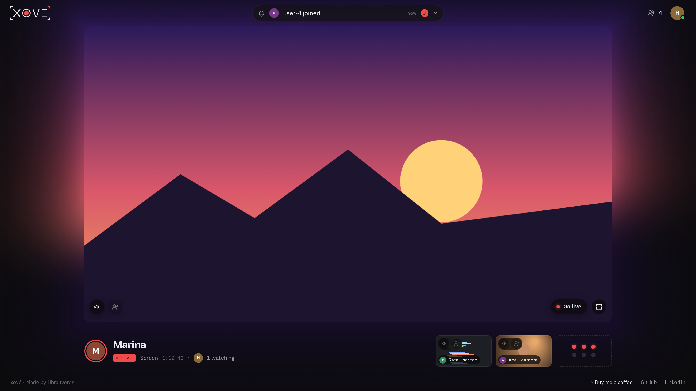

## Contents

- [Name and voice](#name-and-voice)
- [The mark](#the-mark)
- [Icons and favicon](#icons-and-favicon)
- [Colour](#colour)
- [Type](#type)
- [Shape and spacing](#shape-and-spacing)
- [Motion](#motion)
- [Controls](#controls)
- [Notifications and status](#notifications-and-status)
- [Screens and layouts](#screens-and-layouts)
- [Accessibility](#accessibility)
- [Rules for new work](#rules-for-new-work)
- [Keeping this page current](#keeping-this-page-current)

## Name and voice

- **Xovê**, with the circumflex, in every sentence and label. `xove` only where an accent can't go: the domain (`xove.app`), repos, code, image and container names. The wordmark is written in capitals, **XOVE**, and its red corner stands in for the ^.
- **Short, plain sentences**, in sentence case: "Share your screen", "Full-screen view", "Nobody live · 0 of 6 · 6 free", "Xovê works best from your home screen". No exclamation marks, no jargon.
- **Say what happens, then what to do:** "The room is full. You're 2nd in line." A disabled control says why in its tooltip.
- **The middle dot (·)** joins short facts on one line: "Marina · Screen", "3 of 6 live · 3 free".
- **Every control has a spoken name** (`aria-label`) that says what it does or what it shows: "Watch Rafa's screen", "4 people here", "Marina: account, connected".

## The mark

- **The wordmark:** [XOVE] in a slim viewfinder. The O is a record button: a white ring as thick as the letters and a red dot inside. Four corners frame the word; the **top-right corner is red**.
- **The symbol:** the record O alone, inside the same four corners. It's the app icon and the favicon.
- **Construction** (`app/src/brand/mark.ts`, the only place the geometry lives): one grid with a cap height of 100 and a stroke of 10. Letter widths X 88, O 100, V 90, E 68, gaps 20. The viewfinder sits 28 from the letters, with arms of 24 (26 in the symbol). The dot's radius is 29.4 in an O 100 across. The X ends square, the V's tips are cut flat at the cap height.
- **Colours:** white strokes (`--text`, `#ebebec`), the red dot and corner (`--accent`, `#ef4b4b`), on the soft black ground. Never recoloured, outlined, stretched or put on a busy picture.
- **Drawn, not typed:** `components/brand/XoveMark` (the wordmark, inline SVG, named "Xovê" for screen readers) and `XoveIcon` (the symbol). In the header it's about 110 px wide.
- **The hover animation** (`brand/markTimeline.ts`, `useMarkAnimation`): pointing at the wordmark (or focusing it) plays it once, in about 3 seconds. The left corners stay and the word slides under them until the X is gone, while the right corners close in on the O; the corners settle into the symbol; the dot double-blinks like a surprised eye; everything plays back. A new hover doesn't restart it, and it never plays with reduced motion.
- **Three optical sizes of the symbol** (`iconMark("large" | "small" | "tiny")`): **large** (64 px and up) is slim, about 70% of its square; **small** (32 px) and **tiny** (16 px) have heavier strokes and fill more of the square, tiny edge to edge. The outer edges match in all three.

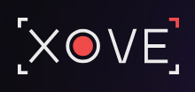

## Icons and favicon

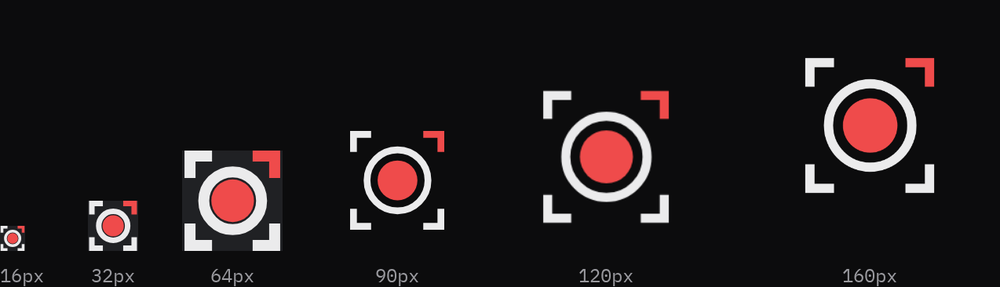

| File | What | Notes |
| --- | --- | --- |
| `app/public/favicon.svg` | The tiny symbol, for the tab and bookmarks | Its white parts turn soft black when the browser is in light mode (a `prefers-color-scheme` rule inside the file); the red stays |
| `apple-touch-icon.png` | iPhone home screen | The large symbol on the soft black ground |
| `icon-192.png`, `icon-512.png` | Android home screen, install prompt | Same |
| `icon-maskable-512.png` | Android's shaped icons (circle, squircle) | The mark sits inside the 80% safe circle (its farthest pixel 191 px from the centre, the safe radius 205) |
| `site.webmanifest` | Name, icons, `theme_color` and `background_color` `#0c0c0d`, `display: fullscreen` | Opened from the home screen, no browser bar |

`node scripts/brand-icons.mjs` (from `app/`) rewrites the favicon from `mark.ts`; `--maskable` renders the maskable icon, and `--phone` prints the SVG the phone icons are rendered from. A test fails if the favicon drifts from the geometry.

**Interface icons** are drawn inline as SVG in the components, on a 20 × 20 grid (12 × 12 for the small arrows), with round 1.5–2 px strokes in `currentColor`, so they take the colour of their button. There's no icon library: a new icon follows the same grid and stroke.

## Colour

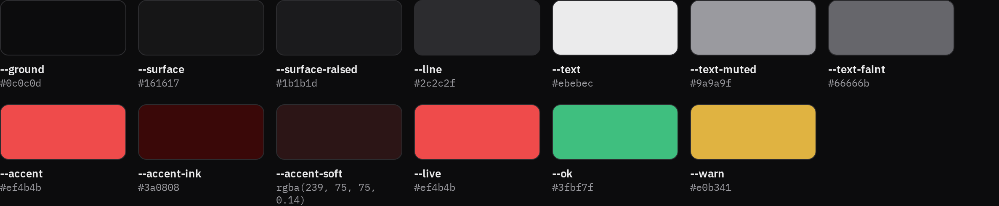

Dark only: Xovê is a room for watching screens, so the chrome stays out of the way of whatever is on the stage.

| Token | Value | Use |
| --- | --- | --- |
| `--ground` | `#0c0c0d` | The page: soft black |
| `--surface` | `#161617` | Panels |
| `--surface-raised` | `#1b1b1d` | Raised surfaces, hovers on ghost buttons |
| `--line` | `#2c2c2f` | Borders and dividers |
| `--text` | `#ebebec` | Text, white strokes, the mark |
| `--text-muted` | `#9a9a9f` | Secondary text |
| `--text-faint` | `#66666b` | Labels that can be faint (3:1 at least) |
| `--accent` | `#ef4b4b` | **The one accent**, red, the record light: live pills, on-air rings, the unseen count, focus rings, the switch when on, primary buttons |
| `--accent-ink` | `#3a0808` | Text and icons on a red fill (4.7:1) |
| `--accent-soft` | `rgba(239, 75, 75, 0.14)` | Soft red glows and tints |
| `--live` | `#ef4b4b` | LIVE, the live dot, danger buttons |
| `--ok` | `#3fbf7f` | Connected, the seats bar, the mic level when it's sent |
| `--warn` | `#e0b341` | Reconnecting |
| `--glass` | `rgba(10, 10, 11, 0.72)` | The round buttons, drop-ups and pickers over the video (with an 8 px blur) |
| `--panel` | `rgba(18, 18, 20, 0.74)` | The settings panel (with a 22 px blur) |
| `--panel-line` | `rgba(255, 255, 255, 0.08)` | The panel's border and its tabs' line |
| `--sel-bg` | `var(--surface-raised)` | The dark pill of a chosen option, and buttons in a row (Change) |
| `--sel-shadow` | `0 1px 2px rgba(0, 0, 0, 0.4)` | Its shadow |
| `--sel-hover` | `#26262a` | A button in a row, pointed at |

- **Pure black `#000` only behind the video:** the stage, the previews, the facecam and the camera's preview in the settings, as the picture's own frame. Nowhere else. A picture that fills the stage (its shape within 1% of the stage's) has nothing black behind it, so no sliver shows at an edge.
- **The speaking greens**, only for "this person is speaking": the tube `#2bcd68` at 85%, the icon `#45e087`, the glow `#16a34a`. Nothing else is green but "connected" and a mic level that's sent.
- **Red is rare on purpose:** it means the brand or something live. Sliders are white and the switch is grey until it's on.
- **Avatars** without a photo get the person's own hue: `hsl(<hue> 42% 38%)` with a white initial.
- **The empty stage** is one flat dark (`#0f0f11`: a gradient this dim shows bands); its corners glow softly, each in its own colour (a slightly blue grey, the top right red).
- **The ambilight** takes its colour from the picture, never from the palette.
- **Contrast:** every text colour reaches 4.5:1 on every surface, 3:1 for faint labels. `styles/palette.test.ts` computes it and rejects the old palettes (amber, blue-tinted greys).

## Type

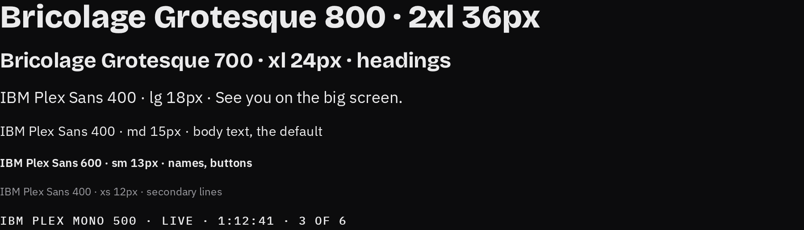

| Font | Token | Use |
| --- | --- | --- |
| **Bricolage Grotesque** 500 / 700 / 800 | `--font-display` | Headings, the name of who's on the stage, big statements ("Be the first to go live") |
| **IBM Plex Sans** 400 / 500 / 600 | `--font-body` | Everything else: body, buttons, names in lists |
| **IBM Plex Mono** 400 / 500 | `--font-mono` | Counters and times: LIVE, `1:12:41`, section labels like "LIVE NOW", the empty stage's camera display |

| Size token | rem | px | Typical use |
| --- | --- | --- | --- |
| `--text-xs` | 0.75 | 12 | Secondary lines, timestamps |
| `--text-sm` | 0.8125 | 13 | Names in rows, small buttons, captions |
| `--text-md` | 0.9375 | 15 | Body (the default), buttons |
| `--text-lg` | 1.125 | 18 | Stage messages, dialog titles |
| `--text-xl` | 1.5 | 24 | Page headings |
| `--text-2xl` | 2.25 | 36 | The largest headings |

Body line height is 1.5; headings balance their lines (`text-wrap: balance`). Fonts load from Google Fonts with `display=swap`; fallbacks are Segoe UI and the system sans.

## Shape and spacing

| Token or value | Use |
| --- | --- |
| `--radius-sm` 6 px | Buttons, the facecam, small boxes |
| `--radius-md` 10 px | Cards, dialogs (the seat offer) |
| 16 px | Dropdown panels |
| 999 px (pill) | Round buttons, the activity pill, badges, dots |
| `--gutter` 16 px | The page's side margin, and the minimum on a phone |

- **Frosted glass** for things floating over the stage or the page: dark at 72–74% with a blur (8 px for the round buttons, 22 px for panels).
- **Clear cuts:** stacked panel sections are separated by a 2 px gap that shows the page behind, never a drawn line.
- **Touch targets** are at least about 36 px (the switch keeps a 36 × 20 px target; the stage's dots an 18 px one around a 6 px dot).

## Motion

| What | Duration | Easing |
| --- | --- | --- |
| Button hover and press | 120 ms (press moves 1 px down, 80 ms) | ease |
| The round buttons' row back to the centre, once the pointer leaves | 220 ms | `cubic-bezier(0.2, 0.8, 0.2, 1)` |
| Slider knob growing | 120 ms | — |
| Switch knob | 180 ms | ease |
| Stage dots | 180 ms | ease |
| Dropdown unroll and roll back | 260 ms, by its height | `cubic-bezier(0.2, 0.8, 0.2, 1)` |
| The settings panel coming in and going out (over the cog: a fade and a 6 px rise; the sheet from the bottom) | 140 ms fade, 180 ms rise; the sheet 260 ms | `cubic-bezier(0.2, 0.8, 0.2, 1)` |
| The toast coming in and going out (a fade and a 6 px drop), and how long it stays | 160 ms fade, 200 ms drop; stays 3 s | `cubic-bezier(0.2, 0.8, 0.2, 1)` |
| The settings' tab marker; a segmented control's pill | 200 ms | `cubic-bezier(0.2, 0.8, 0.2, 1)` |
| A drop-up: the pause before it unrolls | 120 ms resting on the button | — |
| …its fade and 6 px slide up | 140 ms and 180 ms; a slip outside shorter than 300 ms doesn't close it | ease, `cubic-bezier(0.2, 0.8, 0.2, 1)` |
| A sound's slider unrolling over its button: resting the mouse on it, or holding it by touch | after 120 ms at rest, 500 ms held; closes after 4 s without a touch | `cubic-bezier(0.2, 0.8, 0.2, 1)` |
| The speaking cue lighting and going out (a button's, a preview's ring) | 120 ms | ease |
| A small preview's row unrolling from its preview and rolling back into it; moving to another preview, one rolls back as the next unrolls | 260 ms (`--unroll`), fading in 200 ms | `cubic-bezier(0.2, 0.8, 0.2, 1)` |
| The row's slider unrolling after its buttons, and rolling back | 300 ms; 240 ms back | `cubic-bezier(0.2, 0.8, 0.2, 1)`; `cubic-bezier(0.4, 0, 0.2, 1)` back |
| Switching the row's slider to the other sound: the old bar shrinks to the left, the new one grows from it, the icons crossfading | 220 ms shrink; 260 ms grow, 120 ms later | `cubic-bezier(0.4, 0, 0.2, 1)`; `cubic-bezier(0.2, 0.8, 0.2, 1)` |
| A stacked preview's swap: the picture behind comes forward | 360 ms | `cubic-bezier(0.2, 0.8, 0.2, 1)` |
| The buttons rising above the open streams row, and settling back | 280 ms, with the row | ease |
| A picker's chevron turning | 200 ms | `cubic-bezier(0.2, 0.8, 0.2, 1)` |
| The cue: a control pointed at (a sharp red border pulsing in place, with a slight glow) | two 1 s pulses, then lit until the next press; still with reduced motion | ease-in-out |
| A list unrolling from its pill, its options fading in by their distance (40 ms apart), and rolling back | 220 ms; 150 ms back | `cubic-bezier(0.2, 0.8, 0.2, 1)`; ease-in back |
| The soft light behind an option pointed at | 160 ms | ease |
| The player moving up for the settings sheet (upright full view) and back | 260 ms | `cubic-bezier(0.2, 0.8, 0.2, 1)` |
| A new activity in the pill | 350 ms | ease |
| Facecam buttons fading | 250 ms | ease |
| The stage resizing to a new picture | 350 ms | ease |
| Controls over a playing stream | fade after about 2.5 s without a touch or mouse move; back on any mouse move; by touch, a tap on empty space shows or hides them; an open streams row and a heard voice stay | 250 ms fade |
| The ambilight following the picture | 120 ms time constant, with the screen's refresh (at most 60 a second) | — |
| The live dot's ping | 1.8 s, looping | ease-out |
| The mark's hover animation | about 3 s, once | — |

- **Panels never clip, fade or filter** while they move: that would stop their blur. They unroll by their height.
- **With reduced motion**, every animation and transition is cut to nothing (a global rule), the mark doesn't play, swipes change at once and the ambilight updates every 500 ms. A round button that comes or goes still never moves the one under the pointer.

## Controls

### Round buttons

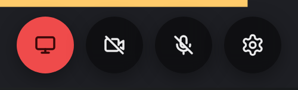 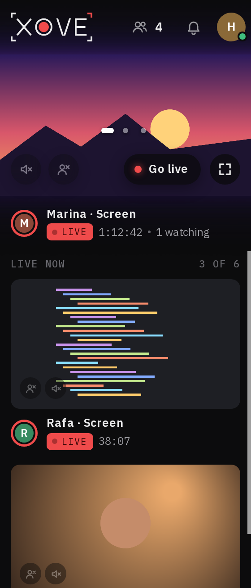

**Controls by owner** (a rule for every control): over **someone else's stream**, the left corner is what I hear from them and the right corner is me ([below](#what-i-hear-and-go-live)), nothing of mine in the middle; over **my own stream**, my controls in the middle. A control goes on the side of whoever it belongs to. **A mic icon always means my mic**; someone else's voice is a speaking head.

- **48 px** circles in a pill (44 px on a phone held upright, 48 px again in its full-screen view and held sideways), 10 px apart (8 px on the upright phone); **on a stage narrower than 360 px, compact: 36 px, 6 px apart**, centred clear of the fullscreen button, so everything fits down to 280 px, the narrowest width supported (measured on the stage's own box, not the window). Every button of the stage, the sounds, Go live and the fullscreen button included, shares one centre line. Dark frosted glass (`rgba(10, 10, 11, 0.72)`, blur 8 px, shadow `0 4px 16px` black at 35%), with a 20 px icon.
- **One state system, on every round button:** **sending** (your screen, your camera) is a red pill (`--accent`) with the plain icon in deep red (`--accent-ink`); **off** is dark glass with the crossed icon in white; **unavailable** is 45% opacity, with the reason in the tooltip. Red means live (and, elsewhere, the brand and [the cue](#rules-for-new-work)).
- **The icons** (`components/stage/icons.tsx`): the screen is a crossed monitor while you're not sharing, and shows **a screen with an arrow up** while it's pointed at or focused, so it says what a click does (not while it's unavailable); while you share, the plain monitor. The camera is crossed while off, plain while on. My mic is crossed while off, plain and red while my voice is on. Settings is **a cog with teeth**.
- **Order**, centred at the bottom of my own stream: screen, camera, mic, settings. They show only on my stream (my tile, or the stage once I start a stream, which opens mine).
- **Plain on/off buttons, no arrows.** A click starts or stops; what you send is set in the [settings panel](#the-settings-panel), and while a stream is live, resting the mouse on its button unrolls its [drop-up](#drop-ups). With a mouse, a live button shows its drop-up instead of a tooltip.
- **Hover:** a glass pill lightens to `rgba(40, 40, 44, 0.85)` in 120 ms (only with a mouse); a red pill and an unavailable one don't change. **Focus** draws one red ring around the pill.
- **Which ones:** on my stream, my screen and camera, my mic, and the cog. On a phone, which can't share a screen, the screen button is **greyed out**, not hidden: faded, its crossed icon, and "This browser can't share a screen" as its description. In fullscreen they come along, and any error from starting is drawn over the player.
- **Unavailable** (a full room, no screen): 45% opacity, with the reason in the tooltip.
- **A button that opens a panel never also changes a setting** (the cog only opens the settings).
- **Never moving what you clicked:** while a mouse pointer rests on the row, the button under it stays exactly where it is when the row changes width (a touch doesn't stay, so nothing is held); once the pointer leaves, the row glides back to the centre in 220 ms.
- They fade with the rest of the controls while a stream plays, and come back on any move.

### What I hear, and Go live

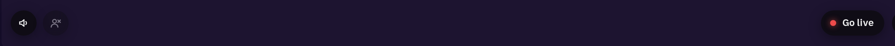

`components/stage/ViewerBar`: the corners over someone else's stream.

- **34 px** round buttons, as small as the fullscreen button, so the picture stays the subject; the round buttons' glass, a 16 px icon. The left corner is level with the fullscreen button; the right corner sits just left of it.
- **At the left, what I hear from them, each sound its own button in a fixed place:** their screen's sound (a speaker), then their voice (a speaking head). A sound that isn't there is greyed in its place (45%, its reason in the tooltip: "No sound in this stream", "Marina's mic is off"), and a touch says it in the [toast](#notifications-and-status).
- **A tap or click mutes and unmutes that one sound** (crossed while muted, pressed for screen readers). **Resting the mouse on it (120 ms) or holding it by touch (500 ms) unrolls its own slider** over it ([the slider](#sliders), upright); Tab opens it, Enter mutes. Moving a slider also unmutes; it closes after 4 s without a touch, a press outside, or as soon as a tooltip or a drop-up shows elsewhere ([one floating thing at a time](#drop-ups)). On an iPhone, which can't set a page's volume, each button is on and off, with no slider.
- **One switch per sound, following the person** (everywhere: the stage, a preview, the phone's feed): each person's sound and voice keep their own on/off and volume while I'm in the room. Until I touch it, a person is heard while on the stage and off while small; once I touch it, my choice stays, small or big. The volumes I set last are the start for the next person.
- **A heard voice never fades:** when the controls fade, the voice button of the person on the stage stays, alone in the bottom-left corner (the sound beside it folds away), so its speaking cue still shows; above the streams row when that's open. Muted or off, it fades with the rest. While faded it's a light, not a button: a tap brings the controls back.

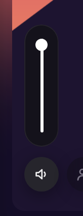 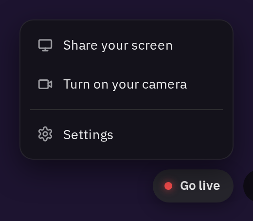

- **At the right, me:** my mic while I'm live (off by default, red while on); while I'm not, a **Go live** pill (a red dot, "Go live") whose menu offers my screen, my camera and the settings. Greyed where they can't start, saying why (a phone's screen; "6 streams are live" in a full room). The settings opened from it open over it.
- **Who's talking:** the voice button lights while the person speaks: a slim green neon tube (1 px, `#2bcd68` at 85%) with a soft glow inside and out (`#16a34a`), the icon brighter green (`#45e087`); silent, the plain button with the icon at 42%; voice off or muted (by them, or by me), the crossed icon, faded. It lights and goes out in 120 ms, and is still with reduced motion. My own stream never shows it: my mic says it.

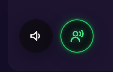

### Segmented controls

`components/ui/Segmented`: every choice between a few options (Quality, Mode) is one.

- A light translucent **track** as tall as the panel's controls, and **one dark pill** (`--sel-bg`, a 1 px inner line, `--sel-shadow`) that slides under the chosen option in 200 ms.
- An option pointed at gets **a soft light that fades only sideways** (white at 6% in the middle, nothing at its ends, the track's full height), fading in 160 ms, and its text goes from muted to white. **The chosen option doesn't react**: it's already chosen.
- Plain labels ("Smooth", "Sharp"), with what each does in its tooltip. A radio group: the arrow keys move the choice, with one tab stop.

### Pickers

`components/ui/Picker`: every choice from a list (which camera) is one, in any panel or over the video.

- **Closed:** a pill as tall as the other controls, the chosen option and a small chevron.
- **Open, it's one box with its pill:** the pill grows into the list with **no gap and no separate floating box**, in the pill's own colour. **The chosen option stays in the pill and isn't repeated**; the others follow in rows as tall as the pill, their text lined up with the pill's.
- **Every list floats:** nothing moves when one opens. **In a panel** it opens down over the controls under it, in the pill's own see-through colour: what's **right behind it is hidden** while it's open, so through it shows only the panel's frosted glass (a blur can't be told to skip what's under it), and what's **just under its bottom edge fades back in over 30 px**, starting 4 px below it, nearly invisible near the list (8% halfway, 35% at three quarters) and fully there at 30 px. Nothing else hides. **Over the video, it grows upward** in the pill's glass, never taller than the room above it, and **opens at the pill's end**: the option nearest the pill whole, the half-shown one at the top.
- **One width, whatever the names:** the pill and its list are always as wide as the picker's box; a name too long for it ends in "…" on one line, in the pill and in the list, the whole name its tooltip (screen readers read it whole).
- **A long list has a scrollbar:** after three and a half options it scrolls, with the app's slim scrollbar (4 px, no arrows) inside the list, its track kept clear of the rounded corners. A row's hover light (white at 5%) stays inside its row, so a short list never scrolls.
- **It unrolls** from its pill (upward from a drop-up's) in 220 ms, each option fading in as the edge reaches it, the nearest first, and **rolls back** in 150 ms; with reduced motion it just appears and goes.

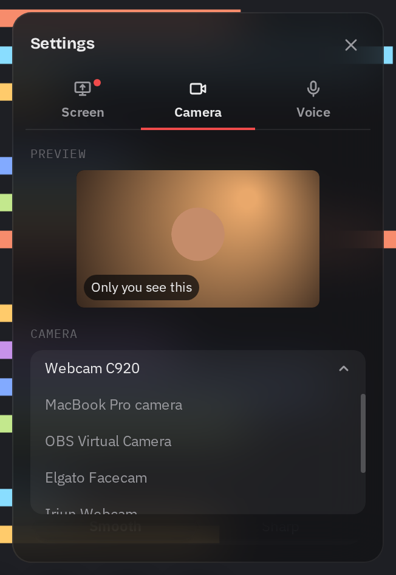
- The arrow keys move through it; Escape or a click outside closes it.
- **Cued** (from a live button, with the settings open), [the cue](#rules-for-new-work) goes round the pill and its open list together, over the list.

### Drop-ups

`components/ui/DropUp`: quick access to a live button's most used action, where the pointer already is. Any later quick action follows these rules.

- **One floating thing at a time** (with the [tooltips](#notifications-and-status)): a drop-up opening closes any other drop-up or tooltip at once, without its grace, and a tooltip showing elsewhere closes it; a tooltip on the drop-up's own controls (its picker) belongs to it and closes nothing. The sound sliders follow the same rule.
- **Resting the mouse on a live round button** unrolls one frosted pill above it, centred, after **120 ms**: the round buttons' glass, blur and shadow, **with no box around it**. It fades and slides 6 px; nothing blurred is animated.
- **Moving up into it keeps it open** (the gap is bridged), and on into an open list inside it. It closes when the pointer leaves, its list with it, **also right after a click**; a slip outside shorter than **300 ms** doesn't close it. Keyboard focus opens it; a click's focus doesn't keep it open.
- **By touch, press and hold the live button for 500 ms** (a long press, as on any phone): it opens and **stays open** after the finger lifts, until a tap outside it, its action done (a camera picked, Change), or the button pressed again. A finger that moves is scrolling, not holding. The button offers no text selection or long-press menu, and by touch the drop-up's controls are 44 px.
- **The button's own click or short tap still does what it always does** (stop the stream).
- **With the settings open, the gesture goes to the panel** instead: resting on a live button, or the 500 ms hold, opens nothing over the button; the panel switches to that button's tab and **cues** the control (Change; the camera's picker, its list opened). The keyboard's focus doesn't move the panel. A rule for any later quick action: when a panel already shows the controls, the quick action goes there.
- **Screen:** what's shared ("A window", "A tab" or "Your whole screen") and **Change**. **Camera:** the camera's picker, growing upward. Their controls are 36 px tall, with 12 px text.

### The settings panel

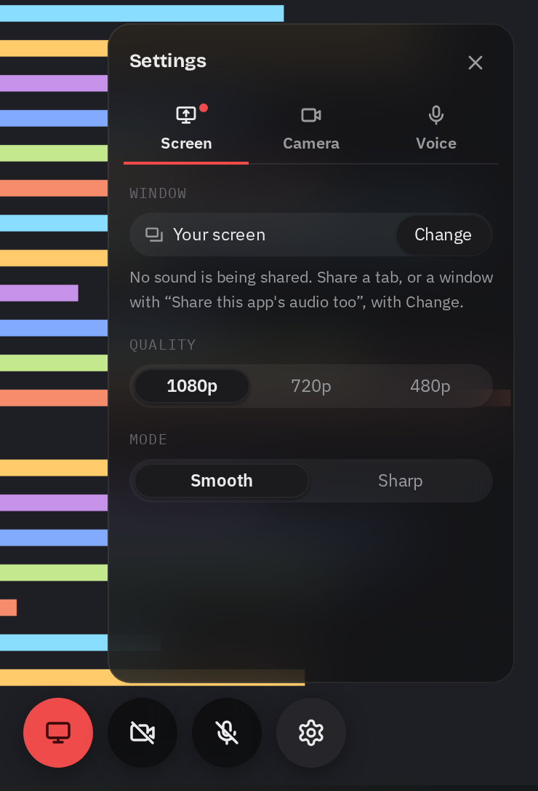 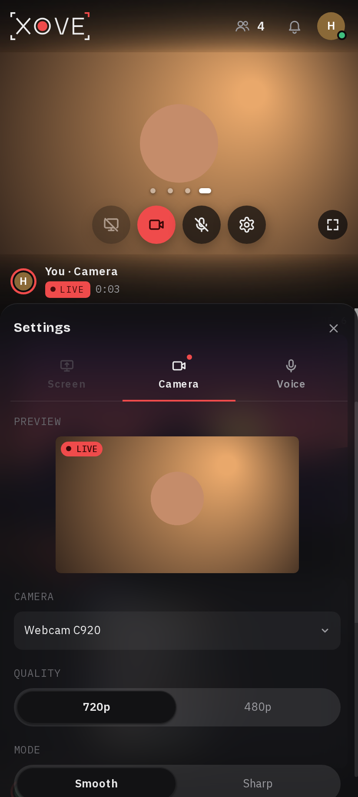 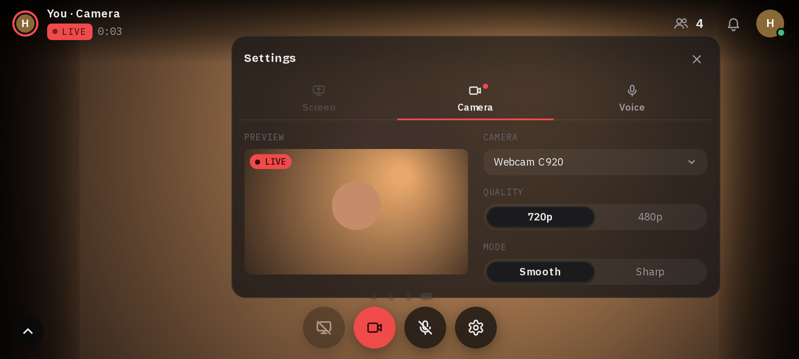

The settings for what you send, from the cog on my own stream, or from Go live's menu (then over Go live).

- **Desktop, tablets and phones held sideways: over the cog.** A popover **centred on the cog** (or on Go live), **10 px above the round buttons** (never behind them) and never past the player's sides; it fades in and rises 6 px. **Every tab has the same height**, the tallest one's, so switching tabs never moves the tabs under the pointer; at least 240 px, at most the room above the buttons (then it scrolls inside). Its width follows the player: a fifth of it, **280 to 320 px**. **Sideways it uses the width:** up to 560 px, in **two columns**, what you pick on the left (the preview and the camera, the window, the microphone) and how it's sent on the right (Quality, Mode, the voice's processing); **the left column stays put while the right one scrolls**. **Another stream taking the stage closes the settings:** they belong to the buttons they opened from. **A phone held upright** (its full-screen view too): a **bottom sheet**, no pull handle; the ✕, the cog or Escape closes it.
- Frosted like the dropdown panels (the panel colour at 74%, blur 22 px, a 1 px white border at 8%), 16 px corners (20 px on top of the sheet). **One control height:** 30 px over the cog, 44 px in the sheet.
- **Tabs Screen, Camera and Voice**, with a **red marker** that slides under the chosen one and a **red dot** on the tab of what you're sending. **On phones the Screen tab is greyed out**, as anywhere a screen can't be shared: it stays in its place, says why ("This browser can't share a screen"), and the panel opens on Camera.
- **Screen:** while you share, what's shared and **Change** (and, when the screen has no sound, a line saying how to share it); while you don't, one line saying these are used next time. **No preview**: the stage and the browser's picker already show it. Then Quality and Mode.
- **Camera:** your camera's preview under its own **Preview** heading, like every other group, centred under it: **LIVE** while it's sent, **"Only you see this"** while it's off (the camera turns on for you alone while the tab is open). Like any app, the browser asks for the camera the first time; refused or missing, the preview's place says so, and how to allow it. Then the camera's picker, Quality and Mode. **Sideways**, the preview is alone in the left column; the camera's picker, Quality and Mode are in the right one.
- **Voice:** the **Microphone** picker; **Mic level**, one row: my live level on the slim track (faint under the line, green over it, when it's sent), the sensitivity line on it (sound under it isn't sent), and **Test**, a small pill that plays my voice back to me for 5 s ("Stop · 5", counting down); the level and Test work once my voice is on (the mic is asked for only then), Test greyed until it is; then **Voice processing**, four [settings rows](#switch): echo cancellation, noise suppression and automatic volume (on), voice isolation (off, greyed where the browser can't). Applied at once, remembered.

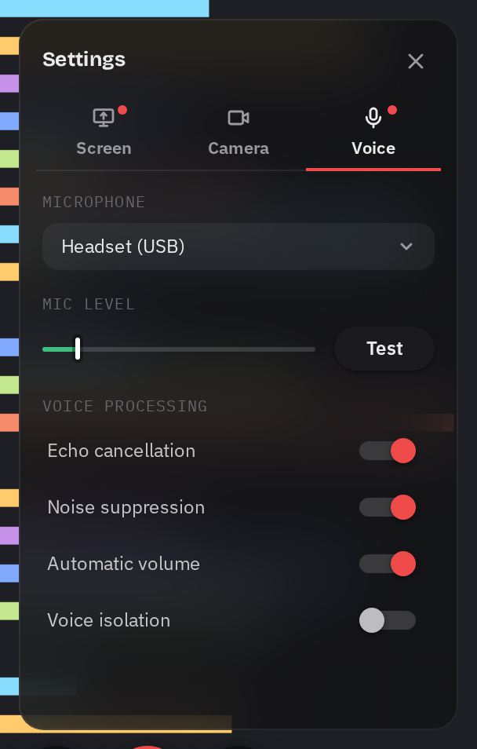
- **No field descriptions**, except where a setting needs a line to make sense. The body scrolls with the app's slim scrollbar, without arrows.
- **In the upright full view, the sheet makes room instead of covering:** the round buttons and the fullscreen button, which sit at the bottom of the screen there, move up together to just above the sheet (8 px), never behind it; the video moves up at the same size between the top bar and the sheet when it fits, and stays where it is (under the sheet) when it doesn't (a vertical share). The video is never shrunk; everything slides back when the sheet closes. The sheet's top is read from the sheet itself.
- **In the upright normal view, the sheet never hides the round buttons either:** where a tall player (a vertical stream) reaches under the sheet, the round buttons and the fullscreen button rise together over the video to just above it (8 px), no higher than the player's top, sliding together; the video, the page and the feed don't move. With a widescreen stream they're already clear and nothing moves.

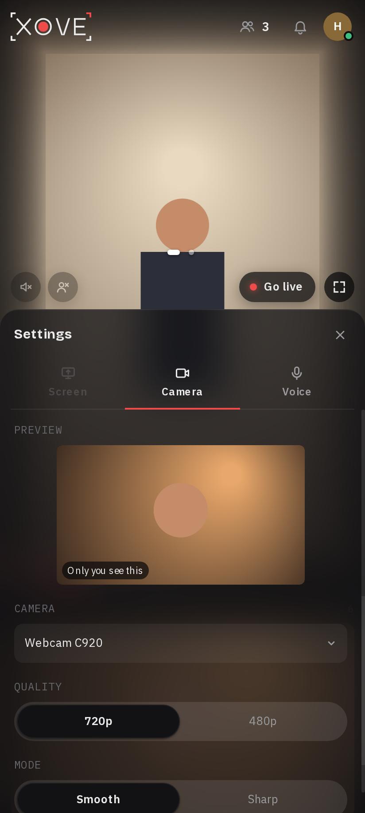
- **Panels open over the button that opened them** (a rule for the whole app): the settings over the cog, the volume over its button, the drop-ups over their live buttons. Nothing slides in from a side.

### Buttons

| Variant | Look | Use |
| --- | --- | --- |
| Primary | Red fill, deep-red text; lighter red (`#f36a6a`) on hover | The one main action on a page ("Get Xovê", "Request access") |
| Ghost | Transparent, muted text, a `--line` border; raised surface on hover | Secondary actions |
| Danger | Transparent, red text and a red border at 55% | Removing a member, stopping |

Two sizes: **md** (10 × 18 px padding, 15 px text) and **sm** (6 × 12 px, 13 px). Weight 600, `--radius-sm`, 45% opacity when disabled.

### Sliders

`components/ui/Range`, white like a video player's: a **3 px track**, white up to the knob and `#ebebec` at 22% after, and a **12 px white knob** that grows to 14 px on hover or keyboard focus. Used for the ambilight's brightness, each sound's volume over the stage and on the phone's feed cards ([upright](#what-i-hear-and-go-live), in the stage's glass pill), and in a small preview's row ([across, after the buttons](#on-the-stage)). WebKit has no part for the filled side, so `Range` sets a `--fill` variable; Firefox uses `::-moz-range-progress`.

**A threshold is a line, not a knob:** the mic's sensitivity is a slim upright white line (3 × 14 px, growing to 16 px) across the same slim track, the common mark for a threshold.

### Switch

A slim grey track (**36 × 12 px**, `#3a3a3d`) that looks the same off and on, and a **16 px knob** over its height but never past its ends: `#bdbdc0` when off, red when on, sliding in 180 ms. The ambilight's on/off in the account menu, the Voice tab's processing.

**Settings rows** (every settings list): the label on the panel's type scale (12 px, regular, white at 82%), never heavier or bigger than the panel's title; what a row does in its tooltip, not under it; the label 3 px inside its heading; the switch ending 12 px in from the column's edge, where a picker's arrow does.

`styles/controls.test.ts` checks the sliders' and the switch's values.

### Dropdown panels

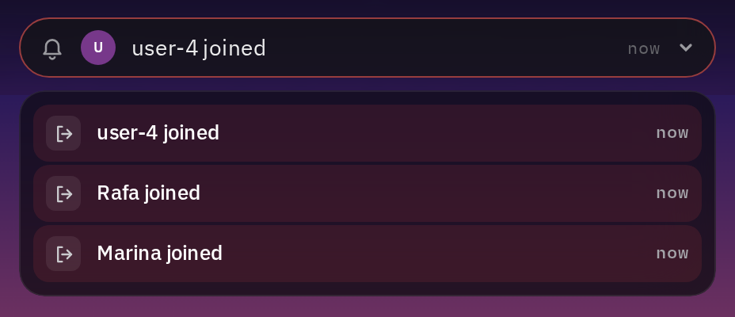

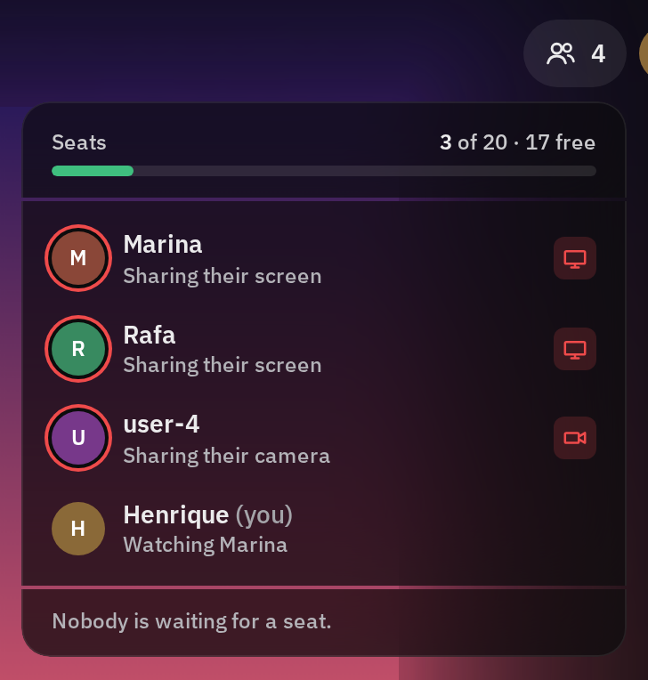 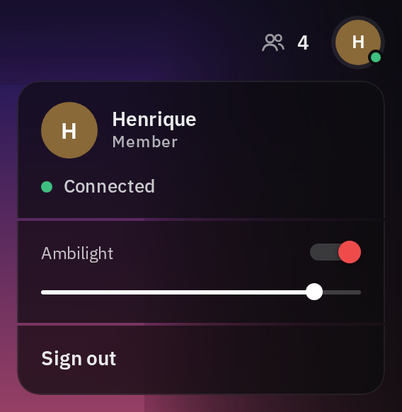

- Frosted sections (dark at 74%, blur 22 px, a 1 px white border at 8%), **16 px corners**, stacked with 2 px clear cuts. 340 px wide (the activity list: up to 440 px, centred under the pill).
- Open 8 px under their button; **one at a time**; they unroll by their height (260 ms).
- **Activity:** the latest events, each with its icon, what happened and when. **People:** the seats bar (green), who's here and what each is doing or watching, and the queue. **Account:** me and my connection, the ambilight's switch and brightness, Admin for admins, Sign out; on a phone, the footer's links at the end.
- Sideways on a phone they're as tall as the screen allows and scroll inside.

### Avatars and LIVE

- **Avatars:** round, the person's photo or their hue with a white initial (`hsl(<hue> 42% 38%)`), weight 700.
- **On air:** a red ring with a ground-coloured gap, outside the avatar in lists and **inside its edge** in the info row, so its outer edge stays the avatar's.
- **LIVE badge:** a filled red pill with a deep-red dot and "LIVE" in mono, next to the stream's kind and its running time.
- **The live dot:** 8 px red, with a ring that pings outward every 1.8 s.

### On the stage

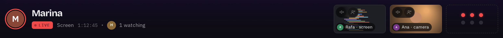

- **The info row:** on the left, who's on the stage (avatar with its ring, name in the display font, LIVE, what (" · voice" while their voice is on), how long) and who's watching (up to 4 avatars and "N watching", me included, never the sharer); with nobody live, an empty circle where the photo goes, **"Nobody's sharing"**, and who's here. On the right, the other streams as **previews** with a name chip (their screen, or their camera when that's all they share), then **the seats**: a dashed box of six dots, three over three, grey for an open seat and red for each stream live, their count in words on hover; gone when all 6 are live. When room runs short, the left gives way first, then the previews scroll with a slim scrollbar, and the box stays put.
- **Previews can be heard:** each person's sound and voice have [one switch each](#what-i-hear-and-go-live), off at first while small; a preview I turn on plays at its own volume, as many as I like. A preview's sounds are downloaded only while I hear them.
- **Small pictures show their buttons only when asked:** pointing at a desktop preview (128 px; a mouse) or holding it for 500 ms (a finger) opens its **row** outside the picture: the voice (a speaking head), the screen's sound, and a swap when they share a screen and a camera. **Big pictures** (the phone's feed) keep the buttons on the picture, each with its own upright slider.
- **The row** floats under the preview, or above it where the window has no room under it (the side is chosen once, as it opens, with room for the slider); it's **exactly the picture's width**, centred on the picture (not on what peeks out behind it), and follows its preview. It wears the [panels' glass](#dropdown-panels) (16 px corners, its thin light border, the panels' shadow); its 28 px buttons are clear until hovered and **centred both ways** (5 px above and below while closed). **Resting on a button (120 ms) or holding it unrolls one slider after the buttons**, on the side away from the preview, so the buttons never move under the pointer; the row never changes width. The button whose slider is open has a soft 1 px ring. Moving to the other sound, the old bar shrinks to the left as the new one grows from it. The row stays while its slider is in use and while the pointer travels from the preview to it (250 ms); it closes a moment after the pointer leaves both, or on a press elsewhere. Moving to another preview, its row unrolls from it as the last one rolls back into its own.
- **A screen and a camera stack:** the other picture peeks out behind, at half opacity, filling its box (no black bar): from the top right on the desktop strip and the sideways thumbnails, from the top and narrower on the phone's full-width cards, inside the page's margins. The swap trades them, the one behind coming forward (360 ms). **My own preview**, when I share both, has the swap alone: there's nothing of mine to hear.
- **Who's speaking, on a preview:** while I hear a person and they speak, their picture's ring lights in the voice button's green (1 px, `#2bcd68` at 85%, the same soft glow), with their row closed; with it open, the voice button lights instead; muted, nothing.
- **One ring on the open preview:** the red hover ring stays while its row is open, drawn inside the picture so the strip's scrolling never clips it.
- **Even spacing:** 10 px between previews, and between the last one and the seats, with a peek counted in.

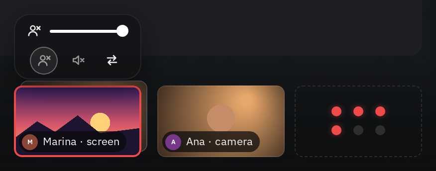 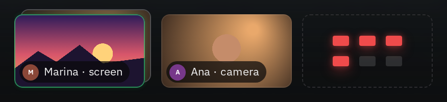
- **The facecam belongs to the picture:** it stays on the screen it's shown over, sized and placed from it, not from the stage's box. The camera as a small window over the screen, 24% of the player's width, `--radius-sm`, with 28 px round buttons (swap views, collapse) that fade with the controls; collapsed, a 28 × 44 px tab at the right edge. It **starts at the top right** (just under the top bar where one lies over the player), clear of the round buttons and the fullscreen button. It can be dragged, or moved with the arrow keys. Swapping also works on your own preview; the swap and the collapse last for the visit only.
- **The fullscreen button has one place:** the **bottom right** of the stage's box (the controls' layer, whatever the picture's shape), its centre level with the round buttons, to enter and to leave, on desktop and phones alike, over a stream and over the empty stage, so stopping the only stream in fullscreen (or in a phone's full view) never strands you there. Held sideways, a phone has none: the room is always in the full view.

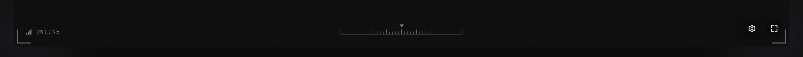
- **Stage dots** (phone, more than one live): 6 px dots just above the round buttons, the current one stretched to 14 px; a tap jumps to that person.

## Notifications and status

- **The activity pill** (desktop header, centre): 38 px tall, up to 440 px wide, frosted. It shows the latest event with its person and time, and a **red count** (18 px pill) of the ones not seen yet. A click opens the activity list; a live stream's event puts it on the stage.
- **The bell** (phone): the same list, with no count or dot, between the people button and my account.
- **Losing the connection** takes over the pill: **yellow** (`--warn`), with a 12 px spinner, until it's back. The account button's dot is green when connected.
- **Stage messages** (`StageNotice`): centred over the stage, a title in `--text-lg` and a line under it (up to 42 characters wide, `--text-sm`), with a 22 px spinner while something loads ("Loading Marina's screen…").
- **The seat offer:** when a seat frees up for someone in the queue, a dialog (up to 400 px, `--radius-md`) offers it for 60 seconds, with the time running down.
- **The waiting room:** the place in the queue, in plain words, while the room is full.
- **Tooltips** (`components/ui/Tooltip`, the app's only one; never the browser's own) say what a control does or why it can't be used, with a mouse after a **120 ms** rest (then at once along a row, for 400 ms after one hides) or on the keyboard's focus; they go the moment the pointer leaves or presses. A finger gets none (a tap leaves a button "hovered"); a greyed-out control says why in the toast instead. The round buttons' look: near-black `#070708`, 12 px text, 6 px corners, at most 260 px wide, **floating on its own layer** 10 px above its control (below it where there's no room), never clipped. **One floating thing at a time:** a tooltip showing closes any other tooltip or drop-up; one on a drop-up's own controls belongs to it. Told to keep quiet (a live button, whose drop-up takes its place), it still describes its control for screen readers.
- **The toast** (`components/ui/Toast`, called with `showToast`): a short message to the user, the app's one way to announce something briefly. The round buttons' glass (frosted, 8 px blur, their shadow), a pill up to 360 px wide and two lines, 13 px text, with the icon of what it's about (the control you touched, crossed out) and no alert sign. At the top centre of the player; on a phone held sideways and in the full view, the top centre of the screen, over the top bar's empty middle. It fades in and drops 6 px, stays **3 s** and fades out by itself; one at a time, the newest replacing it; screen readers hear it once. Today it says why a greyed-out control can't be used when a finger or a pen touches it ("This browser can't share a screen", the full room).

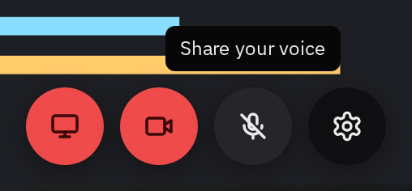 

## Screens and layouts

### Which layout

Three layouts: the **desktop's** (theater mode), the **upright view** (phones held upright, tablets held upright, narrow upright windows) and the **sideways view** (phones held sideways). Which device gets which, and the sizes that decide it, are in [Architecture](architecture.md#layouts).

Turning switches layouts at once, and the stage keeps its place in the page, so the video never reloads. Phones and tablets use Xovê only as a home-screen app; in a browser tab they see the install screen.

### Desktop: theater mode

- **Header** (see-through, full width): the wordmark, the activity pill in the centre, the people button and my account on the right. **Footer:** plain muted text, "Made by Hbrauveres", and white "Buy me a coffee" among muted links.
- **The stage is two layers**: its **box**, the column's full width, holds the controls, and a **view** inside it holds the picture, in its own shape, as big as the box allows, centred, with no black bars and its light around it. A wider picture makes the box shorter; a taller one keeps it as tall as the room allows, the picture narrower in it. **Over a tall picture the controls sit at the box's corners**, over the dark sides, as video players do; a tap anywhere on the box, the dark sides included, shows or hides them. On a window taller than 16:9 (a vertical monitor), the box may take all the height above the info row, so portrait pictures fill it. Empty and loading stages are 16:9.
- **The ambilight** glows around the stage from the picture's edges, soft and slow.
- **The info row** under the stage is exactly as wide as the 16:9 box.

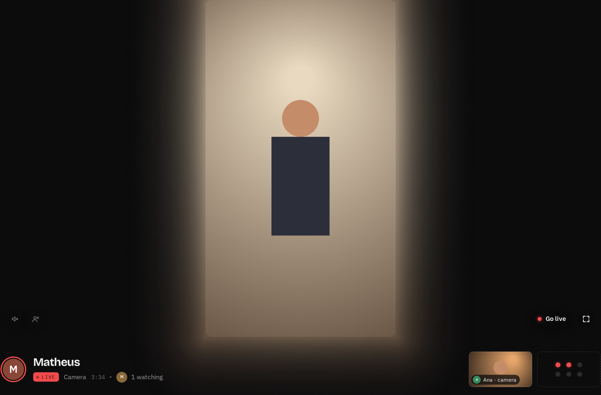 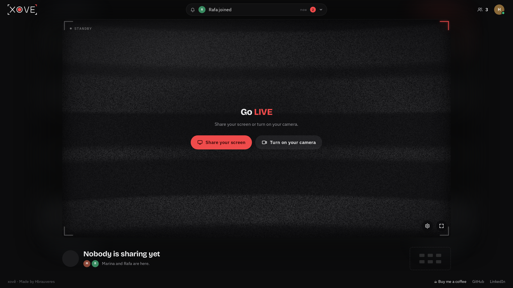

**Nobody live, a camera waiting:**

- **Viewfinder corners** close to the stage's edges (the stage's buttons sit inside the bottom-right one), the top right red as in the logo, on one flat dark.
- **Their glow:** each corner glows outward in its own colour, a blurred L just outside the stage, a fade with no edge; still, following the ambilight's switch and brightness.
- **A quiet camera display** in small grey mono capitals, still but for the clock: a grey dot, "Standby" and the time (never a red dot: that would mean recording); the frame rate (`30` lit in a filled box, what's sent; "60 fps" faint); "Room 01"; an empty L/R meter; `16:9`, HD, Auto; a signal and "Online"; a plain tick ruler; a thirds grid at about 1.6% white. Small stages keep only the top line; sideways, the corners start under the floating top bar and the top line hides.
- **In a faint focus frame:** "Be the first to go live", a line, and the two ways to start (on a phone, the camera first and the screen greyed).

### Phone, upright

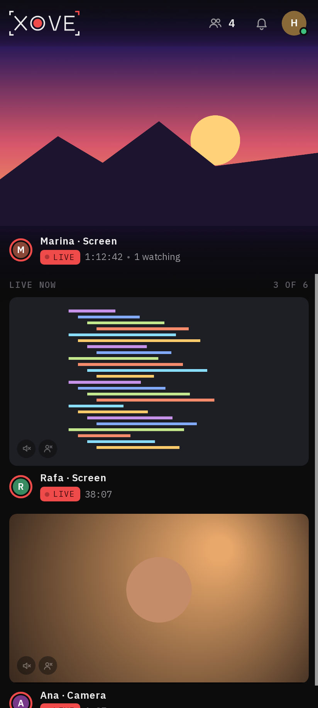 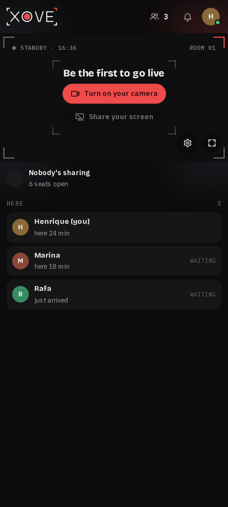

- **Top bar:** the wordmark; the people button, the bell and my account on the right. No footer: its links end the account menu.
- **The stage** edge to edge under the top bar, never taller than 60% of the screen, with the round buttons and the dots on it; a swipe left or right changes who's on it.
- **Under it, the only part that scrolls:** "LIVE NOW · 3 OF 6" and the other streams as a **feed** of full-width pictures, each with the compact info row; a tap puts one on the stage. Each card has its person's buttons at the picture's bottom left (voice, screen sound, and a swap for a [stack](#on-the-stage)); holding one unrolls its slider upright above it. With nobody live: who's here as **cards**, with how long each has been here.

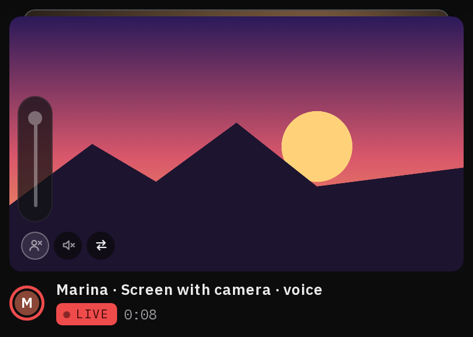

### Phone, sideways

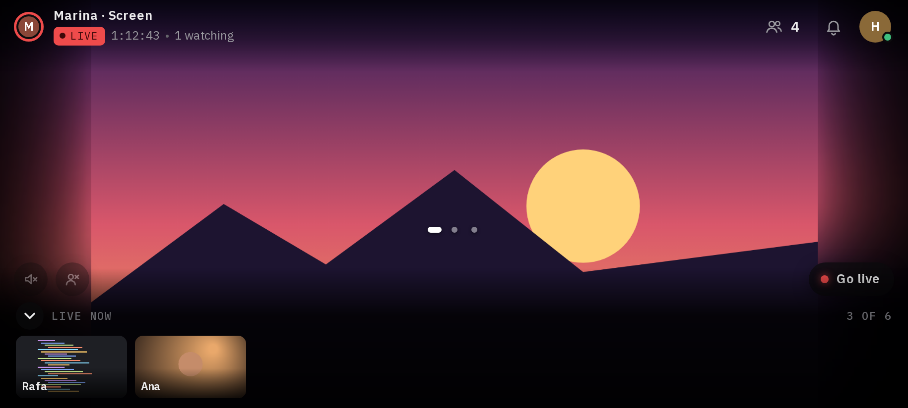

- **No header or footer:** the stage's box is the whole screen; the picture fills the height in its own shape, black at its sides where the light glows.
- **A top bar** over a black gradient: who's on the stage on the left; the people button, the bell and my account on the right.
- **The controls belong to the screen:** the round buttons and the corners' buttons sit at the **screen's** bottom, not the picture's, whatever its shape. A round arrow button at the bottom left opens the **streams row** (small pictures with names, over a black gradient), as does a swipe up; the stage's sounds start 8 px after the arrow, on its line, and go back to the edge when it moves into the open row. A phone held sideways has no fullscreen button: **Go live** (or the cog, with nobody live) takes its corner, 14 px in, like the arrow on the left.
- **The open streams row pushes the buttons up**, to 6 px above its pictures, as the settings sheet does in the full view; its gradient on top lets presses through to them. Held, a thumbnail shows its buttons over its lower part.
- **The settings** open over the cog in two columns, so they fit the short screen without scrolling: on Camera, the preview alone on the left, the camera's picker, Quality and Mode on the right.
- **A tap on empty space shows the controls, or hides them, every time;** a tap on a button only presses it, and a drag (a swipe) only shows them. They fade about 2.5 s after the last touch while a stream plays; **an open streams row stays** through that fade (only a tap hides it, with everything, and the next brings it back), and so does a heard voice. The row keeps its gradient: it's part of the picture's controls and fades with them, while the settings keep their panel.

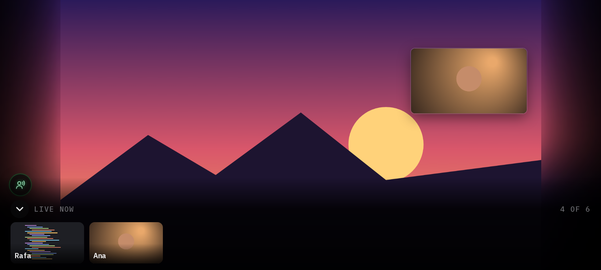
- **The full-screen view:** upright, the fullscreen button shows this same layout without turning the phone; turning doesn't change the choice. There the round buttons and the fullscreen button are the **screen's**, at its bottom (12 px up, above the iPhone's home indicator), not the player band's, so they're where the thumb is whatever the shape of the share; an open streams row lifts them above it, as held sideways.

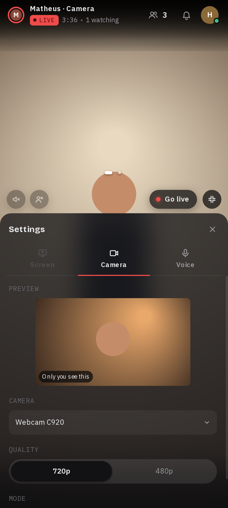

### Tablet, upright

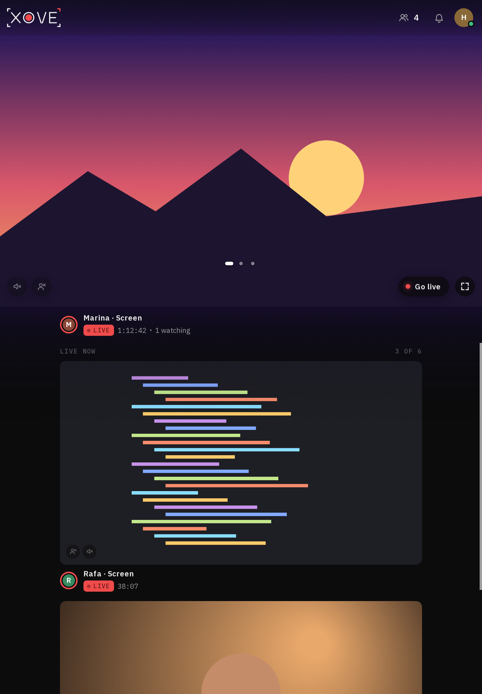

The phone's upright view, with the stage full width and the info row and feed in a centred column up to 640 px wide. Sideways, a tablet gets the desktop layout.

### The install screen

 

What a phone or tablet sees in a browser tab, on every page: the wordmark, the symbol in a rounded tile with a soft red glow, the headline "Xovê works best from your **home screen**" (the last words in red) with a small "i" that shows why, and the action. **Android:** a primary "Get Xovê" button (the browser's install prompt) and a hint for the browser's menu. **iPhone and iPad:** Safari's three Share steps. Centred, with a soft glow from the top that fades out before the wordmark.

## Accessibility

- **Focus is always visible:** a 2 px red ring, 2 px out (3 px around the round buttons' pill, white 4 px out around sliders).
- **Keyboard:** every control is a real button or input; a sound's button mutes on Enter and opens its slider on focus, which moves with the arrow keys; focusing a preview opens its row, Tab goes through it and on to the next preview, Shift+Tab and Escape back to the preview; the facecam moves with the arrow keys; Escape closes panels.
- **Names:** every control and picture has a spoken name; the mark is "Xovê"; videos are named by whose stream they are.
- **Contrast** as in [Colour](#colour), checked by a test.
- **Reduced motion** as in [Motion](#motion).

## Rules for new work

- **Use the tokens.** A new colour, size or font is a design decision: it needs an approved draft first, then it lands in `global.css` and here.
- **Red means the brand, live, or the cue.** Don't use it for anything else.
- **The cue** (`components/ui/cue.module.css`) is how the app points at a control: a sharp 1.5 px red border pulsing in place (never a spreading ring), with a slight glow around it like the stage's ambilight (14 px, the red at 35%); two slow 1 s pulses, then lit and still until the next press anywhere else (or the panel closing). With reduced motion, lit and still from the start. It's a ring of its own over the control, drawn anew for each request, so the control keeps its shadow and focus; round a picker, it takes the open list in too.

  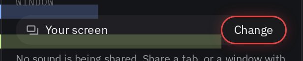
- **A button that opens a panel never also changes a setting** (the cog only opens the settings). A button that *is* a sound mutes it with a tap, and opens its own slider on a rest or a hold.
- **Controls by owner:** what I hear on the left of someone's stream, me on the right; my stream's controls only on my stream. A mic icon means my mic.
- **One switch per sound, following the person:** a person's sound and voice are on or off wherever they are, big or small, once I touch them.
- **Small pictures show their buttons only when asked** (a point or a hold): outside the picture where there's room, in a row; over its lower part on the sideways thumbnails. Big ones keep them on the picture. A row is its picture's width and centred on it, and nothing in it moves under the pointer.
- **What rises from the bottom pushes the buttons up** (the streams row, the settings sheet): nothing covers them.
- **A tap on empty space shows or hides the controls; buttons are only buttons.** Only the keyboard's focus keeps the controls up. What I chose to keep open (the streams row) and what tells me who's speaking (a heard voice) never fade by themselves.
- **Even spacing:** a row of pictures keeps one gap between all of them, counting what peeks out behind one; a button sits in the middle of its box both ways.
- **Say each thing once:** on one screen, a fact (who's here, the seats, that nobody's sharing) appears in one place only.
- **A panel's places are fixed.** A set of controls (the sounds I hear, and any like it) keeps every place it will ever have; one that can't be used yet is greyed in place, never left out, and never counts for a summary.
- **Unavailable, not hidden.** An option that can't be used here stays in its place, greyed out (a text option, like a tab: the faint text colour at 50%; a control, like a round button or a sound I can't hear: 45% opacity), with its reason in its tooltip, so a panel looks the same on every device.
- **Draft first:** a visual change starts as a draft approved before the work starts: a change to screens that exist, as a prototype in the app itself; a brand-new screen may start as a clickable HTML draft with these tokens and fonts. The approved draft is the reference the code must match.
- **Check every size:** desktop 1920 × 1080, vertical monitors (1080 × 1920 and 1440 × 2560), a narrow window, phones upright (412 × 915, 360 × 740, and 280 × 653, the narrowest supported) and sideways (915 × 412, 667 × 375), tablets (820 × 1180, 1180 × 820), the empty room and the install screen.
- **Reuse the components:** `RoundButton` styles, `Button`, `Range`, the switch, `Dropdown`, `Segmented`, `Picker`, `DropUp`, `Avatar`, `LiveDot`, `StageNotice`, `Toast`. A new control follows their sizes, motion and focus ring. A choice from a list is a `Picker` (one box, floating, with the slim scrollbar when long), a few options a `Segmented`, and a quick action over a live button a `DropUp`, everywhere in the app.
- **Panels open over the button that opened them,** never from a side; on a wide, short player they use the width (two columns) rather than scroll. **Panels are frosted, never opaque**; nothing over the video hides the round buttons.
- **Say what effects cost:** blur, canvases and animations run on every frame; keep them to what's here.

## Keeping this page current

The pictures are shot from the real app, with fake people and moving pictures, by a script that drives a headless browser through every screen and size (it lives with the project's tooling, outside this repo). After a visual change, retake them and update the text in the same pull request.
