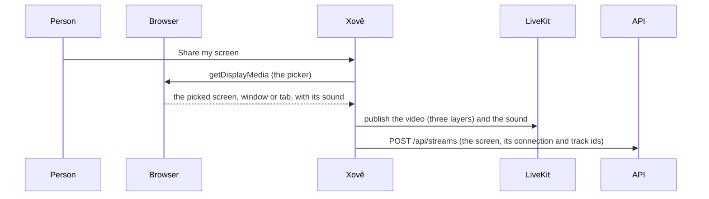

# Media

How the web app sends a screen or a camera, how it plays what others send, and how the ambilight is drawn. The rules live in `app/src/media/` as plain functions with their own tests; `hooks/useLiveKitRoom.ts` applies them to LiveKit. The room's state and the LiveKit connection are in [Architecture](architecture.md); how the controls look is in the [design sheet](design.md).

LiveKit's defaults suit slides and voice calls: 15 fps, sharpness first, voice filters on the sound. Xovê is for games and videos, so it changes most of them.

## Sending a screen

1. **The picker.** Xovê opens the browser's picker itself (`getDisplayMedia`) instead of through LiveKit, because `livekit-client` drops the `windowAudio` option. It always captures the best quality, 1080p at 30 fps, so the sharer can raise the quality later without picking again. It can't pick its own tab (that would show the room inside the room). In Chrome, it asks the browser to stay on Xovê after the pick (`CaptureController.setFocusBehavior`), so the sharer sees that it started and can adjust it right there instead of jumping to the shared window.
2. **One click.** The pick is sent at once with the settings remembered in this browser (the defaults the first time: 1080p and Smooth for a screen, 720p and Smooth for a camera). Closing the picker leaves everything as it was.
3. **Publishing** sends the tracks to LiveKit, then tells the API, which lists the stream for everyone. Up to 6 streams are live at once (someone with a screen and a camera uses 2); with 6 live, the start buttons wait: nobody is pushed out. A phone that can't share a screen offers only the camera.

**Which sound comes along:**

| Picked | Sound sent |
| --- | --- |
| A window | Only that app's sound (`windowAudio: "window"`), not Discord's or the system's |
| A tab | That tab's sound |
| The whole screen | The system's sound, without Xovê's own (`restrictOwnAudio`), so viewers don't hear their own streams back |

Sound is captured as music: no echo cancellation, no noise suppression, no automatic volume, in stereo, and sent at 128 kbit/s without silence skipping (`dtx: false`, which chops quiet moments). Whether a share has sound depends on the browser and the system: Chrome offers it for a tab, for a window where the system supports it, and for the whole screen on Windows; Firefox and Safari offer none. A screen without sound says so in its button's tooltip (with a mouse, in the settings' Screen tab), and viewers see its sound button greyed ("No sound in this stream").

**While sharing**, the settings panel (from the cog) has what's shared and Change, the camera list, and each stream's quality and mode; with a mouse, resting on a live button unrolls the same quick access (Change; the camera list), and by touch a 500 ms press and hold does:

- **Change** opens the picker again and swaps the new pick into the same LiveKit track (`replaceTrack`): no new stream for the API or the viewers. The sound follows: swapped, added as a new track, or removed.
- **A camera list** switches the camera being sent (`restartTrack` on the same track).
- **Stop:** the lit button, or the browser's own "Stop sharing" bar, ends the stream.

**Cameras** are asked for only on that click, or while the settings' Camera tab is open (the browser asks for permission the first time, like any app; refused or missing, the room and the Camera tab say so, and how to allow it) (a preview only the sharer sees, sent as is if the camera button is pressed then, kept if the camera is turned off with the tab open, and stopped when the tab closes), never with the microphone, and go up to 720p: enough for a face, and it spares the upload of someone sending a screen too. They're sent like a screen, with a 720p and a 480p layer.

## The voice

A sharer can talk to the room, alongside their screen or camera, never alone:

- **Asked for only when they turn it on** (the mic button on their stream, or at the right of someone else's while they're live), off by default, never with the camera. The browser asks the first time; refused or missing, the voice stays off and a toast says why and how to allow it. Stopping both streams turns it off. A voice takes none of the 6 places: it isn't a stream for the API.
- **Captured as a voice**, unlike a screen's sound: the browser's echo cancellation, noise suppression and automatic volume on by default, voice isolation off (where the browser has it), all set in the settings' Voice tab with the mic picked, applied live (`restartTrack` on the same track).
- **Through a noise gate** (`media/noiseGate.ts`): sound under the sharer's sensitivity line isn't sent. A small Web Audio step set on the track as LiveKit's audio processor: an analyser read every 10 ms against the line opens a gain at once when the level crosses it, holds it 250 ms after the level drops, then fades it in 100 ms, so words aren't chopped. The line moves live, without restarting the mic. Where the browser can't run it, the voice goes ungated. It costs a little CPU on the sharer's computer while the voice is on; nothing for viewers.
- **The level** in the Voice tab reads the mic itself, before the gate, on the gate's own scale, so the line means the same in both; it's measured only while the tab is open and the voice is on (the mic is asked for only then). **Test** plays the voice as it's sent, back to the sharer, for 5 s.
- **Who's speaking** comes from LiveKit (`ActiveSpeakersChanged`); a voice muted by its sharer shows as off.

## Quality and modes

The sharer picks a quality and a mode in the settings, before sharing or while sharing.

| Quality | Size | Frame rate | Up to |
| --- | --- | --- | --- |
| 1080p (the default for screens) | 1920 × 1080 | 30 fps | 8 Mbit/s |
| 720p (the default for cameras) | 1280 × 720 | 30 fps | 4 Mbit/s |
| 480p | 854 × 480 | 30 fps | 2 Mbit/s |

- **Always three layers.** A screen is sent in VP9 (VP8 where the browser can't) as three separate layers, one per quality (`simulcast` with `scalabilityMode: "L1T3"`). The chosen quality is a **cap**: the layers above it aren't sent. So a change of quality is live: same stream, no reload.
- **No tight limits.** The ceilings are well above what a screen usually needs, so only the sharer's and each viewer's computer and connection limit the picture; the browser and LiveKit lower the bitrate themselves when a connection can't keep up. The sharer uploads every layer up to the cap (about 14 Mbit/s at 1080p on a great connection); each viewer downloads one.
- **Two modes:**
  - **Smooth** (games, videos; the default): the track is marked as motion (`contentHint`), and when the connection is tight the picture gets softer while the frame rate holds (`maintain-framerate`).
  - **Sharp** (text, code): marked as detail; the picture keeps its detail and the frame rate drops (`maintain-resolution`).
- **Changing them** while sharing: the sharer's browser applies the new cap and mode right away and tells the API (`POST /api/streams/{kind}/settings`). Every viewer reads the settings with the streams, every 2 seconds, and follows them: Auto asks for no more than the cap. Since no viewer asks for the layers above the cap, LiveKit stops sending them (dynacast), and the sharer's upload really drops.
- **Browsers:** Firefox (no VP9) and Safari send a single layer, so viewers get only the sharer's quality, with nothing lower to step down to. In Safari, Sharp behaves like Smooth.

## What a viewer downloads

- **The size it shows.** The room connects with `adaptiveStream`: each video is downloaded at the size it's shown, so previews and the facecam come in small. With `dynacast`, layers nobody watches aren't sent at all.
- **Always Auto.** There's no quality to pick while watching: each video comes at the size it's shown, steps down by itself when the connection can't keep up, and never asks for more than the sharer sends.
- **Sound.** Each person's screen sound and voice have one on/off and one volume, kept for the visit and following them wherever they are (`media/hearing.ts`): until I touch it, a person is heard while on the stage and off while small; once I do, my choice holds, small or big, so any number of previews can be heard at once, each at its own volume. **A preview's sounds are downloaded only while I hear them**; the person on the stage's stay downloaded while muted, so unmuting is instant. Someone sharing sees their own streams like everyone else, without their sound. There's no slider on iPhones and iPads, which ignore a page's volume: each sound is on and off.
- **Remembered.** Each browser keeps its choices in `localStorage`: `xove.share.*` (quality, mode), `xove.camera.*` (quality, mode, device), `xove.mic.*` (the mic picked; its processing and line), `xove.watch.*` and `xove.voice.*` (the volume a screen's sound and a voice start at) and `xove.ambilight.*` (on, brightness).

To see what really happens, open `chrome://webrtc-internals` in the sharer's or a viewer's browser: the codec, frame rate, size, bitrate, and why the quality drops ("cpu": the sharer's computer can't keep up; "bandwidth": the connection can't).

## The ambilight

The picture's own edges glow around the stage, like a TV's ambient light. It's drawn by the browser's graphics pipeline and never reads a pixel, so a 4K monitor costs the same as a small window, and a stream the page isn't allowed to read is lit too.

**The canvas** (`media/ambilight.ts`) is small and stretched by the page:

- **A grid of square cells** follows the stage's shape (`gridFor`): 64 × 36 at 16:9, 36 × 64 for a portrait picture, at most 96 along the longer side. Round it, the glow reaches 16 cells, then a 3-cell margin, at 2 px a cell (`glowLayout`).
- **Each update** draws the picture in nine pieces (`edgeDraws`): the whole picture under the stage, its edge strips stretched outward, and its corner patches stretched into the corners. It draws them over the last update at partial opacity, which eases the light with a 120 ms time constant (`easeFor`). Then it blurs the result once and cuts it with a fade mask made once per grid (`fadeMask`): the light falls to exactly zero before the margin, with a fixed grain so it doesn't show bands.

**When it updates** (`components/stage/Ambilight.tsx`): with the screen's refresh (`requestAnimationFrame`, at most 60 times a second), only while the tab is visible, the video plays and the ambilight is on. With reduced motion it updates twice a second instead, a gentle step each time. With nobody live there's no ambilight: the empty stage's corners glow on their own (still CSS: a blurred L at each corner, following the ambilight's switch and brightness).

**What it costs:** one small canvas draw and one blur per frame while a video plays. The ambilight's switch and brightness are in the account menu.
